# Pet Mouse Pointer · 宠物鼠标指针

用自己的宠物照片，制作一套有表情、有动作、可以安装和恢复的 Windows 鼠标指针。另提供 macOS Mousecape 测试版。

项目包含可复用的 **Pet Cursor Theme Skill**、CUR/ANI 构建与验证脚本，以及11套可直接下载的像素全动画主题。Skill 支持根据照片设计新角色，也支持在已批准角色上扩展毛色版本，保留动作、鼻尖点击点与清楚的操作标记。

## 下载现成主题

### macOS 测试版

**[下载全部11套 Mac 主题（ZIP，约31MB）](downloads/pet-mouse-pointer-macos-test.zip?raw=1)** · [安装与恢复说明](docs/macOS.md) · [验证记录](docs/macos-validation.json) · [SHA-256校验](downloads/SHA256SUMS)

先安装 [Mousecape](https://github.com/alexzielenski/Mousecape/releases)，完整解压后双击喜欢的 `.cape` 导入，再在 Mousecape 中应用。每套提供常规32pt和大号48pt，均含1×/2×图像、离线动画预览、点击热点和转换记录。

13种对应动作映射为17个Mac指针条目。受 Mousecape 等时帧和24帧上限影响，部分动画经过时间采样，循环总时长保留。**格式、素材和压缩包检查通过，尚未在 Mac 实机导入或应用；系统版本、Intel/Apple Silicon、多屏和实际点击体验待测。**

导出与验证脚本位于 [`scripts/`](scripts/)，使用方式见 [Mac说明](docs/macOS.md#重新导出)。

### Windows 版

**[一键下载全部11套案例合集（ZIP）](downloads/pet-mouse-pointer-all-cases.zip?raw=1)** · [完整案例清单](docs/all-cases.json) · [SHA-256校验](downloads/SHA256SUMS)

合集为安装版，包含每套指针、预览、安装恢复入口与验证记录；不含大型源精灵图和逐帧复查图/GIF；完整复查媒体可另取单套包。

| 主题 | 特征 | 下载 |
|---|---|---|
| 雕色喜乐蒂 | 金棕毛色、白额纹与长嘴筒 | [完整 ZIP](downloads/pet-pixel-complete.zip?raw=1) · [说明](themes/pet-pixel-complete/README.md) |
| 奶油白金毛 | 奶油宽脸、垂耳与绿色胸背 | [完整 ZIP](downloads/golden-cream-pixel.zip?raw=1) · [说明](themes/golden-cream-pixel/README.md) |
| 黑白三色喜乐蒂 | 黑色底毛、棕色眉颊、白色围脖 | [完整 ZIP](downloads/sheltie-tricolor-pixel.zip?raw=1) · [说明](themes/sheltie-tricolor-pixel/README.md) |
| 三色陨石喜乐蒂 | 银灰黑斑、棕色眉颊、白色围脖 | [完整 ZIP](downloads/sheltie-blue-merle-pixel.zip?raw=1) · [说明](themes/sheltie-blue-merle-pixel/README.md) |
| 标准金毛 | 蜂蜜金毛发、粉褐鼻、绿色胸背 | [完整 ZIP](downloads/golden-standard-pixel.zip?raw=1) · [说明](themes/golden-standard-pixel/README.md) |
| 深金毛 | 铜金毛发、较深垂耳、绿色胸背 | [完整 ZIP](downloads/golden-dark-pixel.zip?raw=1) · [说明](themes/golden-dark-pixel/README.md) |
| 深雕色喜乐蒂 | 深棕耳冠与后鬃、暖棕脸颊、白色围脖 | [完整 ZIP](downloads/sheltie-dark-sable-pixel.zip?raw=1) · [说明](themes/sheltie-dark-sable-pixel/README.md) |
| 黑白两色喜乐蒂 | 炭黑底毛、白额纹与围脖、无棕色眉颊 | [完整 ZIP](downloads/sheltie-bi-black-pixel.zip?raw=1) · [说明](themes/sheltie-bi-black-pixel/README.md) |
| 蓝陨石色喜乐蒂 | 银灰黑斑与白色围脖、无棕色眉颊 | [完整 ZIP](downloads/sheltie-bi-blue-pixel.zip?raw=1) · [说明](themes/sheltie-bi-blue-pixel/README.md) |
| 浅金毛 | 浅麦金毛发、暖金垂耳、绿色胸背 | [完整 ZIP](downloads/golden-light-pixel.zip?raw=1) · [说明](themes/golden-light-pixel/README.md) |
| 红陨石喜乐蒂 | 浅金黄色嘴筒、深棕侧毛、白鼻梁与胸毛；17状态全动画 | [完整 ZIP](downloads/sheltie-red-merle-pixel.zip?raw=1) · [说明](themes/sheltie-red-merle-pixel/README.md) |

11套像素主题均包含 **17 种动画状态**与 **32 / 48 / 64 / 96 / 128px** 五种尺寸，默认48px。

### 品种合集（一键安装同一品种的全部风格）

**[喜乐蒂合集（7 套）](downloads/pet-mouse-pointer-sheltie.zip?raw=1)** · **[金毛合集（4 套）](downloads/pet-mouse-pointer-golden.zip?raw=1)**

解压后在合集根目录双击：

| 双击文件 | 作用 |
|---|---|
| `一键安装所有喜乐蒂.cmd` / `一键安装所有金毛.cmd` | 依次安装该品种全部风格，最后一套为当前生效；全部风格都会注册到「鼠标属性 → 指针 → 方案」 |
| `切换喜乐蒂风格.cmd` / `切换金毛风格.cmd` | 输入编号切换到对应风格，得到**真正的原生像素尺寸** |
| `恢复原鼠标.cmd` | 恢复到首次安装前的指针设置 |

**为什么另需切换入口**：Windows 应用指针方案时固定按系统光标指标 `SM_CXCURSOR`（32px）加载，所以从「方案」下拉里直接选其它风格只会得到缩小版。切换入口会用 `SetSystemCursor` 按原生 48px 重新加载对应套，像素不会被重采样。

11 套合集包（`pet-mouse-pointer-all-cases.zip`）根目录同样提供这四个入口，另含两套品种说明。

### 调整 Windows 指针大小

每个主题只有两个 CMD：`安装鼠标主题.cmd` 和 `恢复原鼠标.cmd`。双击安装直接应用默认48px，不询问尺寸；安装成功后自动打开“鼠标属性 → 指针”，可直接看到已保存的方案；出错时保留窗口和错误信息。

安装器保存“主题名 尺寸”方案，并直接加载全部17种系统光标。需要查看已保存方案，可手动打开“鼠标属性 → 指针”。**本安装包不能在辅助功能页面的四个颜色按钮中注册宠物主题**；修改那里的颜色或大小可能覆盖宠物光标。再次双击安装会恢复默认48px。高级尺寸调整可在主题目录运行 `powershell -NoProfile -ExecutionPolicy Bypass -File .\install-theme.ps1 -Size 96`，支持32/48/64/96/128px。

安装写入或刷新失败时会回滚本次指针及同名方案设置。`恢复原鼠标.cmd` 恢复安装前设置，保留已保存的宠物方案与文件，方便再次选择。详见各包的 `鼠标大小调整说明.txt`。

[修复验证记录](docs/cursor-size-fix-validation.json)：浅金毛主题完成五种尺寸的实机安装，逐项比对85个活动光标的图像、热点及尺寸，恢复后与测试前设置和光标图像一致。其他主题检查范围见记录；系统辅助功能滑块、多显示器和DPI切换未做交互测试。

### 毛色对照

毛色对照中的11款均已有完整动画主题：7款喜乐蒂、4款金毛。新增红陨石喜乐蒂按确认照片设计，保留浅金黄色嘴筒、较深的棕色侧毛、白色鼻梁与胸毛。全部11套均覆盖17种Windows角色和五种尺寸。

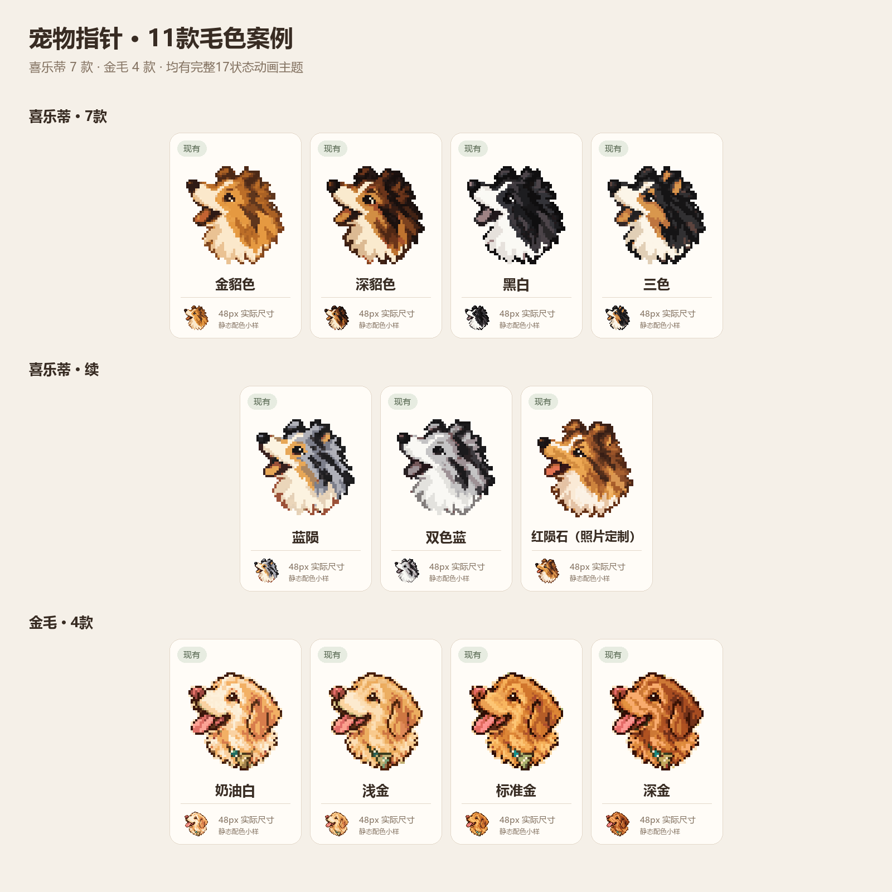

### 更清楚的操作箭头

11套像素主题的上下、左右、两种斜向缩放、移动与候选选择均使用统一的大号像素箭头，并与宠物脸部分开放置。正常选择仍由鼻尖点击；缩放与移动在符号中心定位，候选选择在向上箭头尖定位。

下图展示首六套的箭头升级，其余主题沿用相同符号与尺寸。

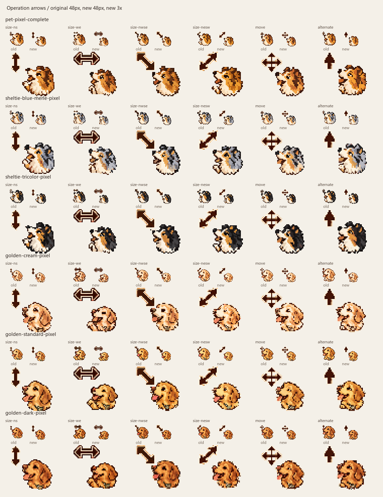

### 从参考照片到鼠标指针

以下是维护者提供并授权在本项目展示的两张案例参考照片，分别对应红陨石喜乐蒂与奶油白金毛主题。

| 红陨石喜乐蒂参考照片 | 奶油白金毛参考照片 |
|:---:|:---:|
| 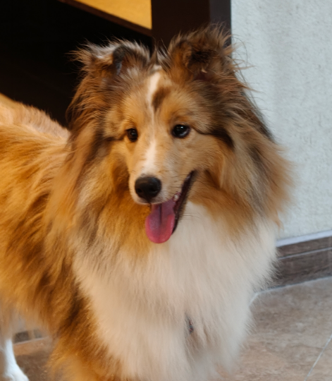 | 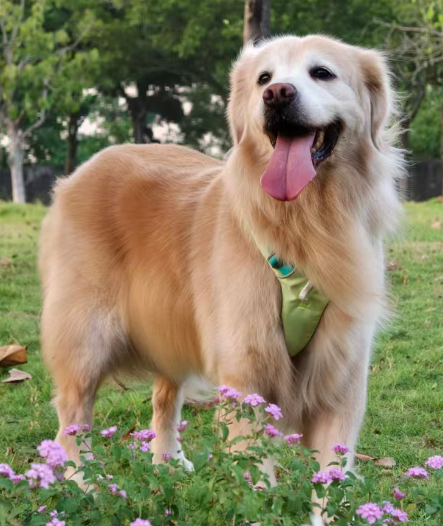 |
| 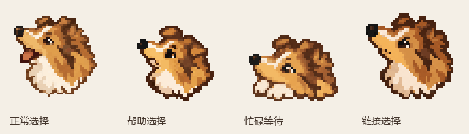 | 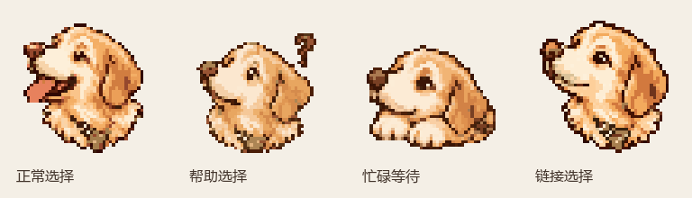 |

照片用于说明毛色、耳型、脸部特征与配饰如何转化为指针角色。红陨石版本按左侧照片调整了黄色嘴筒、较深的侧毛，以及白色鼻梁和胸毛。参考照片不自动适用代码的 MIT 许可，详见[素材说明](ASSETS.md)。

### 动画预览

**新增：红陨石喜乐蒂**


| **深雕色喜乐蒂** | **黑白两色喜乐蒂** |
|:---:|:---:|
| 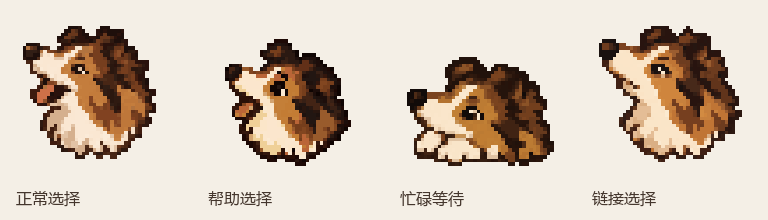 | 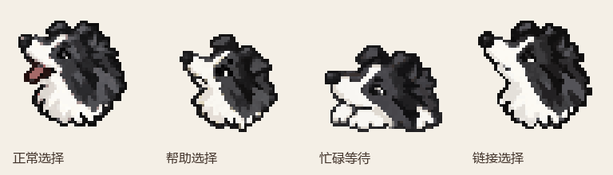 |
| **蓝陨石色喜乐蒂** | **雕色喜乐蒂** |
| 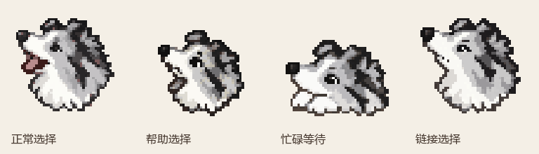 | 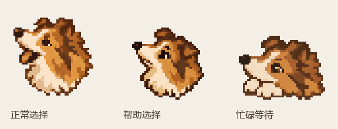 |

| **黑白三色喜乐蒂** | **三色陨石喜乐蒂** |
|:---:|:---:|
| 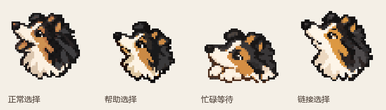 | 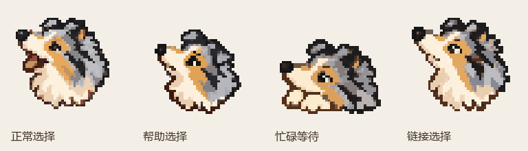 |
| **标准金毛** | **深金毛** |
| 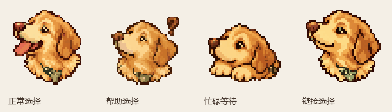 | 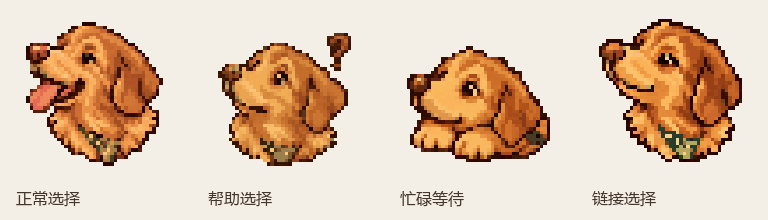 |
| **浅金毛** | **奶油白金毛** |
| 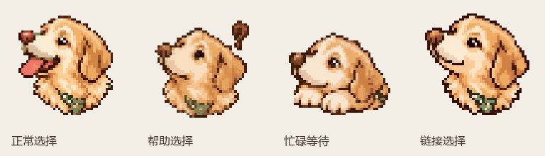 |  |

预览展示正常、帮助、等待、链接等动作。完整17状态、热点与实际尺寸请打开对应包内的 `preview.html`。

## 普通用户：双击应用或恢复

下载对应 ZIP 后，**先完整解压**，再进入主题文件夹。无需安装 Python，也无需管理员权限。

| 双击文件 | 作用 |
|---|---|
| `安装鼠标主题.cmd` | 直接应用默认48px，不询问尺寸；安装成功后自动打开“鼠标属性 → 指针” |
| `恢复原鼠标.cmd` | 恢复应用前备份的鼠标设置 |

运行窗口会显示结果，按任意键关闭。应用前会备份当前用户的指针设置，并把系统需要的文件复制到用户目录。连续应用本项目主题或切换尺寸时，只要当前完整方案仍属于本项目且原备份有效，就会保留最初的恢复基线。恢复操作保留备份文件。

主题包中的 `preview.html` 可以直接打开；请保留旁边的 `frames/` 文件夹。预览支持尺寸、深浅背景、热点标记和点击试用。网页显示 PNG 动画，Windows 实际使用 ANI 文件。

如果系统策略阻止脚本运行，可按 `Win + R` 输入 `main.cpl`，在「指针」页手动分配主题内的文件，并先另存原方案。手动分配后应保留这些 ANI 文件的路径。

## 用自己的宠物制作

### 安装 Skill

下载 [Skill ZIP](downloads/pet-cursor-skill.zip?raw=1)，或取出仓库的 [`skills/pet-cursor-theme/`](skills/pet-cursor-theme/) 文件夹。将整个文件夹放入支持 `SKILL.md` 的客户端技能目录，再按客户端的方式启用。请保留其中的 `scripts/`、`references/`、`assets/` 与 `requirements.txt`。

Skill 需要宿主提供可用的图像生成工具。本项目不包含图像模型、API 密钥，也不会自行把照片发送给某个固定服务；图像生成的可用性和使用条件取决于宿主及所选服务。

### 提供照片和要求

启用后，附上清楚的宠物照片，例如：

> 使用 pet-cursor-theme Skill，根据这张照片制作完整的 Windows 鼠标指针主题。采用清晰的像素风格，保留宠物自己的毛色、耳型和配饰。正常选择用侧脸鼻尖定位，毛发持续轻动；帮助选择做疑问表情，问号弹出再缩回；等待时睡着、冒出 ZZZ、再醒来。17 种状态都要有动画，操作标记保持清楚。每次制作或修改后，逐帧检查所有过渡与首尾衔接，修复严重抖动、偏移和突然缩放，交付预览、安装包和检查记录。

流程包括观察宠物特征、确定造型、生成各状态素材、测量每帧点击点、编译五种尺寸、逐帧复查和 Windows 验证。新宠物需要重新设计脸型和动作；示例中的犬种特征不会直接套用到新照片上。像素风是当前示例采用的方向，编译器也支持非像素素材。

## 17 种状态与点击点

| Windows 角色 | 中文状态 | 点击位置 |
|---|---|---|
| `Arrow` | 正常选择 | 鼻尖 |
| `Help` | 帮助选择 | 鼻尖 |
| `AppStarting` | 后台工作 | 鼻尖 |
| `Wait` | 忙碌等待 | 睡姿中明确、固定的接触点 |
| `Crosshair` | 精确选择 | 准星中心 |
| `IBeam` | 文本选择 | 插入线中心 |
| `NWPen` | 手写 | 笔尖 |
| `No` | 不可用 | 禁止标记中心 |
| `SizeNS` | 垂直缩放 | 双向箭头中心 |
| `SizeWE` | 水平缩放 | 双向箭头中心 |
| `SizeNWSE` | 左上右下缩放 | 双向箭头中心 |
| `SizeNESW` | 右上左下缩放 | 双向箭头中心 |
| `SizeAll` | 移动 | 四向箭头交点 |
| `UpArrow` | 候选选择 | 向上箭头尖 |
| `Hand` | 链接选择 | 鼻尖 |
| `Pin` | 位置选择 | 鼻尖或明确设计的接触点 |
| `Person` | 人员选择 | 鼻尖或明确设计的接触点 |

动画中让眼睛、耳朵、毛发或爪子动起来，点击点与操作标记保持稳定。正常选择、疑问、嗅闻、专注和睡眠可以有不同表情与姿态。

动作过渡通常使用 3 个 ANI 时基单位，即每帧 1/20 秒。睡眠、表情和休息会有意停留，因此完整循环的平均变化率可能低于 20 FPS。预览与清单分别记录实际独立帧数、动作峰值、循环平均变化率和时长；重复同一张图不会增加真实动作细节。

## 开发者：构建与检查

需要 Python 3.10+ 和 Pillow 12.3+。编译可在非 Windows 环境完成；原生验证与应用主题需要 Windows。

在仓库根目录运行：

```powershell
python -m pip install -r requirements.txt
```

在 `projects/my-pet/` 中创建 `assets/`，放入生成的透明精灵图，并将配置保存为 `projects/my-pet/theme-config.json`。素材路径相对于该项目目录。配置应覆盖全部 17 个角色，并测量每帧真实的鼻尖或标记位置。完整字段说明见 [配置文档](skills/pet-cursor-theme/references/configuration.md)。

```powershell
python skills/pet-cursor-theme/scripts/build_complete_theme.py --root projects/my-pet --config projects/my-pet/theme-config.json --output output/my-pet
python skills/pet-cursor-theme/scripts/verify_cursor_motion.py output/my-pet
# 以下原生检查在 Windows 上运行，不会应用主题：
python skills/pet-cursor-theme/scripts/verify_complete_theme.py output/my-pet
```

`--root` 只负责解析项目素材路径。预览模板与安装／恢复脚本自动从 Skill 自身目录读取，独立项目无需复制 `scripts/`。

像素主题建议配置：

```json
{
  "pixel_art": true,
  "native_pixel_size": 48,
  "pixel_alpha_threshold": 128,
  "pixel_palette_colors": 16,
  "states": []
}
```

其中 `states` 需要填入全部角色。编译器采用最近邻缩放、二值透明度，以及每个状态所有帧共享的无抖动调色板。单帧状态输出 CUR，多帧状态输出 ANI。

### 每次制作、修改后都检查每一帧

`verify_cursor_motion.py` 会输出全部动画序列、浅色／深色底图、原速／慢放 GIF，以及可疑过渡的相邻帧叠图，覆盖最后一帧回到第一帧的衔接。

随后需要视觉检查 **每个状态的全部过渡**，包括未被自动标记的部分：点击特征是否固定，头部、眼窝、嘴筒和胸背是否突然移动或缩放，单帧是否闪现异常姿态。区分有意的眨眼、飘毛、抬爪、问号缩放和睡姿变化。发现问题后修正源素材或配准点，重新构建并复查。

自动检测提供复查线索，不能单独证明动画稳定。完成视觉复查后，将覆盖范围、判断和剩余问题写入 `motion-review/visual-review.json`。详见 [逐帧检查规范](skills/pet-cursor-theme/references/motion-review.md)。

Windows 原生检查会验证 CUR/ANI 结构、各尺寸、每个嵌入帧的加载与绘制，以及热点坐标。安装入口也支持只预演、不修改系统设置：

```powershell
& './output/my-pet/安装鼠标主题.cmd' --check
```

已有有效安装备份时，可预演恢复：

```powershell
& './output/my-pet/恢复原鼠标.cmd' --check
```

### 示例验证范围

- 11套像素主题均有 Windows 原生加载、绘制、尺寸和热点检查，以及48/96px的逐帧视觉复查记录，包括循环接缝。
- 11套像素主题共187个状态、1949张源动作导出帧；六种功能箭头均采用大号符号。轻微像素轮廓与毛发纹理变化仍可能存在。
- 自动检测只提供可疑过渡线索，视觉结论见各包内 `motion-review/visual-review.json`。11套像素主题汇总见 [验证记录](docs/coat-release-validation.json)。
- 两个双击入口经过预演检查；浅金毛另做五种尺寸的实际安装及恢复检查。桌面点击手感、不同DPI和多显示器仍需实际试用。

### 扩展其他毛色

先选择或生成毛色母版，再逐状态编辑源精灵图，保护眼睛、鼻子、舌头、胸背配饰与功能符号。蓝陨等斑块需固定在对应身体部位，逐帧检查花纹连续性。
可复用的注册脚本会把旧的测量点映射到新图，并保留动作时序；它不能代替视觉验收。流程、毛色选项与命令见 [毛色扩展说明](skills/pet-cursor-theme/references/coat-variants.md)。
色板数量可按角色调整，彩色胸背和粉色舌头等细节较多时可用32–64色，避免被严格16色量化吞掉。

## 仓库结构

```text
skills/pet-cursor-theme/    可复用 Skill、脚本和配置／检查规范
themes/pet-pixel-complete/ 喜乐蒂主题说明
themes/golden-cream-pixel/ 奶油金毛主题说明
themes/*-pixel/           其他毛色主题说明与检查记录
downloads/                11套案例ZIP、全部案例合集与Skill ZIP
docs/images/              README 动画预览
```

主题包保留构建参数、热点、绘图提示词、预览和检查报告。仓库仅公开上述两张经维护者授权展示的案例参考照片，主题 ZIP 不新增照片；其他私人照片不随仓库或下载包分发。重新构建同一套图案时，需要配置所引用的源精灵图；仅安装和预览现成主题无需这些源图。

## 运行测试

```powershell
python -m unittest discover -s skills/pet-cursor-theme/scripts -p "test_*.py"
powershell -NoProfile -ExecutionPolicy Bypass -File skills/pet-cursor-theme/scripts/test_cursor_backup.ps1
```

测试覆盖编码、角色和尺寸、跨项目构建、重复ID、动画时序、裁切、逐帧抖动检测，以及Windows双击入口和恢复备份逻辑。

## 许可与素材

代码与文档采用 [MIT License](LICENSE)。宠物照片、参考图、生成图像和主题美术素材的权利需分别确认，不自动继承代码的 MIT 许可；请查看[素材说明](ASSETS.md)和各主题中的说明，并遵守所用图像生成服务的条款。

贡献代码时请附上相关测试结果；贡献或修改动画时，请附上逐帧复查范围和剩余问题，避免只凭帧率或原生加载结果判断质量。
