# Pet Mouse Pointer · 宠物鼠标指针

小猫、鹦鹉、守宫、仓鼠和更多小动物，加上11种狗狗，共61款配色，均可免费下载使用。

## 全部默认动画 · 48px

所有指针均按48px展示，先挑喜欢的伙伴。

### 小动物 · 24款

| 种类 | 配色与默认动画 |
|---|---|
| 猫咪 | 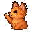 猫咪 · 橘猫 ·  猫咪 · 橘白 ·  猫咪 · 黑白猫 · 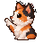 猫咪 · 三花 · 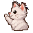 猫咪 · 纯白猫 |
| 玄凤鹦鹉 | 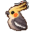 玄凤鹦鹉 · 原始灰 ·  玄凤鹦鹉 · 黄化 · 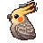 玄凤鹦鹉 · 珍珠灰 |
| 豹纹守宫 | 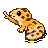 豹纹守宫 · 经典金黄 · 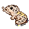 豹纹守宫 · 麦克雪（Mack Snow） · 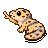 豹纹守宫 · 薰衣草斑 |
| 长毛猫 |  布偶 · 蓝双色 · 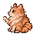 长毛猫 · 金渐层 · 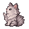 长毛猫 · 银渐层 |
| 瓜子仓鼠 | 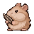 瓜子仓鼠 · 金黄 · 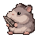 瓜子仓鼠 · 银灰 ·  瓜子仓鼠 · 奶白 |
| 垂耳兔 |  垂耳兔 |
| 蜜袋鼯 |  蜜袋鼯 |
| 刺猬 | 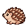 刺猬 |
| 巴西龟 |  巴西龟 |
| 玉米蛇 | 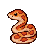 玉米蛇 |
| 角蛙 | 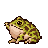 角蛙 |
| 水豚 |  水豚 |

### 狗狗 · 37款

| 犬种 | 配色1 | 配色2 | 配色3 | 配色4 | 配色5 | 配色6 | 配色7 |
|---|---|---|---|---|---|---|---|
| 喜乐蒂 | 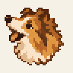<br>貂色 | 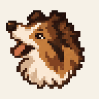<br>深貂色 | 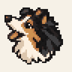<br>三色 | 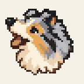<br>蓝陨石 | 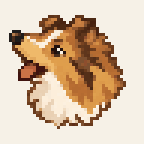<br>红陨石 | 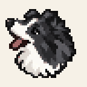<br>黑白 | 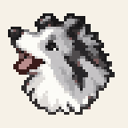<br>双色蓝陨石 |
| 金毛 | 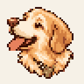<br>奶油金 | 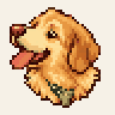<br>标准金 | 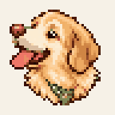<br>浅金 | 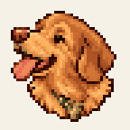<br>深金 |  |  |  |
| 比熊 | <br>雪白蓝胸背 | 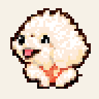<br>奶油珊瑚 | 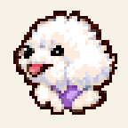<br>冰白丁香 |  |  |  |  |
| 泰迪 | <br>杏棕粉蓝 | 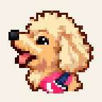<br>奶油杏 | 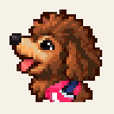<br>巧克力棕 |  |  |  |  |
| 柯基 | 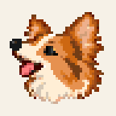<br>赤金白 | 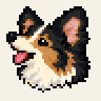<br>黑头三色 | 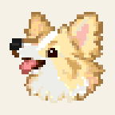<br>奶油黄白 |  |  |  |  |
| 瑞牧 | 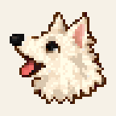<br>雪白 | 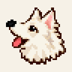<br>暖米白 | 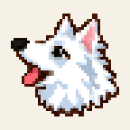<br>冰银白 |  |  |  |  |
| 哈士奇 | 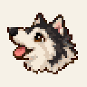<br>黑白棕瞳 | 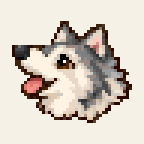<br>银灰白 | 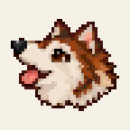<br>红棕白 |  |  |  |  |
| 西高地 | 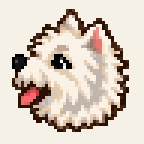<br>雪白 |  |  |  |  |  |  |
| 博美 | 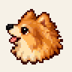<br>橘棕 | 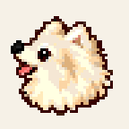<br>奶油白 | 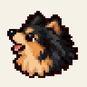<br>黑棕 |  |  |  |  |
| 边牧 | 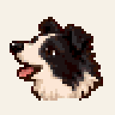<br>黑白 | <br>棕白 | 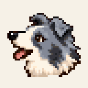<br>蓝陨石 |  |  |  |  |
| 柴犬 | 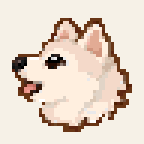<br>白柴 | 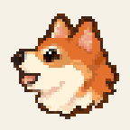<br>赤柴 | 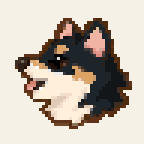<br>黑柴 | 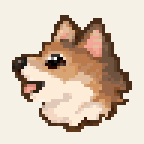<br>胡麻 |  |  |  |

## 其他状态动画 · 48px

### 小动物 · 全部16种其他状态

每款都对应实际发布的动画帧，默认状态见上方。

| 款式 | 帮助选择 | 后台运行 | 忙碌等待 | 精确定位 |
|---|---|---|---|---|
| 猫咪 · 橘猫 |  | 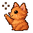 |  |  |
| 猫咪 · 橘白 |  |  |  |  |
| 猫咪 · 黑白猫 |  |  |  |  |
| 猫咪 · 三花 |  |  |  |  |
| 猫咪 · 纯白猫 |  |  |  |  |
| 玄凤鹦鹉 · 原始灰 |  |  |  |  |
| 玄凤鹦鹉 · 黄化 |  |  |  |  |
| 玄凤鹦鹉 · 珍珠灰 |  |  |  |  |
| 豹纹守宫 · 经典金黄 |  |  |  |  |
| 豹纹守宫 · 麦克雪（Mack Snow） |  |  |  |  |
| 豹纹守宫 · 薰衣草斑 |  |  |  |  |
| 布偶 · 蓝双色 |  |  |  |  |
| 长毛猫 · 金渐层 |  |  |  |  |
| 长毛猫 · 银渐层 |  |  |  |  |
| 瓜子仓鼠 · 金黄 |  |  |  |  |
| 瓜子仓鼠 · 银灰 |  |  |  |  |
| 瓜子仓鼠 · 奶白 |  |  |  |  |
| 垂耳兔 |  |  |  |  |
| 蜜袋鼯 |  |  |  |  |
| 刺猬 |  |  |  |  |
| 巴西龟 |  |  |  |  |
| 玉米蛇 |  |  |  |  |
| 角蛙 |  |  |  |  |
| 水豚 |  |  |  |  |

| 款式 | 文本选择 | 手写 | 不可用 | 垂直调整 |
|---|---|---|---|---|
| 猫咪 · 橘猫 |  |  |  |  |
| 猫咪 · 橘白 |  |  |  |  |
| 猫咪 · 黑白猫 |  |  |  |  |
| 猫咪 · 三花 |  |  |  |  |
| 猫咪 · 纯白猫 |  |  |  |  |
| 玄凤鹦鹉 · 原始灰 |  |  |  |  |
| 玄凤鹦鹉 · 黄化 |  |  |  |  |
| 玄凤鹦鹉 · 珍珠灰 |  |  |  |  |
| 豹纹守宫 · 经典金黄 |  |  |  |  |
| 豹纹守宫 · 麦克雪（Mack Snow） |  |  |  |  |
| 豹纹守宫 · 薰衣草斑 |  |  |  |  |
| 布偶 · 蓝双色 |  |  |  |  |
| 长毛猫 · 金渐层 |  |  |  |  |
| 长毛猫 · 银渐层 |  |  |  |  |
| 瓜子仓鼠 · 金黄 |  |  |  |  |
| 瓜子仓鼠 · 银灰 |  |  |  |  |
| 瓜子仓鼠 · 奶白 |  |  |  |  |
| 垂耳兔 |  |  |  |  |
| 蜜袋鼯 |  |  |  |  |
| 刺猬 |  |  |  |  |
| 巴西龟 |  |  |  |  |
| 玉米蛇 |  |  |  |  |
| 角蛙 |  |  |  |  |
| 水豚 |  |  |  |  |

| 款式 | 水平调整 | 西北—东南调整 | 东北—西南调整 | 移动 |
|---|---|---|---|---|
| 猫咪 · 橘猫 |  |  |  |  |
| 猫咪 · 橘白 |  |  |  |  |
| 猫咪 · 黑白猫 |  |  |  |  |
| 猫咪 · 三花 |  |  |  |  |
| 猫咪 · 纯白猫 |  |  |  |  |
| 玄凤鹦鹉 · 原始灰 |  |  |  |  |
| 玄凤鹦鹉 · 黄化 |  |  |  |  |
| 玄凤鹦鹉 · 珍珠灰 |  |  |  |  |
| 豹纹守宫 · 经典金黄 |  |  |  |  |
| 豹纹守宫 · 麦克雪（Mack Snow） |  |  |  |  |
| 豹纹守宫 · 薰衣草斑 |  |  |  |  |
| 布偶 · 蓝双色 |  |  |  |  |
| 长毛猫 · 金渐层 |  |  |  |  |
| 长毛猫 · 银渐层 |  |  |  |  |
| 瓜子仓鼠 · 金黄 |  |  |  |  |
| 瓜子仓鼠 · 银灰 |  |  |  |  |
| 瓜子仓鼠 · 奶白 |  |  |  |  |
| 垂耳兔 |  |  |  |  |
| 蜜袋鼯 |  |  |  |  |
| 刺猬 |  |  |  |  |
| 巴西龟 |  |  |  |  |
| 玉米蛇 |  |  |  |  |
| 角蛙 |  |  |  |  |
| 水豚 |  |  |  |  |

| 款式 | 候选选择 | 链接选择 | 位置选择 | 人员选择 |
|---|---|---|---|---|
| 猫咪 · 橘猫 |  |  |  |  |
| 猫咪 · 橘白 |  |  |  |  |
| 猫咪 · 黑白猫 |  |  |  |  |
| 猫咪 · 三花 |  |  |  |  |
| 猫咪 · 纯白猫 |  |  |  |  |
| 玄凤鹦鹉 · 原始灰 |  |  |  |  |
| 玄凤鹦鹉 · 黄化 |  |  |  |  |
| 玄凤鹦鹉 · 珍珠灰 |  |  |  |  |
| 豹纹守宫 · 经典金黄 |  |  |  |  |
| 豹纹守宫 · 麦克雪（Mack Snow） |  |  |  |  |
| 豹纹守宫 · 薰衣草斑 |  |  |  |  |
| 布偶 · 蓝双色 |  |  |  |  |
| 长毛猫 · 金渐层 |  |  |  |  |
| 长毛猫 · 银渐层 |  |  |  |  |
| 瓜子仓鼠 · 金黄 |  |  |  |  |
| 瓜子仓鼠 · 银灰 |  |  |  |  |
| 瓜子仓鼠 · 奶白 |  |  |  |  |
| 垂耳兔 |  |  |  |  |
| 蜜袋鼯 |  |  |  |  |
| 刺猬 |  |  |  |  |
| 巴西龟 |  |  |  |  |
| 玉米蛇 |  |  |  |  |
| 角蛙 |  |  |  |  |
| 水豚 |  |  |  |  |

### 狗狗 · 常用状态

| 品种 · 配色 | 帮助选择 | 忙碌等待 | 文本选择 | 手写 | 移动 |
|---|---|---|---|---|---|
| 喜乐蒂 · 红陨石 |  |  |  |  |  |
| 金毛 · 奶油金 |  |  |  |  |  |
| 比熊 · 雪白蓝胸背 |  |  |  |  |  |
| 泰迪 · 杏棕粉蓝 |  |  |  |  |  |
| 柯基 · 赤金白 |  |  |  |  |  |
| 瑞牧 · 雪白 |  |  |  |  |  |
| 哈士奇 · 黑白棕瞳 |  |  |  |  |  |
| 西高地 · 雪白 |  |  |  |  |  |
| 博美 · 橘棕 |  |  |  |  |  |
| 边牧 · 黑白 |  |  |  |  |  |
| 柴犬 · 白柴 |  |  |  |  |  |

## 按款下载

选择系统并完整解压。Windows默认48px；macOS使用Mousecape；Linux使用Xcursor主题。

### 小动物 · 单款下载

| 款式 | Windows | macOS | Linux／麒麟／UOS |
|---|---|---|---|
| 猫咪 · 橘猫 | [下载](https://raw.githubusercontent.com/CYemin/Pet-mouse-pointer/main/other-pets/downloads/themes/cat-windows.zip) | [下载](https://raw.githubusercontent.com/CYemin/Pet-mouse-pointer/main/other-pets/downloads/themes/cat-macos.zip) | [下载](https://raw.githubusercontent.com/CYemin/Pet-mouse-pointer/main/other-pets/downloads/themes/cat-linux.tar.gz) |
| 猫咪 · 橘白 | [下载](https://raw.githubusercontent.com/CYemin/Pet-mouse-pointer/main/other-pets/downloads/themes/cat-silver-windows.zip) | [下载](https://raw.githubusercontent.com/CYemin/Pet-mouse-pointer/main/other-pets/downloads/themes/cat-silver-macos.zip) | [下载](https://raw.githubusercontent.com/CYemin/Pet-mouse-pointer/main/other-pets/downloads/themes/cat-silver-linux.tar.gz) |
| 猫咪 · 黑白猫 | [下载](https://raw.githubusercontent.com/CYemin/Pet-mouse-pointer/main/other-pets/downloads/themes/cat-tuxedo-windows.zip) | [下载](https://raw.githubusercontent.com/CYemin/Pet-mouse-pointer/main/other-pets/downloads/themes/cat-tuxedo-macos.zip) | [下载](https://raw.githubusercontent.com/CYemin/Pet-mouse-pointer/main/other-pets/downloads/themes/cat-tuxedo-linux.tar.gz) |
| 猫咪 · 三花 | [下载](https://raw.githubusercontent.com/CYemin/Pet-mouse-pointer/main/other-pets/downloads/themes/cat-calico-windows.zip) | [下载](https://raw.githubusercontent.com/CYemin/Pet-mouse-pointer/main/other-pets/downloads/themes/cat-calico-macos.zip) | [下载](https://raw.githubusercontent.com/CYemin/Pet-mouse-pointer/main/other-pets/downloads/themes/cat-calico-linux.tar.gz) |
| 猫咪 · 纯白猫 | [下载](https://raw.githubusercontent.com/CYemin/Pet-mouse-pointer/main/other-pets/downloads/themes/cat-cream-windows.zip) | [下载](https://raw.githubusercontent.com/CYemin/Pet-mouse-pointer/main/other-pets/downloads/themes/cat-cream-macos.zip) | [下载](https://raw.githubusercontent.com/CYemin/Pet-mouse-pointer/main/other-pets/downloads/themes/cat-cream-linux.tar.gz) |
| 玄凤鹦鹉 · 原始灰 | [下载](https://raw.githubusercontent.com/CYemin/Pet-mouse-pointer/main/other-pets/downloads/themes/cockatiel-windows.zip) | [下载](https://raw.githubusercontent.com/CYemin/Pet-mouse-pointer/main/other-pets/downloads/themes/cockatiel-macos.zip) | [下载](https://raw.githubusercontent.com/CYemin/Pet-mouse-pointer/main/other-pets/downloads/themes/cockatiel-linux.tar.gz) |
| 玄凤鹦鹉 · 黄化 | [下载](https://raw.githubusercontent.com/CYemin/Pet-mouse-pointer/main/other-pets/downloads/themes/cockatiel-lutino-windows.zip) | [下载](https://raw.githubusercontent.com/CYemin/Pet-mouse-pointer/main/other-pets/downloads/themes/cockatiel-lutino-macos.zip) | [下载](https://raw.githubusercontent.com/CYemin/Pet-mouse-pointer/main/other-pets/downloads/themes/cockatiel-lutino-linux.tar.gz) |
| 玄凤鹦鹉 · 珍珠灰 | [下载](https://raw.githubusercontent.com/CYemin/Pet-mouse-pointer/main/other-pets/downloads/themes/cockatiel-pearl-windows.zip) | [下载](https://raw.githubusercontent.com/CYemin/Pet-mouse-pointer/main/other-pets/downloads/themes/cockatiel-pearl-macos.zip) | [下载](https://raw.githubusercontent.com/CYemin/Pet-mouse-pointer/main/other-pets/downloads/themes/cockatiel-pearl-linux.tar.gz) |
| 豹纹守宫 · 经典金黄 | [下载](https://raw.githubusercontent.com/CYemin/Pet-mouse-pointer/main/other-pets/downloads/themes/gecko-windows.zip) | [下载](https://raw.githubusercontent.com/CYemin/Pet-mouse-pointer/main/other-pets/downloads/themes/gecko-macos.zip) | [下载](https://raw.githubusercontent.com/CYemin/Pet-mouse-pointer/main/other-pets/downloads/themes/gecko-linux.tar.gz) |
| 豹纹守宫 · 麦克雪（Mack Snow） | [下载](https://raw.githubusercontent.com/CYemin/Pet-mouse-pointer/main/other-pets/downloads/themes/gecko-snow-windows.zip) | [下载](https://raw.githubusercontent.com/CYemin/Pet-mouse-pointer/main/other-pets/downloads/themes/gecko-snow-macos.zip) | [下载](https://raw.githubusercontent.com/CYemin/Pet-mouse-pointer/main/other-pets/downloads/themes/gecko-snow-linux.tar.gz) |
| 豹纹守宫 · 薰衣草斑 | [下载](https://raw.githubusercontent.com/CYemin/Pet-mouse-pointer/main/other-pets/downloads/themes/gecko-lavender-windows.zip) | [下载](https://raw.githubusercontent.com/CYemin/Pet-mouse-pointer/main/other-pets/downloads/themes/gecko-lavender-macos.zip) | [下载](https://raw.githubusercontent.com/CYemin/Pet-mouse-pointer/main/other-pets/downloads/themes/gecko-lavender-linux.tar.gz) |
| 布偶 · 蓝双色 | [下载](https://raw.githubusercontent.com/CYemin/Pet-mouse-pointer/main/other-pets/downloads/themes/longhair-ragdoll-windows.zip) | [下载](https://raw.githubusercontent.com/CYemin/Pet-mouse-pointer/main/other-pets/downloads/themes/longhair-ragdoll-macos.zip) | [下载](https://raw.githubusercontent.com/CYemin/Pet-mouse-pointer/main/other-pets/downloads/themes/longhair-ragdoll-linux.tar.gz) |
| 长毛猫 · 金渐层 | [下载](https://raw.githubusercontent.com/CYemin/Pet-mouse-pointer/main/other-pets/downloads/themes/longhair-golden-windows.zip) | [下载](https://raw.githubusercontent.com/CYemin/Pet-mouse-pointer/main/other-pets/downloads/themes/longhair-golden-macos.zip) | [下载](https://raw.githubusercontent.com/CYemin/Pet-mouse-pointer/main/other-pets/downloads/themes/longhair-golden-linux.tar.gz) |
| 长毛猫 · 银渐层 | [下载](https://raw.githubusercontent.com/CYemin/Pet-mouse-pointer/main/other-pets/downloads/themes/longhair-silver-windows.zip) | [下载](https://raw.githubusercontent.com/CYemin/Pet-mouse-pointer/main/other-pets/downloads/themes/longhair-silver-macos.zip) | [下载](https://raw.githubusercontent.com/CYemin/Pet-mouse-pointer/main/other-pets/downloads/themes/longhair-silver-linux.tar.gz) |
| 瓜子仓鼠 · 金黄 | [下载](https://raw.githubusercontent.com/CYemin/Pet-mouse-pointer/main/other-pets/downloads/themes/seed-hamster-golden-windows.zip) | [下载](https://raw.githubusercontent.com/CYemin/Pet-mouse-pointer/main/other-pets/downloads/themes/seed-hamster-golden-macos.zip) | [下载](https://raw.githubusercontent.com/CYemin/Pet-mouse-pointer/main/other-pets/downloads/themes/seed-hamster-golden-linux.tar.gz) |
| 瓜子仓鼠 · 银灰 | [下载](https://raw.githubusercontent.com/CYemin/Pet-mouse-pointer/main/other-pets/downloads/themes/seed-hamster-silver-windows.zip) | [下载](https://raw.githubusercontent.com/CYemin/Pet-mouse-pointer/main/other-pets/downloads/themes/seed-hamster-silver-macos.zip) | [下载](https://raw.githubusercontent.com/CYemin/Pet-mouse-pointer/main/other-pets/downloads/themes/seed-hamster-silver-linux.tar.gz) |
| 瓜子仓鼠 · 奶白 | [下载](https://raw.githubusercontent.com/CYemin/Pet-mouse-pointer/main/other-pets/downloads/themes/seed-hamster-ivory-windows.zip) | [下载](https://raw.githubusercontent.com/CYemin/Pet-mouse-pointer/main/other-pets/downloads/themes/seed-hamster-ivory-macos.zip) | [下载](https://raw.githubusercontent.com/CYemin/Pet-mouse-pointer/main/other-pets/downloads/themes/seed-hamster-ivory-linux.tar.gz) |
| 垂耳兔 | [下载](https://raw.githubusercontent.com/CYemin/Pet-mouse-pointer/main/other-pets/downloads/themes/lop-rabbit-windows.zip) | [下载](https://raw.githubusercontent.com/CYemin/Pet-mouse-pointer/main/other-pets/downloads/themes/lop-rabbit-macos.zip) | [下载](https://raw.githubusercontent.com/CYemin/Pet-mouse-pointer/main/other-pets/downloads/themes/lop-rabbit-linux.tar.gz) |
| 蜜袋鼯 | [下载](https://raw.githubusercontent.com/CYemin/Pet-mouse-pointer/main/other-pets/downloads/themes/sugar-glider-windows.zip) | [下载](https://raw.githubusercontent.com/CYemin/Pet-mouse-pointer/main/other-pets/downloads/themes/sugar-glider-macos.zip) | [下载](https://raw.githubusercontent.com/CYemin/Pet-mouse-pointer/main/other-pets/downloads/themes/sugar-glider-linux.tar.gz) |
| 刺猬 | [下载](https://raw.githubusercontent.com/CYemin/Pet-mouse-pointer/main/other-pets/downloads/themes/hedgehog-windows.zip) | [下载](https://raw.githubusercontent.com/CYemin/Pet-mouse-pointer/main/other-pets/downloads/themes/hedgehog-macos.zip) | [下载](https://raw.githubusercontent.com/CYemin/Pet-mouse-pointer/main/other-pets/downloads/themes/hedgehog-linux.tar.gz) |
| 巴西龟 | [下载](https://raw.githubusercontent.com/CYemin/Pet-mouse-pointer/main/other-pets/downloads/themes/red-eared-slider-windows.zip) | [下载](https://raw.githubusercontent.com/CYemin/Pet-mouse-pointer/main/other-pets/downloads/themes/red-eared-slider-macos.zip) | [下载](https://raw.githubusercontent.com/CYemin/Pet-mouse-pointer/main/other-pets/downloads/themes/red-eared-slider-linux.tar.gz) |
| 玉米蛇 | [下载](https://raw.githubusercontent.com/CYemin/Pet-mouse-pointer/main/other-pets/downloads/themes/corn-snake-windows.zip) | [下载](https://raw.githubusercontent.com/CYemin/Pet-mouse-pointer/main/other-pets/downloads/themes/corn-snake-macos.zip) | [下载](https://raw.githubusercontent.com/CYemin/Pet-mouse-pointer/main/other-pets/downloads/themes/corn-snake-linux.tar.gz) |
| 角蛙 | [下载](https://raw.githubusercontent.com/CYemin/Pet-mouse-pointer/main/other-pets/downloads/themes/pacman-frog-windows.zip) | [下载](https://raw.githubusercontent.com/CYemin/Pet-mouse-pointer/main/other-pets/downloads/themes/pacman-frog-macos.zip) | [下载](https://raw.githubusercontent.com/CYemin/Pet-mouse-pointer/main/other-pets/downloads/themes/pacman-frog-linux.tar.gz) |
| 水豚 | [下载](https://raw.githubusercontent.com/CYemin/Pet-mouse-pointer/main/other-pets/downloads/themes/capybara-windows.zip) | [下载](https://raw.githubusercontent.com/CYemin/Pet-mouse-pointer/main/other-pets/downloads/themes/capybara-macos.zip) | [下载](https://raw.githubusercontent.com/CYemin/Pet-mouse-pointer/main/other-pets/downloads/themes/capybara-linux.tar.gz) |

### 狗狗 · 单款下载

| 犬种 | 配色 · Windows ZIP |
|---|---|
| 喜乐蒂 | [貂色](https://raw.githubusercontent.com/CYemin/Pet-mouse-pointer/refs/heads/main/downloads/themes/pet-pixel-complete.zip) · [深貂色](https://raw.githubusercontent.com/CYemin/Pet-mouse-pointer/refs/heads/main/downloads/themes/sheltie-dark-sable-pixel.zip) · [三色](https://raw.githubusercontent.com/CYemin/Pet-mouse-pointer/refs/heads/main/downloads/themes/sheltie-tricolor-pixel.zip) · [蓝陨石](https://raw.githubusercontent.com/CYemin/Pet-mouse-pointer/refs/heads/main/downloads/themes/sheltie-blue-merle-pixel.zip) · [红陨石](https://raw.githubusercontent.com/CYemin/Pet-mouse-pointer/refs/heads/main/downloads/themes/sheltie-red-merle-pixel.zip) · [黑白](https://raw.githubusercontent.com/CYemin/Pet-mouse-pointer/refs/heads/main/downloads/themes/sheltie-bi-black-pixel.zip) · [双色蓝陨石](https://raw.githubusercontent.com/CYemin/Pet-mouse-pointer/refs/heads/main/downloads/themes/sheltie-bi-blue-pixel.zip) |
| 金毛 | [奶油金](https://raw.githubusercontent.com/CYemin/Pet-mouse-pointer/refs/heads/main/downloads/themes/golden-cream-pixel.zip) · [标准金](https://raw.githubusercontent.com/CYemin/Pet-mouse-pointer/refs/heads/main/downloads/themes/golden-standard-pixel.zip) · [浅金](https://raw.githubusercontent.com/CYemin/Pet-mouse-pointer/refs/heads/main/downloads/themes/golden-light-pixel.zip) · [深金](https://raw.githubusercontent.com/CYemin/Pet-mouse-pointer/refs/heads/main/downloads/themes/golden-dark-pixel.zip) |
| 比熊 | [雪白蓝胸背](https://raw.githubusercontent.com/CYemin/Pet-mouse-pointer/refs/heads/main/downloads/themes/bichon-photo-v3.zip) · [奶油珊瑚](https://raw.githubusercontent.com/CYemin/Pet-mouse-pointer/refs/heads/main/downloads/themes/bichon-cream-coral-v5.zip) · [冰白丁香](https://raw.githubusercontent.com/CYemin/Pet-mouse-pointer/refs/heads/main/downloads/themes/bichon-ice-lilac-v5.zip) |
| 泰迪 | [杏棕粉蓝](https://raw.githubusercontent.com/CYemin/Pet-mouse-pointer/refs/heads/main/downloads/themes/teddy-profile-v6.zip) · [奶油杏](https://raw.githubusercontent.com/CYemin/Pet-mouse-pointer/refs/heads/main/downloads/themes/teddy-cream-profile-v6.zip) · [巧克力棕](https://raw.githubusercontent.com/CYemin/Pet-mouse-pointer/refs/heads/main/downloads/themes/teddy-chocolate-profile-v6.zip) |
| 柯基 | [赤金白](https://raw.githubusercontent.com/CYemin/Pet-mouse-pointer/refs/heads/main/downloads/themes/corgi-photo-v3.zip) · [黑头三色](https://raw.githubusercontent.com/CYemin/Pet-mouse-pointer/refs/heads/main/downloads/themes/corgi-tricolor-v5.zip) · [奶油黄白](https://raw.githubusercontent.com/CYemin/Pet-mouse-pointer/refs/heads/main/downloads/themes/corgi-cream-v5.zip) |
| 瑞牧 | [雪白](https://raw.githubusercontent.com/CYemin/Pet-mouse-pointer/refs/heads/main/downloads/themes/swiss-profile-v6.zip) · [暖米白](https://raw.githubusercontent.com/CYemin/Pet-mouse-pointer/refs/heads/main/downloads/themes/swiss-ivory-profile-v6.zip) · [冰银白](https://raw.githubusercontent.com/CYemin/Pet-mouse-pointer/refs/heads/main/downloads/themes/swiss-ice-profile-v6.zip) |
| 哈士奇 | [黑白棕瞳侧面](https://raw.githubusercontent.com/CYemin/Pet-mouse-pointer/refs/heads/main/downloads/themes/husky-profile-v6.zip) · [银灰白](https://raw.githubusercontent.com/CYemin/Pet-mouse-pointer/refs/heads/main/downloads/themes/husky-silver-profile-v6.zip) · [红棕白](https://raw.githubusercontent.com/CYemin/Pet-mouse-pointer/refs/heads/main/downloads/themes/husky-red-profile-v6.zip) |
| 西高地 | [雪白](https://raw.githubusercontent.com/CYemin/Pet-mouse-pointer/refs/heads/main/downloads/themes/westie-profile-v1.zip) |
| 博美 | [橘棕](https://raw.githubusercontent.com/CYemin/Pet-mouse-pointer/refs/heads/main/downloads/themes/pomeranian-orange-v1.zip) · [奶油白](https://raw.githubusercontent.com/CYemin/Pet-mouse-pointer/refs/heads/main/downloads/themes/pomeranian-cream-v1.zip) · [黑棕](https://raw.githubusercontent.com/CYemin/Pet-mouse-pointer/refs/heads/main/downloads/themes/pomeranian-black-tan-v1.zip) |
| 边牧 | [黑白](https://raw.githubusercontent.com/CYemin/Pet-mouse-pointer/refs/heads/main/downloads/themes/border-collie-black-white-v1.zip) · [棕白](https://raw.githubusercontent.com/CYemin/Pet-mouse-pointer/refs/heads/main/downloads/themes/border-collie-brown-white-v1.zip) · [蓝陨石](https://raw.githubusercontent.com/CYemin/Pet-mouse-pointer/refs/heads/main/downloads/themes/border-collie-blue-merle-v1.zip) |
| 柴犬 | [白柴](https://raw.githubusercontent.com/CYemin/Pet-mouse-pointer/refs/heads/main/downloads/themes/shiba-white-v1.zip) · [赤柴](https://raw.githubusercontent.com/CYemin/Pet-mouse-pointer/refs/heads/main/downloads/themes/shiba-red-v1.zip) · [黑柴](https://raw.githubusercontent.com/CYemin/Pet-mouse-pointer/refs/heads/main/downloads/themes/shiba-black-tan-v1.zip) · [胡麻](https://raw.githubusercontent.com/CYemin/Pet-mouse-pointer/refs/heads/main/downloads/themes/shiba-sesame-v1.zip) |

## 小动物合集与离线测试

[Windows全集](https://raw.githubusercontent.com/CYemin/Pet-mouse-pointer/main/other-pets/downloads/Windows.zip) · [macOS全集](https://raw.githubusercontent.com/CYemin/Pet-mouse-pointer/main/other-pets/downloads/macOS.zip) · [Linux全集](https://raw.githubusercontent.com/CYemin/Pet-mouse-pointer/main/other-pets/downloads/Linux.tar.gz) · [48px离线测试页](https://raw.githubusercontent.com/CYemin/Pet-mouse-pointer/main/other-pets/downloads/offline-24-pets.zip)

小动物扩展采用[MIT许可](other-pets/LICENSE)，可免费使用、修改和再分发。[源码与重建方法](other-pets/source/)；原有狗狗素材授权见[ASSETS.md](ASSETS.md)。

## 下载现成安装包

| 范围 | 款数 | Windows 一键安装包 | macOS Mousecape 测试包 |
|---|---:|---|---|
| 全部狗狗 | 37 | [全部安装](https://raw.githubusercontent.com/CYemin/Pet-mouse-pointer/refs/heads/main/downloads/windows-all.zip) | [全部导入](https://raw.githubusercontent.com/CYemin/Pet-mouse-pointer/refs/heads/main/downloads/macos-all.zip) |
| 喜乐蒂 | 7 | [安装该犬种所有配色](https://raw.githubusercontent.com/CYemin/Pet-mouse-pointer/refs/heads/main/downloads/windows-sheltie.zip) | [导入该犬种所有配色](https://raw.githubusercontent.com/CYemin/Pet-mouse-pointer/refs/heads/main/downloads/macos-sheltie.zip) |
| 金毛 | 4 | [安装该犬种所有配色](https://raw.githubusercontent.com/CYemin/Pet-mouse-pointer/refs/heads/main/downloads/windows-golden.zip) | [导入该犬种所有配色](https://raw.githubusercontent.com/CYemin/Pet-mouse-pointer/refs/heads/main/downloads/macos-golden.zip) |
| 比熊 | 3 | [安装该犬种所有配色](https://raw.githubusercontent.com/CYemin/Pet-mouse-pointer/refs/heads/main/downloads/windows-bichon.zip) | [导入该犬种所有配色](https://raw.githubusercontent.com/CYemin/Pet-mouse-pointer/refs/heads/main/downloads/macos-bichon.zip) |
| 泰迪 | 3 | [安装该犬种所有配色](https://raw.githubusercontent.com/CYemin/Pet-mouse-pointer/refs/heads/main/downloads/windows-teddy.zip) | [导入该犬种所有配色](https://raw.githubusercontent.com/CYemin/Pet-mouse-pointer/refs/heads/main/downloads/macos-teddy.zip) |
| 柯基 | 3 | [安装该犬种所有配色](https://raw.githubusercontent.com/CYemin/Pet-mouse-pointer/refs/heads/main/downloads/windows-corgi.zip) | [导入该犬种所有配色](https://raw.githubusercontent.com/CYemin/Pet-mouse-pointer/refs/heads/main/downloads/macos-corgi.zip) |
| 瑞牧 | 3 | [安装该犬种所有配色](https://raw.githubusercontent.com/CYemin/Pet-mouse-pointer/refs/heads/main/downloads/windows-swiss.zip) | [导入该犬种所有配色](https://raw.githubusercontent.com/CYemin/Pet-mouse-pointer/refs/heads/main/downloads/macos-swiss.zip) |
| 哈士奇 | 3 | [安装该犬种所有配色](https://raw.githubusercontent.com/CYemin/Pet-mouse-pointer/refs/heads/main/downloads/windows-husky.zip) | [导入该犬种所有配色](https://raw.githubusercontent.com/CYemin/Pet-mouse-pointer/refs/heads/main/downloads/macos-husky.zip) |
| 西高地 | 1 | [安装该犬种所有配色](https://raw.githubusercontent.com/CYemin/Pet-mouse-pointer/refs/heads/main/downloads/windows-westie.zip) | [导入该犬种所有配色](https://raw.githubusercontent.com/CYemin/Pet-mouse-pointer/refs/heads/main/downloads/macos-westie.zip) |
| 博美 | 3 | [安装该犬种所有配色](https://raw.githubusercontent.com/CYemin/Pet-mouse-pointer/refs/heads/main/downloads/windows-pomeranian.zip) | [导入该犬种所有配色](https://raw.githubusercontent.com/CYemin/Pet-mouse-pointer/refs/heads/main/downloads/macos-pomeranian.zip) |
| 边牧 | 3 | [安装该犬种所有配色](https://raw.githubusercontent.com/CYemin/Pet-mouse-pointer/refs/heads/main/downloads/windows-border-collie.zip) | [导入该犬种所有配色](https://raw.githubusercontent.com/CYemin/Pet-mouse-pointer/refs/heads/main/downloads/macos-border-collie.zip) |
| 柴犬 | 4 | [安装该犬种所有配色](https://raw.githubusercontent.com/CYemin/Pet-mouse-pointer/refs/heads/main/downloads/windows-shiba.zip) | [导入该犬种所有配色](https://raw.githubusercontent.com/CYemin/Pet-mouse-pointer/refs/heads/main/downloads/macos-shiba.zip) |

### Windows：一键安装与恢复

1. 完整解压ZIP，双击 `一键安装所有狗狗.cmd`，或 `一键安装所有喜乐蒂.cmd` 等单犬种入口。无需管理员权限或Python。
2. 默认48px，按顺序安装并保存每款方案；**最后安装的一套当前生效**。安装成功后打开“鼠标属性 → 指针”，可在方案列表里选择其他款式并应用。
3. 只想安装一款：进入对应主题文件夹，双击 `安装鼠标主题.cmd`。
4. 双击 `恢复原鼠标.cmd` 恢复首次安装前的基线。恢复保留备份、已装文件和已保存的方案。

主题方案名统一为中文 `品种 · 颜色`，例如 `喜乐蒂 · 红陨石`、`金毛 · 奶油金`；不附加像素、动作描述或尺寸后缀。重新下载并安装后，新方案使用此名称；旧安装已保存的名称不会仅因下载更新而自动改变。

已经解压过旧安装包，可下载[大小调整工具](https://raw.githubusercontent.com/CYemin/Pet-mouse-pointer/refs/heads/main/downloads/pet-cursor-size-tools.zip)，把里面全部文件复制到原单款、单犬种或全部合集根目录，提示覆盖时替换。

**双击调整当前指针：** 双击 `当前指针改为32px.cmd`，只把正在使用的那款狗狗改成32px；其他狗狗不会被安装、修改或重新应用。另附48、64、96、128px。旧名 `全部狗狗改为32px.cmd` 等入口已改为相同的当前款式行为。

当前款式的源主题文件夹需保留在工具同层或直接子目录中。无法识别当前宠物、找不到源文件或存在重复匹配时，程序会提示并停止，不会切换到其他款式。新版安装入口默认48px；大小补充工具只替换调整入口，不修改旧安装入口。

五档尺寸为32/48/64/96/128px。高级用法在工具所在目录运行，只调整当前款式：

```powershell
powershell -NoProfile -ExecutionPolicy Bypass -File ./resize-current.ps1 -Size 96
```

首次安装并指定尺寸可用 `install-theme.ps1 -Size 96`。给CMD追加 `--check` 可只做预演。批量安装先检查全部目标，中途失败即停止，已成功项保留。系统辅助功能里的四个颜色按钮不会新增狗狗卡片；调整系统颜色或大小可能覆盖宠物光标，重新运行安装入口可恢复。

### macOS：一键导入与应用

**2026-11-01兼容修复：** 已为原33款补上macOS26及更新系统使用的普通箭头、文本指针名称。若旧版出现“链接有小狗、普通区域却是默认箭头”，请重新下载Mac包，并在Mousecape恢复默认、移除旧同款后重新导入、Apply。重复导入可能保留同名副本；新版为2.0、19个条目。[原因与验证](docs/macos-compatibility-validation.json)。

1. 先安装 [Mousecape 官方版本](https://github.com/alexzielenski/Mousecape/releases)，本项目不捆绑第三方程序。
2. 解压Mac合集，双击 `一键导入全部主题-32pt.command`；大号使用48pt入口。也可直接双击 `.cape` 文件逐一导入。
3. 在Mousecape中选中喜欢的一套，然后 **Apply**。批量入口负责导入，不能同时应用多套。
4. 用 `Capes → Restore Defaults` 恢复默认指针。

所有37款均提供32pt/48pt、1×/2×素材。13种源动作对应19个Mac条目（含ArrowS／IBeamS兼容条目），Windows手写、候选、位置和人员状态不直接导出；Mac额外状态保留系统默认。[Mousecape动画格式](https://github.com/alexzielenski/Mousecape/blob/master/Mousecape/mousecloak/apply.m)最多24个等时帧，部分Windows停留节奏需采样；转换记录随包提供。

**Mac版已完成格式、热点、时长及全部嵌入像素校验，本次兼容补丁尚未在Mac真机复测，Retina与多屏仍待确认。** 双击脚本还可能受本机执行权限限制，可改用直接打开.cape；不需要绕过系统安全提示。详见[macOS说明](docs/macOS.md)与[37款转换校验](docs/macos-37-validation.json)。


## 动作、鼻尖与验证

Windows每款含17种动画状态：正常、帮助、后台工作、等待、精确定位、文本、手写、不可用、四向缩放、移动、候选、链接、位置和人员选择。点选类使用可见鼻尖；文字用插入线，手写用笔尖，定位及缩放用操作符号接触点。侧面造型保留品种的耳朵、口鼻和毛色特征。

37款使用已复查的源动作，提供Windows原生加载/绘制、各尺寸与热点检查记录；安装器经过预演，未在制作机应用主题。实际桌面点击手感、不同DPI与多显示器仍需试用；局部毛发纹理变化可能存在。自动检测不能替代逐帧视觉检查。见[发布目录](docs/release-37.json)、[柴犬扩展打包验证](docs/release-37-validation.json)、[33款扩展打包验证（2026-10-31）](docs/release-33-validation.json)、[Mac兼容修复验证（2026-11-01）](docs/macos-compatibility-validation.json)及各主题包内报告。

## 用 Skill 制作自己的宠物

[下载 Skill](https://raw.githubusercontent.com/CYemin/Pet-mouse-pointer/refs/heads/main/downloads/pet-cursor-skill.zip) · [Skill 源文件](skills/pet-cursor-theme/SKILL.md)

将 `pet-cursor-theme` 文件夹放入客户端技能目录，保留 scripts、references 和 assets。提供宠物照片与风格要求，先确定普通指针侧面造型、可见鼻尖，再扩展17状态和配色。Python只负责分帧、配准和编码，美术由宿主图像生成工具制作；不包含模型或API密钥。

支持Windows CUR/ANI编译、macOS Mousecape转换、可恢复安装、逐帧检查，以及整套/单犬种打包。开发依赖Python3.10+与Pillow，见[Skill说明](skills/pet-cursor-theme/README.md)。Skill不会因本地包完成而自行发布或应用系统鼠标。

```powershell
python -m unittest discover -s skills/pet-cursor-theme/scripts -p "test_*.py"
```

## 仓库文件

`downloads/` 为平台与犬种合集，`downloads/themes/` 为37款单主题包；`skills/` 为可复用制作工具；`docs/` 为图鉴、动画和检查记录。旧版下载保留供溯源，当前推荐入口均以上方37款为准。下载完整性见 [SHA-256](downloads/SHA256SUMS)。

本次新增主题和合集不附私人参考照片、密钥或本机路径。博美、边牧依据维护者提供的参考形象设计；边牧不包含参考图的牵引绳、衣物或配饰。柴犬参考白柴照片，忽略胸背，另含赤柴、黑柴、胡麻配色。

## 使用许可与版权

- **免费下载、安装和使用**。本仓库发布的宠物指针主题和安装包可免费下载安装使用。
- **欢迎在 GitHub 二次创作**。你可以 Fork 本仓库，制作自己的宠物指针，也可以在 GitHub 免费分享基于官方主题的改版。分享改版时请注明原项目并附上仓库链接。
- **未经授权，禁止售卖**。销售官方主题、安装包或包含本项目主题美术素材的改版，须事先获得相关权利人授权。收费下载、付费合集和随其他商品捆绑销售均适用。如需授权，可联系仓库维护者。

代码、文档和 Skill 内置的六个功能箭头模板采用 [MIT 许可证](LICENSE)。参考照片、第三方参考图及主题美术素材的授权范围见[素材说明](ASSETS.md)和各主题中的说明。

## 致谢

感谢 🍠 不要芋泥要啵啵 的反馈。
