# Pet Mouse Pointer · 宠物鼠标指针

61款像素宠物，免费下载使用。默认动画按48px展示，点击名字跳到对应下载。

## 全部默认动画

### 小狗 · 37款

|  |  |  |  |  |
|:---:|:---:|:---:|:---:|:---:|
|  [喜乐蒂 · 貂色](#download-pet-pixel-complete) |  [喜乐蒂 · 深貂色](#download-sheltie-dark-sable-pixel) | 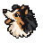 [喜乐蒂 · 三色](#download-sheltie-tricolor-pixel) |  [喜乐蒂 · 蓝陨石](#download-sheltie-blue-merle-pixel) |  [喜乐蒂 · 红陨石](#download-sheltie-red-merle-pixel) |
|  [喜乐蒂 · 黑白](#download-sheltie-bi-black-pixel) |  [喜乐蒂 · 双色蓝陨石](#download-sheltie-bi-blue-pixel) |  [金毛 · 奶油金](#download-golden-cream-pixel) |  [金毛 · 标准金](#download-golden-standard-pixel) |  [金毛 · 浅金](#download-golden-light-pixel) |
|  [金毛 · 深金](#download-golden-dark-pixel) |  [比熊 · 雪白蓝胸背](#download-bichon-photo-v3) |  [比熊 · 奶油珊瑚](#download-bichon-cream-coral-v5) |  [比熊 · 冰白丁香](#download-bichon-ice-lilac-v5) |  [泰迪 · 杏棕粉蓝](#download-teddy-profile-v6) |
|  [泰迪 · 奶油杏](#download-teddy-cream-profile-v6) |  [泰迪 · 巧克力棕](#download-teddy-chocolate-profile-v6) |  [柯基 · 赤金白](#download-corgi-photo-v3) |  [柯基 · 黑头三色](#download-corgi-tricolor-v5) |  [柯基 · 奶油黄白](#download-corgi-cream-v5) |
|  [瑞牧 · 雪白](#download-swiss-profile-v6) | 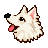 [瑞牧 · 暖米白](#download-swiss-ivory-profile-v6) |  [瑞牧 · 冰银白](#download-swiss-ice-profile-v6) |  [哈士奇 · 黑白棕瞳](#download-husky-profile-v6) |  [哈士奇 · 银灰白](#download-husky-silver-profile-v6) |
|  [哈士奇 · 红棕白](#download-husky-red-profile-v6) |  [西高地 · 雪白](#download-westie-profile-v1) |  [博美 · 橘棕](#download-pomeranian-orange-v1) |  [博美 · 奶油白](#download-pomeranian-cream-v1) |  [博美 · 黑棕](#download-pomeranian-black-tan-v1) |
|  [边牧 · 黑白](#download-border-collie-black-white-v1) |  [边牧 · 棕白](#download-border-collie-brown-white-v1) |  [边牧 · 蓝陨石](#download-border-collie-blue-merle-v1) |  [柴犬 · 白柴](#download-shiba-white-v1) |  [柴犬 · 赤柴](#download-shiba-red-v1) |
|  [柴犬 · 黑柴](#download-shiba-black-tan-v1) |  [柴犬 · 胡麻](#download-shiba-sesame-v1) |  |  |  |

### 其他小动物 · 24款

|  |  |  |  |  |
|:---:|:---:|:---:|:---:|:---:|
|  [猫咪 · 橘猫](#download-cat) |  [猫咪 · 橘白](#download-cat-silver) |  [猫咪 · 黑白猫](#download-cat-tuxedo) |  [猫咪 · 三花](#download-cat-calico) |  [猫咪 · 纯白猫](#download-cat-cream) |
|  [玄凤鹦鹉 · 原始灰](#download-cockatiel) |  [玄凤鹦鹉 · 黄化](#download-cockatiel-lutino) |  [玄凤鹦鹉 · 珍珠灰](#download-cockatiel-pearl) |  [豹纹守宫 · 经典金黄](#download-gecko) |  [豹纹守宫 · 麦克雪（Mack Snow）](#download-gecko-snow) |
|  [豹纹守宫 · 薰衣草斑](#download-gecko-lavender) |  [布偶 · 蓝双色](#download-longhair-ragdoll) |  [长毛猫 · 金渐层](#download-longhair-golden) |  [长毛猫 · 银渐层](#download-longhair-silver) |  [瓜子仓鼠 · 金黄](#download-seed-hamster-golden) |
|  [瓜子仓鼠 · 银灰](#download-seed-hamster-silver) |  [瓜子仓鼠 · 奶白](#download-seed-hamster-ivory) |  [垂耳兔](#download-lop-rabbit) | 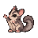 [蜜袋鼯](#download-sugar-glider) |  [刺猬](#download-hedgehog) |
|  [巴西龟](#download-red-eared-slider) |  [玉米蛇](#download-corn-snake) |  [角蛙](#download-pacman-frog) | 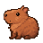 [水豚](#download-capybara) |  |

## 下载

完整解压后安装：[安装、调整与恢复说明](docs/使用说明.md)。

| 款式 | Windows | macOS | Linux／麒麟／UOS |
|---|---|---|---|
| 喜乐蒂 · 貂色 | [下载](https://raw.githubusercontent.com/CYemin/Pet-mouse-pointer/main/downloads/themes/pet-pixel-complete-windows.zip) | [下载](https://raw.githubusercontent.com/CYemin/Pet-mouse-pointer/main/downloads/themes/pet-pixel-complete-macos.zip) | [下载](https://raw.githubusercontent.com/CYemin/Pet-mouse-pointer/main/downloads/themes/pet-pixel-complete-linux.tar.gz) |
| 喜乐蒂 · 深貂色 | [下载](https://raw.githubusercontent.com/CYemin/Pet-mouse-pointer/main/downloads/themes/sheltie-dark-sable-pixel-windows.zip) | [下载](https://raw.githubusercontent.com/CYemin/Pet-mouse-pointer/main/downloads/themes/sheltie-dark-sable-pixel-macos.zip) | [下载](https://raw.githubusercontent.com/CYemin/Pet-mouse-pointer/main/downloads/themes/sheltie-dark-sable-pixel-linux.tar.gz) |
| 喜乐蒂 · 三色 | [下载](https://raw.githubusercontent.com/CYemin/Pet-mouse-pointer/main/downloads/themes/sheltie-tricolor-pixel-windows.zip) | [下载](https://raw.githubusercontent.com/CYemin/Pet-mouse-pointer/main/downloads/themes/sheltie-tricolor-pixel-macos.zip) | [下载](https://raw.githubusercontent.com/CYemin/Pet-mouse-pointer/main/downloads/themes/sheltie-tricolor-pixel-linux.tar.gz) |
| 喜乐蒂 · 蓝陨石 | [下载](https://raw.githubusercontent.com/CYemin/Pet-mouse-pointer/main/downloads/themes/sheltie-blue-merle-pixel-windows.zip) | [下载](https://raw.githubusercontent.com/CYemin/Pet-mouse-pointer/main/downloads/themes/sheltie-blue-merle-pixel-macos.zip) | [下载](https://raw.githubusercontent.com/CYemin/Pet-mouse-pointer/main/downloads/themes/sheltie-blue-merle-pixel-linux.tar.gz) |
| 喜乐蒂 · 红陨石 | [下载](https://raw.githubusercontent.com/CYemin/Pet-mouse-pointer/main/downloads/themes/sheltie-red-merle-pixel-windows.zip) | [下载](https://raw.githubusercontent.com/CYemin/Pet-mouse-pointer/main/downloads/themes/sheltie-red-merle-pixel-macos.zip) | [下载](https://raw.githubusercontent.com/CYemin/Pet-mouse-pointer/main/downloads/themes/sheltie-red-merle-pixel-linux.tar.gz) |
| 喜乐蒂 · 黑白 | [下载](https://raw.githubusercontent.com/CYemin/Pet-mouse-pointer/main/downloads/themes/sheltie-bi-black-pixel-windows.zip) | [下载](https://raw.githubusercontent.com/CYemin/Pet-mouse-pointer/main/downloads/themes/sheltie-bi-black-pixel-macos.zip) | [下载](https://raw.githubusercontent.com/CYemin/Pet-mouse-pointer/main/downloads/themes/sheltie-bi-black-pixel-linux.tar.gz) |
| 喜乐蒂 · 双色蓝陨石 | [下载](https://raw.githubusercontent.com/CYemin/Pet-mouse-pointer/main/downloads/themes/sheltie-bi-blue-pixel-windows.zip) | [下载](https://raw.githubusercontent.com/CYemin/Pet-mouse-pointer/main/downloads/themes/sheltie-bi-blue-pixel-macos.zip) | [下载](https://raw.githubusercontent.com/CYemin/Pet-mouse-pointer/main/downloads/themes/sheltie-bi-blue-pixel-linux.tar.gz) |
| 金毛 · 奶油金 | [下载](https://raw.githubusercontent.com/CYemin/Pet-mouse-pointer/main/downloads/themes/golden-cream-pixel-windows.zip) | [下载](https://raw.githubusercontent.com/CYemin/Pet-mouse-pointer/main/downloads/themes/golden-cream-pixel-macos.zip) | [下载](https://raw.githubusercontent.com/CYemin/Pet-mouse-pointer/main/downloads/themes/golden-cream-pixel-linux.tar.gz) |
| 金毛 · 标准金 | [下载](https://raw.githubusercontent.com/CYemin/Pet-mouse-pointer/main/downloads/themes/golden-standard-pixel-windows.zip) | [下载](https://raw.githubusercontent.com/CYemin/Pet-mouse-pointer/main/downloads/themes/golden-standard-pixel-macos.zip) | [下载](https://raw.githubusercontent.com/CYemin/Pet-mouse-pointer/main/downloads/themes/golden-standard-pixel-linux.tar.gz) |
| 金毛 · 浅金 | [下载](https://raw.githubusercontent.com/CYemin/Pet-mouse-pointer/main/downloads/themes/golden-light-pixel-windows.zip) | [下载](https://raw.githubusercontent.com/CYemin/Pet-mouse-pointer/main/downloads/themes/golden-light-pixel-macos.zip) | [下载](https://raw.githubusercontent.com/CYemin/Pet-mouse-pointer/main/downloads/themes/golden-light-pixel-linux.tar.gz) |
| 金毛 · 深金 | [下载](https://raw.githubusercontent.com/CYemin/Pet-mouse-pointer/main/downloads/themes/golden-dark-pixel-windows.zip) | [下载](https://raw.githubusercontent.com/CYemin/Pet-mouse-pointer/main/downloads/themes/golden-dark-pixel-macos.zip) | [下载](https://raw.githubusercontent.com/CYemin/Pet-mouse-pointer/main/downloads/themes/golden-dark-pixel-linux.tar.gz) |
| 比熊 · 雪白蓝胸背 | [下载](https://raw.githubusercontent.com/CYemin/Pet-mouse-pointer/main/downloads/themes/bichon-photo-v3-windows.zip) | [下载](https://raw.githubusercontent.com/CYemin/Pet-mouse-pointer/main/downloads/themes/bichon-photo-v3-macos.zip) | [下载](https://raw.githubusercontent.com/CYemin/Pet-mouse-pointer/main/downloads/themes/bichon-photo-v3-linux.tar.gz) |
| 比熊 · 奶油珊瑚 | [下载](https://raw.githubusercontent.com/CYemin/Pet-mouse-pointer/main/downloads/themes/bichon-cream-coral-v5-windows.zip) | [下载](https://raw.githubusercontent.com/CYemin/Pet-mouse-pointer/main/downloads/themes/bichon-cream-coral-v5-macos.zip) | [下载](https://raw.githubusercontent.com/CYemin/Pet-mouse-pointer/main/downloads/themes/bichon-cream-coral-v5-linux.tar.gz) |
| 比熊 · 冰白丁香 | [下载](https://raw.githubusercontent.com/CYemin/Pet-mouse-pointer/main/downloads/themes/bichon-ice-lilac-v5-windows.zip) | [下载](https://raw.githubusercontent.com/CYemin/Pet-mouse-pointer/main/downloads/themes/bichon-ice-lilac-v5-macos.zip) | [下载](https://raw.githubusercontent.com/CYemin/Pet-mouse-pointer/main/downloads/themes/bichon-ice-lilac-v5-linux.tar.gz) |
| 泰迪 · 杏棕粉蓝 | [下载](https://raw.githubusercontent.com/CYemin/Pet-mouse-pointer/main/downloads/themes/teddy-profile-v6-windows.zip) | [下载](https://raw.githubusercontent.com/CYemin/Pet-mouse-pointer/main/downloads/themes/teddy-profile-v6-macos.zip) | [下载](https://raw.githubusercontent.com/CYemin/Pet-mouse-pointer/main/downloads/themes/teddy-profile-v6-linux.tar.gz) |
| 泰迪 · 奶油杏 | [下载](https://raw.githubusercontent.com/CYemin/Pet-mouse-pointer/main/downloads/themes/teddy-cream-profile-v6-windows.zip) | [下载](https://raw.githubusercontent.com/CYemin/Pet-mouse-pointer/main/downloads/themes/teddy-cream-profile-v6-macos.zip) | [下载](https://raw.githubusercontent.com/CYemin/Pet-mouse-pointer/main/downloads/themes/teddy-cream-profile-v6-linux.tar.gz) |
| 泰迪 · 巧克力棕 | [下载](https://raw.githubusercontent.com/CYemin/Pet-mouse-pointer/main/downloads/themes/teddy-chocolate-profile-v6-windows.zip) | [下载](https://raw.githubusercontent.com/CYemin/Pet-mouse-pointer/main/downloads/themes/teddy-chocolate-profile-v6-macos.zip) | [下载](https://raw.githubusercontent.com/CYemin/Pet-mouse-pointer/main/downloads/themes/teddy-chocolate-profile-v6-linux.tar.gz) |
| 柯基 · 赤金白 | [下载](https://raw.githubusercontent.com/CYemin/Pet-mouse-pointer/main/downloads/themes/corgi-photo-v3-windows.zip) | [下载](https://raw.githubusercontent.com/CYemin/Pet-mouse-pointer/main/downloads/themes/corgi-photo-v3-macos.zip) | [下载](https://raw.githubusercontent.com/CYemin/Pet-mouse-pointer/main/downloads/themes/corgi-photo-v3-linux.tar.gz) |
| 柯基 · 黑头三色 | [下载](https://raw.githubusercontent.com/CYemin/Pet-mouse-pointer/main/downloads/themes/corgi-tricolor-v5-windows.zip) | [下载](https://raw.githubusercontent.com/CYemin/Pet-mouse-pointer/main/downloads/themes/corgi-tricolor-v5-macos.zip) | [下载](https://raw.githubusercontent.com/CYemin/Pet-mouse-pointer/main/downloads/themes/corgi-tricolor-v5-linux.tar.gz) |
| 柯基 · 奶油黄白 | [下载](https://raw.githubusercontent.com/CYemin/Pet-mouse-pointer/main/downloads/themes/corgi-cream-v5-windows.zip) | [下载](https://raw.githubusercontent.com/CYemin/Pet-mouse-pointer/main/downloads/themes/corgi-cream-v5-macos.zip) | [下载](https://raw.githubusercontent.com/CYemin/Pet-mouse-pointer/main/downloads/themes/corgi-cream-v5-linux.tar.gz) |
| 瑞牧 · 雪白 | [下载](https://raw.githubusercontent.com/CYemin/Pet-mouse-pointer/main/downloads/themes/swiss-profile-v6-windows.zip) | [下载](https://raw.githubusercontent.com/CYemin/Pet-mouse-pointer/main/downloads/themes/swiss-profile-v6-macos.zip) | [下载](https://raw.githubusercontent.com/CYemin/Pet-mouse-pointer/main/downloads/themes/swiss-profile-v6-linux.tar.gz) |
| 瑞牧 · 暖米白 | [下载](https://raw.githubusercontent.com/CYemin/Pet-mouse-pointer/main/downloads/themes/swiss-ivory-profile-v6-windows.zip) | [下载](https://raw.githubusercontent.com/CYemin/Pet-mouse-pointer/main/downloads/themes/swiss-ivory-profile-v6-macos.zip) | [下载](https://raw.githubusercontent.com/CYemin/Pet-mouse-pointer/main/downloads/themes/swiss-ivory-profile-v6-linux.tar.gz) |
| 瑞牧 · 冰银白 | [下载](https://raw.githubusercontent.com/CYemin/Pet-mouse-pointer/main/downloads/themes/swiss-ice-profile-v6-windows.zip) | [下载](https://raw.githubusercontent.com/CYemin/Pet-mouse-pointer/main/downloads/themes/swiss-ice-profile-v6-macos.zip) | [下载](https://raw.githubusercontent.com/CYemin/Pet-mouse-pointer/main/downloads/themes/swiss-ice-profile-v6-linux.tar.gz) |
| 哈士奇 · 黑白棕瞳 | [下载](https://raw.githubusercontent.com/CYemin/Pet-mouse-pointer/main/downloads/themes/husky-profile-v6-windows.zip) | [下载](https://raw.githubusercontent.com/CYemin/Pet-mouse-pointer/main/downloads/themes/husky-profile-v6-macos.zip) | [下载](https://raw.githubusercontent.com/CYemin/Pet-mouse-pointer/main/downloads/themes/husky-profile-v6-linux.tar.gz) |
| 哈士奇 · 银灰白 | [下载](https://raw.githubusercontent.com/CYemin/Pet-mouse-pointer/main/downloads/themes/husky-silver-profile-v6-windows.zip) | [下载](https://raw.githubusercontent.com/CYemin/Pet-mouse-pointer/main/downloads/themes/husky-silver-profile-v6-macos.zip) | [下载](https://raw.githubusercontent.com/CYemin/Pet-mouse-pointer/main/downloads/themes/husky-silver-profile-v6-linux.tar.gz) |
| 哈士奇 · 红棕白 | [下载](https://raw.githubusercontent.com/CYemin/Pet-mouse-pointer/main/downloads/themes/husky-red-profile-v6-windows.zip) | [下载](https://raw.githubusercontent.com/CYemin/Pet-mouse-pointer/main/downloads/themes/husky-red-profile-v6-macos.zip) | [下载](https://raw.githubusercontent.com/CYemin/Pet-mouse-pointer/main/downloads/themes/husky-red-profile-v6-linux.tar.gz) |
| 西高地 · 雪白 | [下载](https://raw.githubusercontent.com/CYemin/Pet-mouse-pointer/main/downloads/themes/westie-profile-v1-windows.zip) | [下载](https://raw.githubusercontent.com/CYemin/Pet-mouse-pointer/main/downloads/themes/westie-profile-v1-macos.zip) | [下载](https://raw.githubusercontent.com/CYemin/Pet-mouse-pointer/main/downloads/themes/westie-profile-v1-linux.tar.gz) |
| 博美 · 橘棕 | [下载](https://raw.githubusercontent.com/CYemin/Pet-mouse-pointer/main/downloads/themes/pomeranian-orange-v1-windows.zip) | [下载](https://raw.githubusercontent.com/CYemin/Pet-mouse-pointer/main/downloads/themes/pomeranian-orange-v1-macos.zip) | [下载](https://raw.githubusercontent.com/CYemin/Pet-mouse-pointer/main/downloads/themes/pomeranian-orange-v1-linux.tar.gz) |
| 博美 · 奶油白 | [下载](https://raw.githubusercontent.com/CYemin/Pet-mouse-pointer/main/downloads/themes/pomeranian-cream-v1-windows.zip) | [下载](https://raw.githubusercontent.com/CYemin/Pet-mouse-pointer/main/downloads/themes/pomeranian-cream-v1-macos.zip) | [下载](https://raw.githubusercontent.com/CYemin/Pet-mouse-pointer/main/downloads/themes/pomeranian-cream-v1-linux.tar.gz) |
| 博美 · 黑棕 | [下载](https://raw.githubusercontent.com/CYemin/Pet-mouse-pointer/main/downloads/themes/pomeranian-black-tan-v1-windows.zip) | [下载](https://raw.githubusercontent.com/CYemin/Pet-mouse-pointer/main/downloads/themes/pomeranian-black-tan-v1-macos.zip) | [下载](https://raw.githubusercontent.com/CYemin/Pet-mouse-pointer/main/downloads/themes/pomeranian-black-tan-v1-linux.tar.gz) |
| 边牧 · 黑白 | [下载](https://raw.githubusercontent.com/CYemin/Pet-mouse-pointer/main/downloads/themes/border-collie-black-white-v1-windows.zip) | [下载](https://raw.githubusercontent.com/CYemin/Pet-mouse-pointer/main/downloads/themes/border-collie-black-white-v1-macos.zip) | [下载](https://raw.githubusercontent.com/CYemin/Pet-mouse-pointer/main/downloads/themes/border-collie-black-white-v1-linux.tar.gz) |
| 边牧 · 棕白 | [下载](https://raw.githubusercontent.com/CYemin/Pet-mouse-pointer/main/downloads/themes/border-collie-brown-white-v1-windows.zip) | [下载](https://raw.githubusercontent.com/CYemin/Pet-mouse-pointer/main/downloads/themes/border-collie-brown-white-v1-macos.zip) | [下载](https://raw.githubusercontent.com/CYemin/Pet-mouse-pointer/main/downloads/themes/border-collie-brown-white-v1-linux.tar.gz) |
| 边牧 · 蓝陨石 | [下载](https://raw.githubusercontent.com/CYemin/Pet-mouse-pointer/main/downloads/themes/border-collie-blue-merle-v1-windows.zip) | [下载](https://raw.githubusercontent.com/CYemin/Pet-mouse-pointer/main/downloads/themes/border-collie-blue-merle-v1-macos.zip) | [下载](https://raw.githubusercontent.com/CYemin/Pet-mouse-pointer/main/downloads/themes/border-collie-blue-merle-v1-linux.tar.gz) |
| 柴犬 · 白柴 | [下载](https://raw.githubusercontent.com/CYemin/Pet-mouse-pointer/main/downloads/themes/shiba-white-v1-windows.zip) | [下载](https://raw.githubusercontent.com/CYemin/Pet-mouse-pointer/main/downloads/themes/shiba-white-v1-macos.zip) | [下载](https://raw.githubusercontent.com/CYemin/Pet-mouse-pointer/main/downloads/themes/shiba-white-v1-linux.tar.gz) |
| 柴犬 · 赤柴 | [下载](https://raw.githubusercontent.com/CYemin/Pet-mouse-pointer/main/downloads/themes/shiba-red-v1-windows.zip) | [下载](https://raw.githubusercontent.com/CYemin/Pet-mouse-pointer/main/downloads/themes/shiba-red-v1-macos.zip) | [下载](https://raw.githubusercontent.com/CYemin/Pet-mouse-pointer/main/downloads/themes/shiba-red-v1-linux.tar.gz) |
| 柴犬 · 黑柴 | [下载](https://raw.githubusercontent.com/CYemin/Pet-mouse-pointer/main/downloads/themes/shiba-black-tan-v1-windows.zip) | [下载](https://raw.githubusercontent.com/CYemin/Pet-mouse-pointer/main/downloads/themes/shiba-black-tan-v1-macos.zip) | [下载](https://raw.githubusercontent.com/CYemin/Pet-mouse-pointer/main/downloads/themes/shiba-black-tan-v1-linux.tar.gz) |
| 柴犬 · 胡麻 | [下载](https://raw.githubusercontent.com/CYemin/Pet-mouse-pointer/main/downloads/themes/shiba-sesame-v1-windows.zip) | [下载](https://raw.githubusercontent.com/CYemin/Pet-mouse-pointer/main/downloads/themes/shiba-sesame-v1-macos.zip) | [下载](https://raw.githubusercontent.com/CYemin/Pet-mouse-pointer/main/downloads/themes/shiba-sesame-v1-linux.tar.gz) |
| 猫咪 · 橘猫 | [下载](https://raw.githubusercontent.com/CYemin/Pet-mouse-pointer/main/downloads/themes/cat-windows.zip) | [下载](https://raw.githubusercontent.com/CYemin/Pet-mouse-pointer/main/downloads/themes/cat-macos.zip) | [下载](https://raw.githubusercontent.com/CYemin/Pet-mouse-pointer/main/downloads/themes/cat-linux.tar.gz) |
| 猫咪 · 橘白 | [下载](https://raw.githubusercontent.com/CYemin/Pet-mouse-pointer/main/downloads/themes/cat-silver-windows.zip) | [下载](https://raw.githubusercontent.com/CYemin/Pet-mouse-pointer/main/downloads/themes/cat-silver-macos.zip) | [下载](https://raw.githubusercontent.com/CYemin/Pet-mouse-pointer/main/downloads/themes/cat-silver-linux.tar.gz) |
| 猫咪 · 黑白猫 | [下载](https://raw.githubusercontent.com/CYemin/Pet-mouse-pointer/main/downloads/themes/cat-tuxedo-windows.zip) | [下载](https://raw.githubusercontent.com/CYemin/Pet-mouse-pointer/main/downloads/themes/cat-tuxedo-macos.zip) | [下载](https://raw.githubusercontent.com/CYemin/Pet-mouse-pointer/main/downloads/themes/cat-tuxedo-linux.tar.gz) |
| 猫咪 · 三花 | [下载](https://raw.githubusercontent.com/CYemin/Pet-mouse-pointer/main/downloads/themes/cat-calico-windows.zip) | [下载](https://raw.githubusercontent.com/CYemin/Pet-mouse-pointer/main/downloads/themes/cat-calico-macos.zip) | [下载](https://raw.githubusercontent.com/CYemin/Pet-mouse-pointer/main/downloads/themes/cat-calico-linux.tar.gz) |
| 猫咪 · 纯白猫 | [下载](https://raw.githubusercontent.com/CYemin/Pet-mouse-pointer/main/downloads/themes/cat-cream-windows.zip) | [下载](https://raw.githubusercontent.com/CYemin/Pet-mouse-pointer/main/downloads/themes/cat-cream-macos.zip) | [下载](https://raw.githubusercontent.com/CYemin/Pet-mouse-pointer/main/downloads/themes/cat-cream-linux.tar.gz) |
| 玄凤鹦鹉 · 原始灰 | [下载](https://raw.githubusercontent.com/CYemin/Pet-mouse-pointer/main/downloads/themes/cockatiel-windows.zip) | [下载](https://raw.githubusercontent.com/CYemin/Pet-mouse-pointer/main/downloads/themes/cockatiel-macos.zip) | [下载](https://raw.githubusercontent.com/CYemin/Pet-mouse-pointer/main/downloads/themes/cockatiel-linux.tar.gz) |
| 玄凤鹦鹉 · 黄化 | [下载](https://raw.githubusercontent.com/CYemin/Pet-mouse-pointer/main/downloads/themes/cockatiel-lutino-windows.zip) | [下载](https://raw.githubusercontent.com/CYemin/Pet-mouse-pointer/main/downloads/themes/cockatiel-lutino-macos.zip) | [下载](https://raw.githubusercontent.com/CYemin/Pet-mouse-pointer/main/downloads/themes/cockatiel-lutino-linux.tar.gz) |
| 玄凤鹦鹉 · 珍珠灰 | [下载](https://raw.githubusercontent.com/CYemin/Pet-mouse-pointer/main/downloads/themes/cockatiel-pearl-windows.zip) | [下载](https://raw.githubusercontent.com/CYemin/Pet-mouse-pointer/main/downloads/themes/cockatiel-pearl-macos.zip) | [下载](https://raw.githubusercontent.com/CYemin/Pet-mouse-pointer/main/downloads/themes/cockatiel-pearl-linux.tar.gz) |
| 豹纹守宫 · 经典金黄 | [下载](https://raw.githubusercontent.com/CYemin/Pet-mouse-pointer/main/downloads/themes/gecko-windows.zip) | [下载](https://raw.githubusercontent.com/CYemin/Pet-mouse-pointer/main/downloads/themes/gecko-macos.zip) | [下载](https://raw.githubusercontent.com/CYemin/Pet-mouse-pointer/main/downloads/themes/gecko-linux.tar.gz) |
| 豹纹守宫 · 麦克雪（Mack Snow） | [下载](https://raw.githubusercontent.com/CYemin/Pet-mouse-pointer/main/downloads/themes/gecko-snow-windows.zip) | [下载](https://raw.githubusercontent.com/CYemin/Pet-mouse-pointer/main/downloads/themes/gecko-snow-macos.zip) | [下载](https://raw.githubusercontent.com/CYemin/Pet-mouse-pointer/main/downloads/themes/gecko-snow-linux.tar.gz) |
| 豹纹守宫 · 薰衣草斑 | [下载](https://raw.githubusercontent.com/CYemin/Pet-mouse-pointer/main/downloads/themes/gecko-lavender-windows.zip) | [下载](https://raw.githubusercontent.com/CYemin/Pet-mouse-pointer/main/downloads/themes/gecko-lavender-macos.zip) | [下载](https://raw.githubusercontent.com/CYemin/Pet-mouse-pointer/main/downloads/themes/gecko-lavender-linux.tar.gz) |
| 布偶 · 蓝双色 | [下载](https://raw.githubusercontent.com/CYemin/Pet-mouse-pointer/main/downloads/themes/longhair-ragdoll-windows.zip) | [下载](https://raw.githubusercontent.com/CYemin/Pet-mouse-pointer/main/downloads/themes/longhair-ragdoll-macos.zip) | [下载](https://raw.githubusercontent.com/CYemin/Pet-mouse-pointer/main/downloads/themes/longhair-ragdoll-linux.tar.gz) |
| 长毛猫 · 金渐层 | [下载](https://raw.githubusercontent.com/CYemin/Pet-mouse-pointer/main/downloads/themes/longhair-golden-windows.zip) | [下载](https://raw.githubusercontent.com/CYemin/Pet-mouse-pointer/main/downloads/themes/longhair-golden-macos.zip) | [下载](https://raw.githubusercontent.com/CYemin/Pet-mouse-pointer/main/downloads/themes/longhair-golden-linux.tar.gz) |
| 长毛猫 · 银渐层 | [下载](https://raw.githubusercontent.com/CYemin/Pet-mouse-pointer/main/downloads/themes/longhair-silver-windows.zip) | [下载](https://raw.githubusercontent.com/CYemin/Pet-mouse-pointer/main/downloads/themes/longhair-silver-macos.zip) | [下载](https://raw.githubusercontent.com/CYemin/Pet-mouse-pointer/main/downloads/themes/longhair-silver-linux.tar.gz) |
| 瓜子仓鼠 · 金黄 | [下载](https://raw.githubusercontent.com/CYemin/Pet-mouse-pointer/main/downloads/themes/seed-hamster-golden-windows.zip) | [下载](https://raw.githubusercontent.com/CYemin/Pet-mouse-pointer/main/downloads/themes/seed-hamster-golden-macos.zip) | [下载](https://raw.githubusercontent.com/CYemin/Pet-mouse-pointer/main/downloads/themes/seed-hamster-golden-linux.tar.gz) |
| 瓜子仓鼠 · 银灰 | [下载](https://raw.githubusercontent.com/CYemin/Pet-mouse-pointer/main/downloads/themes/seed-hamster-silver-windows.zip) | [下载](https://raw.githubusercontent.com/CYemin/Pet-mouse-pointer/main/downloads/themes/seed-hamster-silver-macos.zip) | [下载](https://raw.githubusercontent.com/CYemin/Pet-mouse-pointer/main/downloads/themes/seed-hamster-silver-linux.tar.gz) |
| 瓜子仓鼠 · 奶白 | [下载](https://raw.githubusercontent.com/CYemin/Pet-mouse-pointer/main/downloads/themes/seed-hamster-ivory-windows.zip) | [下载](https://raw.githubusercontent.com/CYemin/Pet-mouse-pointer/main/downloads/themes/seed-hamster-ivory-macos.zip) | [下载](https://raw.githubusercontent.com/CYemin/Pet-mouse-pointer/main/downloads/themes/seed-hamster-ivory-linux.tar.gz) |
| 垂耳兔 | [下载](https://raw.githubusercontent.com/CYemin/Pet-mouse-pointer/main/downloads/themes/lop-rabbit-windows.zip) | [下载](https://raw.githubusercontent.com/CYemin/Pet-mouse-pointer/main/downloads/themes/lop-rabbit-macos.zip) | [下载](https://raw.githubusercontent.com/CYemin/Pet-mouse-pointer/main/downloads/themes/lop-rabbit-linux.tar.gz) |
| 蜜袋鼯 | [下载](https://raw.githubusercontent.com/CYemin/Pet-mouse-pointer/main/downloads/themes/sugar-glider-windows.zip) | [下载](https://raw.githubusercontent.com/CYemin/Pet-mouse-pointer/main/downloads/themes/sugar-glider-macos.zip) | [下载](https://raw.githubusercontent.com/CYemin/Pet-mouse-pointer/main/downloads/themes/sugar-glider-linux.tar.gz) |
| 刺猬 | [下载](https://raw.githubusercontent.com/CYemin/Pet-mouse-pointer/main/downloads/themes/hedgehog-windows.zip) | [下载](https://raw.githubusercontent.com/CYemin/Pet-mouse-pointer/main/downloads/themes/hedgehog-macos.zip) | [下载](https://raw.githubusercontent.com/CYemin/Pet-mouse-pointer/main/downloads/themes/hedgehog-linux.tar.gz) |
| 巴西龟 | [下载](https://raw.githubusercontent.com/CYemin/Pet-mouse-pointer/main/downloads/themes/red-eared-slider-windows.zip) | [下载](https://raw.githubusercontent.com/CYemin/Pet-mouse-pointer/main/downloads/themes/red-eared-slider-macos.zip) | [下载](https://raw.githubusercontent.com/CYemin/Pet-mouse-pointer/main/downloads/themes/red-eared-slider-linux.tar.gz) |
| 玉米蛇 | [下载](https://raw.githubusercontent.com/CYemin/Pet-mouse-pointer/main/downloads/themes/corn-snake-windows.zip) | [下载](https://raw.githubusercontent.com/CYemin/Pet-mouse-pointer/main/downloads/themes/corn-snake-macos.zip) | [下载](https://raw.githubusercontent.com/CYemin/Pet-mouse-pointer/main/downloads/themes/corn-snake-linux.tar.gz) |
| 角蛙 | [下载](https://raw.githubusercontent.com/CYemin/Pet-mouse-pointer/main/downloads/themes/pacman-frog-windows.zip) | [下载](https://raw.githubusercontent.com/CYemin/Pet-mouse-pointer/main/downloads/themes/pacman-frog-macos.zip) | [下载](https://raw.githubusercontent.com/CYemin/Pet-mouse-pointer/main/downloads/themes/pacman-frog-linux.tar.gz) |
| 水豚 | [下载](https://raw.githubusercontent.com/CYemin/Pet-mouse-pointer/main/downloads/themes/capybara-windows.zip) | [下载](https://raw.githubusercontent.com/CYemin/Pet-mouse-pointer/main/downloads/themes/capybara-macos.zip) | [下载](https://raw.githubusercontent.com/CYemin/Pet-mouse-pointer/main/downloads/themes/capybara-linux.tar.gz) |

**合集下载**

| 范围 | Windows | macOS | Linux／麒麟／UOS |
|---|---|---|---|
| 全部小狗 | [下载](https://raw.githubusercontent.com/CYemin/Pet-mouse-pointer/main/downloads/collections/dogs-windows.zip) | [下载](https://raw.githubusercontent.com/CYemin/Pet-mouse-pointer/main/downloads/collections/dogs-macos.zip) | [下载](https://raw.githubusercontent.com/CYemin/Pet-mouse-pointer/main/downloads/collections/dogs-linux.tar.gz) |
| 其他小动物 | [下载](https://raw.githubusercontent.com/CYemin/Pet-mouse-pointer/main/downloads/collections/animals-windows.zip) | [下载](https://raw.githubusercontent.com/CYemin/Pet-mouse-pointer/main/downloads/collections/animals-macos.zip) | [下载](https://raw.githubusercontent.com/CYemin/Pet-mouse-pointer/main/downloads/collections/animals-linux.tar.gz) |

## 其他状态 · 静帧

每类选一款配色展示16种状态，宠物保持48px原尺寸。

展开查看各类宠物的状态图

|  |  |  |
|:---:|:---:|:---:|
| 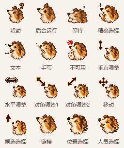 喜乐蒂 · 貂色 | 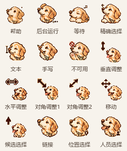 金毛 · 奶油金 | 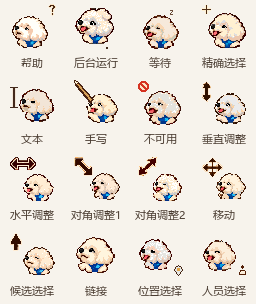 比熊 · 雪白蓝胸背 |
| 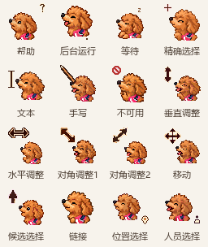 泰迪 · 杏棕粉蓝 | 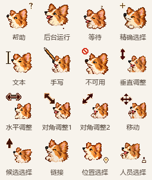 柯基 · 赤金白 | 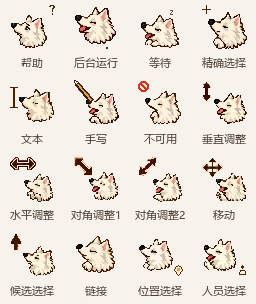 瑞牧 · 雪白 |
| 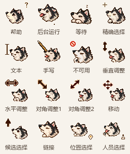 哈士奇 · 黑白棕瞳 | 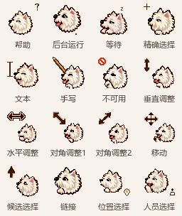 西高地 · 雪白 | 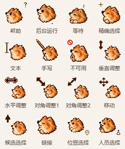 博美 · 橘棕 |
| 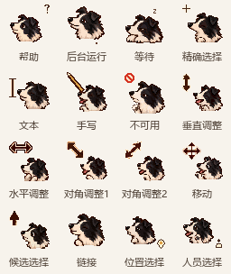 边牧 · 黑白 | 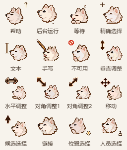 柴犬 · 白柴 | 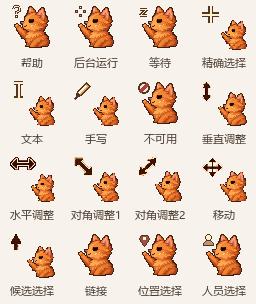 猫咪 · 橘猫 |
| 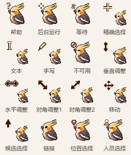 玄凤鹦鹉 · 原始灰 | 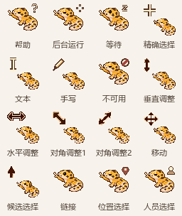 豹纹守宫 · 经典金黄 | 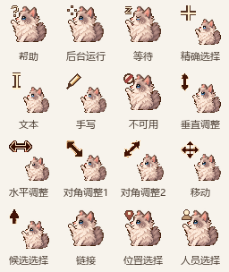 长毛猫 · 布偶 · 蓝双色 |
| 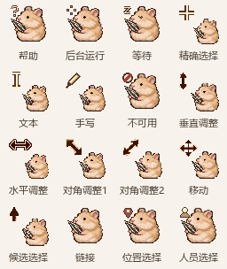 瓜子仓鼠 · 金黄 | 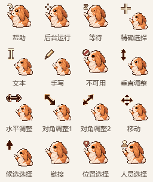 垂耳兔 · 垂耳兔 | 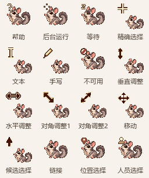 蜜袋鼯 · 蜜袋鼯 |
| 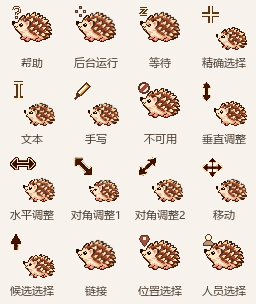 刺猬 · 刺猬 | 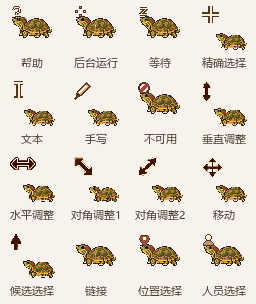 巴西龟 · 巴西龟 | 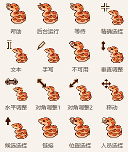 玉米蛇 · 玉米蛇 |
| 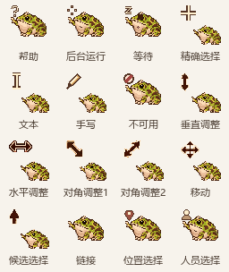 角蛙 · 角蛙 | 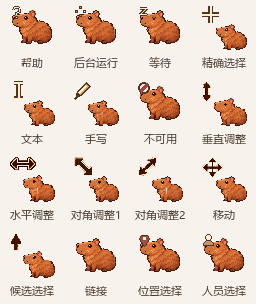 水豚 · 水豚 |  |

[安装说明](docs/使用说明.md) · [制作自己的宠物指针](skills/pet-cursor-theme/SKILL.md) · [小动物源码](other-pets/source/) · [许可与素材授权](ASSETS.md)
