# Pet Mouse Pointer · 宠物鼠标指针

11种狗狗与猫咪、鹦鹉、守宫、仓鼠等小动物，共61款配色，免费下载使用。

## 全部默认动画 · 48px

| 种类 | 配色1 | 配色2 | 配色3 | 配色4 | 配色5 | 配色6 | 配色7 |
|---|---|---|---|---|---|---|---|
| 喜乐蒂 |  貂色 |  深貂色 |  三色 |  蓝陨石 | 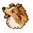 红陨石 |  黑白 |  双色蓝陨石 |
| 金毛 |  奶油金 |  标准金 |  浅金 |  深金 |  |  |  |
| 比熊 |  雪白蓝胸背 |  奶油珊瑚 |  冰白丁香 |  |  |  |  |
| 泰迪 | 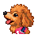 杏棕粉蓝 |  奶油杏 | 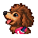 巧克力棕 |  |  |  |  |
| 柯基 |  赤金白 | 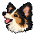 黑头三色 | 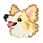 奶油黄白 |  |  |  |  |
| 瑞牧 |  雪白 |  暖米白 |  冰银白 |  |  |  |  |
| 哈士奇 |  黑白棕瞳 |  银灰白 |  红棕白 |  |  |  |  |
| 西高地 |  雪白 |  |  |  |  |  |  |
| 博美 | 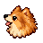 橘棕 |  奶油白 | 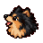 黑棕 |  |  |  |  |
| 边牧 | 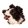 黑白 | 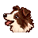 棕白 | 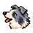 蓝陨石 |  |  |  |  |
| 柴犬 | 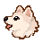 白柴 |  赤柴 |  黑柴 | 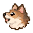 胡麻 |  |  |  |
| 猫咪 |  橘猫 |  橘白 |  黑白猫 |  三花 |  纯白猫 |  |  |
| 玄凤鹦鹉 |  原始灰 | 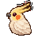 黄化 |  珍珠灰 |  |  |  |  |
| 豹纹守宫 |  经典金黄 |  麦克雪（Mack Snow） |  薰衣草斑 |  |  |  |  |
| 长毛猫 | 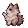 布偶 · 蓝双色 |  长毛猫 · 金渐层 |  长毛猫 · 银渐层 |  |  |  |  |
| 瓜子仓鼠 |  金黄 |  银灰 | 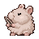 奶白 |  |  |  |  |
| 垂耳兔 | 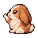 垂耳兔 |  |  |  |  |  |  |
| 蜜袋鼯 |  蜜袋鼯 |  |  |  |  |  |  |
| 刺猬 |  刺猬 |  |  |  |  |  |  |
| 巴西龟 |  巴西龟 |  |  |  |  |  |  |
| 玉米蛇 |  玉米蛇 |  |  |  |  |  |  |
| 角蛙 |  角蛙 |  |  |  |  |  |  |
| 水豚 |  水豚 |  |  |  |  |  |  |

## 其他状态动画 · 48px

各款均展示完整的16种其他状态，与下载包使用同一套实际指针帧。

| 款式 | 帮助选择 | 后台工作 | 忙碌等待 | 精确选择 |
|---|---|---|---|---|
| 喜乐蒂 · 貂色 | 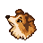 | 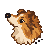 | 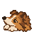 | 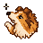 |
| 喜乐蒂 · 深貂色 | 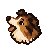 | 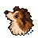 | 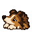 | 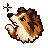 |
| 喜乐蒂 · 三色 | 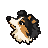 | 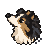 | 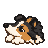 | 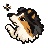 |
| 喜乐蒂 · 蓝陨石 | 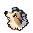 | 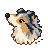 | 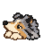 | 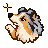 |
| 喜乐蒂 · 红陨石 | 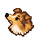 | 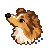 | 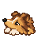 |  |
| 喜乐蒂 · 黑白 | 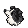 | 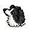 | 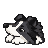 |  |
| 喜乐蒂 · 双色蓝陨石 | 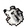 | 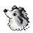 | 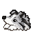 | 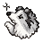 |
| 金毛 · 奶油金 | 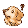 | 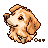 | 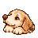 |  |
| 金毛 · 标准金 | 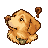 | 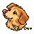 | 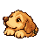 |  |
| 金毛 · 浅金 |  | 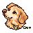 |  | 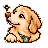 |
| 金毛 · 深金 |  |  |  |  |
| 比熊 · 雪白蓝胸背 |  |  |  |  |
| 比熊 · 奶油珊瑚 |  |  |  |  |
| 比熊 · 冰白丁香 |  |  |  |  |
| 泰迪 · 杏棕粉蓝 |  |  |  |  |
| 泰迪 · 奶油杏 |  |  |  |  |
| 泰迪 · 巧克力棕 |  |  |  |  |
| 柯基 · 赤金白 |  |  |  |  |
| 柯基 · 黑头三色 |  |  |  |  |
| 柯基 · 奶油黄白 |  |  |  |  |
| 瑞牧 · 雪白 |  |  |  |  |
| 瑞牧 · 暖米白 |  |  |  |  |
| 瑞牧 · 冰银白 |  |  |  |  |
| 哈士奇 · 黑白棕瞳 |  |  |  |  |
| 哈士奇 · 银灰白 |  |  |  |  |
| 哈士奇 · 红棕白 |  |  |  |  |
| 西高地 · 雪白 |  |  |  |  |
| 博美 · 橘棕 |  |  |  |  |
| 博美 · 奶油白 |  |  |  |  |
| 博美 · 黑棕 |  |  |  |  |
| 边牧 · 黑白 |  |  |  |  |
| 边牧 · 棕白 |  |  |  |  |
| 边牧 · 蓝陨石 |  |  |  |  |
| 柴犬 · 白柴 |  |  |  |  |
| 柴犬 · 赤柴 |  |  |  |  |
| 柴犬 · 黑柴 |  |  |  |  |
| 柴犬 · 胡麻 |  |  |  |  |
| 猫咪 · 橘猫 |  |  |  |  |
| 猫咪 · 橘白 |  |  |  |  |
| 猫咪 · 黑白猫 |  |  |  |  |
| 猫咪 · 三花 |  |  |  |  |
| 猫咪 · 纯白猫 |  |  |  |  |
| 玄凤鹦鹉 · 原始灰 |  |  |  |  |
| 玄凤鹦鹉 · 黄化 |  |  |  |  |
| 玄凤鹦鹉 · 珍珠灰 |  |  |  |  |
| 豹纹守宫 · 经典金黄 |  |  |  |  |
| 豹纹守宫 · 麦克雪（Mack Snow） |  |  |  |  |
| 豹纹守宫 · 薰衣草斑 |  |  |  |  |
| 布偶 · 蓝双色 |  |  |  |  |
| 长毛猫 · 金渐层 |  |  |  |  |
| 长毛猫 · 银渐层 |  |  |  |  |
| 瓜子仓鼠 · 金黄 |  |  |  |  |
| 瓜子仓鼠 · 银灰 |  |  |  |  |
| 瓜子仓鼠 · 奶白 |  |  |  |  |
| 垂耳兔 |  |  |  |  |
| 蜜袋鼯 |  |  |  |  |
| 刺猬 |  |  |  |  |
| 巴西龟 |  |  |  |  |
| 玉米蛇 |  |  |  |  |
| 角蛙 |  |  |  |  |
| 水豚 |  |  |  |  |

| 款式 | 文本选择 | 手写 | 不可用 | 垂直缩放 |
|---|---|---|---|---|
| 喜乐蒂 · 貂色 |  |  |  |  |
| 喜乐蒂 · 深貂色 |  |  |  |  |
| 喜乐蒂 · 三色 |  |  |  |  |
| 喜乐蒂 · 蓝陨石 |  |  |  |  |
| 喜乐蒂 · 红陨石 |  |  |  |  |
| 喜乐蒂 · 黑白 |  |  |  |  |
| 喜乐蒂 · 双色蓝陨石 |  |  |  |  |
| 金毛 · 奶油金 |  |  |  |  |
| 金毛 · 标准金 |  |  |  |  |
| 金毛 · 浅金 |  |  |  |  |
| 金毛 · 深金 |  |  |  |  |
| 比熊 · 雪白蓝胸背 |  |  |  |  |
| 比熊 · 奶油珊瑚 |  |  |  |  |
| 比熊 · 冰白丁香 |  |  |  |  |
| 泰迪 · 杏棕粉蓝 |  |  |  |  |
| 泰迪 · 奶油杏 |  |  |  |  |
| 泰迪 · 巧克力棕 |  |  |  |  |
| 柯基 · 赤金白 |  |  |  |  |
| 柯基 · 黑头三色 |  |  |  |  |
| 柯基 · 奶油黄白 |  |  |  |  |
| 瑞牧 · 雪白 |  |  |  |  |
| 瑞牧 · 暖米白 |  |  |  |  |
| 瑞牧 · 冰银白 |  |  |  |  |
| 哈士奇 · 黑白棕瞳 |  |  |  |  |
| 哈士奇 · 银灰白 |  |  |  |  |
| 哈士奇 · 红棕白 |  |  |  |  |
| 西高地 · 雪白 |  |  |  |  |
| 博美 · 橘棕 |  |  |  |  |
| 博美 · 奶油白 |  |  |  |  |
| 博美 · 黑棕 |  |  |  |  |
| 边牧 · 黑白 |  |  |  |  |
| 边牧 · 棕白 |  |  |  |  |
| 边牧 · 蓝陨石 |  |  |  |  |
| 柴犬 · 白柴 |  |  |  |  |
| 柴犬 · 赤柴 |  |  |  |  |
| 柴犬 · 黑柴 |  |  |  |  |
| 柴犬 · 胡麻 |  |  |  |  |
| 猫咪 · 橘猫 |  |  |  |  |
| 猫咪 · 橘白 |  |  |  |  |
| 猫咪 · 黑白猫 |  |  |  |  |
| 猫咪 · 三花 |  |  |  |  |
| 猫咪 · 纯白猫 |  |  |  |  |
| 玄凤鹦鹉 · 原始灰 |  |  |  |  |
| 玄凤鹦鹉 · 黄化 |  |  |  |  |
| 玄凤鹦鹉 · 珍珠灰 |  |  |  |  |
| 豹纹守宫 · 经典金黄 |  |  |  |  |
| 豹纹守宫 · 麦克雪（Mack Snow） |  |  |  |  |
| 豹纹守宫 · 薰衣草斑 |  |  |  |  |
| 布偶 · 蓝双色 |  |  |  |  |
| 长毛猫 · 金渐层 |  |  |  |  |
| 长毛猫 · 银渐层 |  |  |  |  |
| 瓜子仓鼠 · 金黄 |  |  |  |  |
| 瓜子仓鼠 · 银灰 |  |  |  |  |
| 瓜子仓鼠 · 奶白 |  |  |  |  |
| 垂耳兔 |  |  |  |  |
| 蜜袋鼯 |  |  |  |  |
| 刺猬 |  |  |  |  |
| 巴西龟 |  |  |  |  |
| 玉米蛇 |  |  |  |  |
| 角蛙 |  |  |  |  |
| 水豚 |  |  |  |  |

| 款式 | 水平缩放 | 左上右下缩放 | 右上左下缩放 | 移动 |
|---|---|---|---|---|
| 喜乐蒂 · 貂色 |  |  |  |  |
| 喜乐蒂 · 深貂色 |  |  |  |  |
| 喜乐蒂 · 三色 |  |  |  |  |
| 喜乐蒂 · 蓝陨石 |  |  |  |  |
| 喜乐蒂 · 红陨石 |  |  |  |  |
| 喜乐蒂 · 黑白 |  |  |  |  |
| 喜乐蒂 · 双色蓝陨石 |  |  |  |  |
| 金毛 · 奶油金 |  |  |  |  |
| 金毛 · 标准金 |  |  |  |  |
| 金毛 · 浅金 |  |  |  |  |
| 金毛 · 深金 |  |  |  |  |
| 比熊 · 雪白蓝胸背 |  |  |  |  |
| 比熊 · 奶油珊瑚 |  |  |  |  |
| 比熊 · 冰白丁香 |  |  |  |  |
| 泰迪 · 杏棕粉蓝 |  |  |  |  |
| 泰迪 · 奶油杏 |  |  |  |  |
| 泰迪 · 巧克力棕 |  |  |  |  |
| 柯基 · 赤金白 |  |  |  |  |
| 柯基 · 黑头三色 |  |  |  |  |
| 柯基 · 奶油黄白 |  |  |  |  |
| 瑞牧 · 雪白 |  |  |  |  |
| 瑞牧 · 暖米白 |  |  |  |  |
| 瑞牧 · 冰银白 |  |  |  |  |
| 哈士奇 · 黑白棕瞳 |  |  |  |  |
| 哈士奇 · 银灰白 |  |  |  |  |
| 哈士奇 · 红棕白 |  |  |  |  |
| 西高地 · 雪白 |  |  |  |  |
| 博美 · 橘棕 |  |  |  |  |
| 博美 · 奶油白 |  |  |  |  |
| 博美 · 黑棕 |  |  |  |  |
| 边牧 · 黑白 |  |  |  |  |
| 边牧 · 棕白 |  |  |  |  |
| 边牧 · 蓝陨石 |  |  |  |  |
| 柴犬 · 白柴 |  |  |  |  |
| 柴犬 · 赤柴 |  |  |  |  |
| 柴犬 · 黑柴 |  |  |  |  |
| 柴犬 · 胡麻 |  |  |  |  |
| 猫咪 · 橘猫 |  |  |  |  |
| 猫咪 · 橘白 |  |  |  |  |
| 猫咪 · 黑白猫 |  |  |  |  |
| 猫咪 · 三花 |  |  |  |  |
| 猫咪 · 纯白猫 |  |  |  |  |
| 玄凤鹦鹉 · 原始灰 |  |  |  |  |
| 玄凤鹦鹉 · 黄化 |  |  |  |  |
| 玄凤鹦鹉 · 珍珠灰 |  |  |  |  |
| 豹纹守宫 · 经典金黄 |  |  |  |  |
| 豹纹守宫 · 麦克雪（Mack Snow） |  |  |  |  |
| 豹纹守宫 · 薰衣草斑 |  |  |  |  |
| 布偶 · 蓝双色 |  |  |  |  |
| 长毛猫 · 金渐层 |  |  |  |  |
| 长毛猫 · 银渐层 |  |  |  |  |
| 瓜子仓鼠 · 金黄 |  |  |  |  |
| 瓜子仓鼠 · 银灰 |  |  |  |  |
| 瓜子仓鼠 · 奶白 |  |  |  |  |
| 垂耳兔 |  |  |  |  |
| 蜜袋鼯 |  |  |  |  |
| 刺猬 |  |  |  |  |
| 巴西龟 |  |  |  |  |
| 玉米蛇 |  |  |  |  |
| 角蛙 |  |  |  |  |
| 水豚 |  |  |  |  |

| 款式 | 候选选择 | 链接选择 | 位置选择 | 人员选择 |
|---|---|---|---|---|
| 喜乐蒂 · 貂色 |  |  |  |  |
| 喜乐蒂 · 深貂色 |  |  |  |  |
| 喜乐蒂 · 三色 |  |  |  |  |
| 喜乐蒂 · 蓝陨石 |  |  |  |  |
| 喜乐蒂 · 红陨石 |  |  |  |  |
| 喜乐蒂 · 黑白 |  |  |  |  |
| 喜乐蒂 · 双色蓝陨石 |  |  |  |  |
| 金毛 · 奶油金 |  |  |  |  |
| 金毛 · 标准金 |  |  |  |  |
| 金毛 · 浅金 |  |  |  |  |
| 金毛 · 深金 |  |  |  |  |
| 比熊 · 雪白蓝胸背 |  |  |  |  |
| 比熊 · 奶油珊瑚 |  |  |  |  |
| 比熊 · 冰白丁香 |  |  |  |  |
| 泰迪 · 杏棕粉蓝 |  |  |  |  |
| 泰迪 · 奶油杏 |  |  |  |  |
| 泰迪 · 巧克力棕 |  |  |  |  |
| 柯基 · 赤金白 |  |  |  |  |
| 柯基 · 黑头三色 |  |  |  |  |
| 柯基 · 奶油黄白 |  |  |  |  |
| 瑞牧 · 雪白 |  |  |  |  |
| 瑞牧 · 暖米白 |  |  |  |  |
| 瑞牧 · 冰银白 |  |  |  |  |
| 哈士奇 · 黑白棕瞳 |  |  |  |  |
| 哈士奇 · 银灰白 |  |  |  |  |
| 哈士奇 · 红棕白 |  |  |  |  |
| 西高地 · 雪白 |  |  |  |  |
| 博美 · 橘棕 |  |  |  |  |
| 博美 · 奶油白 |  |  |  |  |
| 博美 · 黑棕 |  |  |  |  |
| 边牧 · 黑白 |  |  |  |  |
| 边牧 · 棕白 |  |  |  |  |
| 边牧 · 蓝陨石 |  |  |  |  |
| 柴犬 · 白柴 |  |  |  |  |
| 柴犬 · 赤柴 |  |  |  |  |
| 柴犬 · 黑柴 |  |  |  |  |
| 柴犬 · 胡麻 |  |  |  |  |
| 猫咪 · 橘猫 |  |  |  |  |
| 猫咪 · 橘白 |  |  |  |  |
| 猫咪 · 黑白猫 |  |  |  |  |
| 猫咪 · 三花 |  |  |  |  |
| 猫咪 · 纯白猫 |  |  |  |  |
| 玄凤鹦鹉 · 原始灰 |  |  |  |  |
| 玄凤鹦鹉 · 黄化 |  |  |  |  |
| 玄凤鹦鹉 · 珍珠灰 |  |  |  |  |
| 豹纹守宫 · 经典金黄 |  |  |  |  |
| 豹纹守宫 · 麦克雪（Mack Snow） |  |  |  |  |
| 豹纹守宫 · 薰衣草斑 |  |  |  |  |
| 布偶 · 蓝双色 |  |  |  |  |
| 长毛猫 · 金渐层 |  |  |  |  |
| 长毛猫 · 银渐层 |  |  |  |  |
| 瓜子仓鼠 · 金黄 |  |  |  |  |
| 瓜子仓鼠 · 银灰 |  |  |  |  |
| 瓜子仓鼠 · 奶白 |  |  |  |  |
| 垂耳兔 |  |  |  |  |
| 蜜袋鼯 |  |  |  |  |
| 刺猬 |  |  |  |  |
| 巴西龟 |  |  |  |  |
| 玉米蛇 |  |  |  |  |
| 角蛙 |  |  |  |  |
| 水豚 |  |  |  |  |

## 按款下载

完整解压后再安装。每款均提供Windows、macOS和Linux版本，安装包只包含使用所需文件。

| 款式 | Windows | macOS | Linux／麒麟／UOS |
|---|---|---|---|
| 喜乐蒂 · 貂色 | [下载](https://raw.githubusercontent.com/CYemin/Pet-mouse-pointer/main/downloads/themes/pet-pixel-complete-windows.zip) | [下载](https://raw.githubusercontent.com/CYemin/Pet-mouse-pointer/main/downloads/themes/pet-pixel-complete-macos.zip) | [下载](https://raw.githubusercontent.com/CYemin/Pet-mouse-pointer/main/downloads/themes/pet-pixel-complete-linux.tar.gz) |
| 喜乐蒂 · 深貂色 | [下载](https://raw.githubusercontent.com/CYemin/Pet-mouse-pointer/main/downloads/themes/sheltie-dark-sable-pixel-windows.zip) | [下载](https://raw.githubusercontent.com/CYemin/Pet-mouse-pointer/main/downloads/themes/sheltie-dark-sable-pixel-macos.zip) | [下载](https://raw.githubusercontent.com/CYemin/Pet-mouse-pointer/main/downloads/themes/sheltie-dark-sable-pixel-linux.tar.gz) |
| 喜乐蒂 · 三色 | [下载](https://raw.githubusercontent.com/CYemin/Pet-mouse-pointer/main/downloads/themes/sheltie-tricolor-pixel-windows.zip) | [下载](https://raw.githubusercontent.com/CYemin/Pet-mouse-pointer/main/downloads/themes/sheltie-tricolor-pixel-macos.zip) | [下载](https://raw.githubusercontent.com/CYemin/Pet-mouse-pointer/main/downloads/themes/sheltie-tricolor-pixel-linux.tar.gz) |
| 喜乐蒂 · 蓝陨石 | [下载](https://raw.githubusercontent.com/CYemin/Pet-mouse-pointer/main/downloads/themes/sheltie-blue-merle-pixel-windows.zip) | [下载](https://raw.githubusercontent.com/CYemin/Pet-mouse-pointer/main/downloads/themes/sheltie-blue-merle-pixel-macos.zip) | [下载](https://raw.githubusercontent.com/CYemin/Pet-mouse-pointer/main/downloads/themes/sheltie-blue-merle-pixel-linux.tar.gz) |
| 喜乐蒂 · 红陨石 | [下载](https://raw.githubusercontent.com/CYemin/Pet-mouse-pointer/main/downloads/themes/sheltie-red-merle-pixel-windows.zip) | [下载](https://raw.githubusercontent.com/CYemin/Pet-mouse-pointer/main/downloads/themes/sheltie-red-merle-pixel-macos.zip) | [下载](https://raw.githubusercontent.com/CYemin/Pet-mouse-pointer/main/downloads/themes/sheltie-red-merle-pixel-linux.tar.gz) |
| 喜乐蒂 · 黑白 | [下载](https://raw.githubusercontent.com/CYemin/Pet-mouse-pointer/main/downloads/themes/sheltie-bi-black-pixel-windows.zip) | [下载](https://raw.githubusercontent.com/CYemin/Pet-mouse-pointer/main/downloads/themes/sheltie-bi-black-pixel-macos.zip) | [下载](https://raw.githubusercontent.com/CYemin/Pet-mouse-pointer/main/downloads/themes/sheltie-bi-black-pixel-linux.tar.gz) |
| 喜乐蒂 · 双色蓝陨石 | [下载](https://raw.githubusercontent.com/CYemin/Pet-mouse-pointer/main/downloads/themes/sheltie-bi-blue-pixel-windows.zip) | [下载](https://raw.githubusercontent.com/CYemin/Pet-mouse-pointer/main/downloads/themes/sheltie-bi-blue-pixel-macos.zip) | [下载](https://raw.githubusercontent.com/CYemin/Pet-mouse-pointer/main/downloads/themes/sheltie-bi-blue-pixel-linux.tar.gz) |
| 金毛 · 奶油金 | [下载](https://raw.githubusercontent.com/CYemin/Pet-mouse-pointer/main/downloads/themes/golden-cream-pixel-windows.zip) | [下载](https://raw.githubusercontent.com/CYemin/Pet-mouse-pointer/main/downloads/themes/golden-cream-pixel-macos.zip) | [下载](https://raw.githubusercontent.com/CYemin/Pet-mouse-pointer/main/downloads/themes/golden-cream-pixel-linux.tar.gz) |
| 金毛 · 标准金 | [下载](https://raw.githubusercontent.com/CYemin/Pet-mouse-pointer/main/downloads/themes/golden-standard-pixel-windows.zip) | [下载](https://raw.githubusercontent.com/CYemin/Pet-mouse-pointer/main/downloads/themes/golden-standard-pixel-macos.zip) | [下载](https://raw.githubusercontent.com/CYemin/Pet-mouse-pointer/main/downloads/themes/golden-standard-pixel-linux.tar.gz) |
| 金毛 · 浅金 | [下载](https://raw.githubusercontent.com/CYemin/Pet-mouse-pointer/main/downloads/themes/golden-light-pixel-windows.zip) | [下载](https://raw.githubusercontent.com/CYemin/Pet-mouse-pointer/main/downloads/themes/golden-light-pixel-macos.zip) | [下载](https://raw.githubusercontent.com/CYemin/Pet-mouse-pointer/main/downloads/themes/golden-light-pixel-linux.tar.gz) |
| 金毛 · 深金 | [下载](https://raw.githubusercontent.com/CYemin/Pet-mouse-pointer/main/downloads/themes/golden-dark-pixel-windows.zip) | [下载](https://raw.githubusercontent.com/CYemin/Pet-mouse-pointer/main/downloads/themes/golden-dark-pixel-macos.zip) | [下载](https://raw.githubusercontent.com/CYemin/Pet-mouse-pointer/main/downloads/themes/golden-dark-pixel-linux.tar.gz) |
| 比熊 · 雪白蓝胸背 | [下载](https://raw.githubusercontent.com/CYemin/Pet-mouse-pointer/main/downloads/themes/bichon-photo-v3-windows.zip) | [下载](https://raw.githubusercontent.com/CYemin/Pet-mouse-pointer/main/downloads/themes/bichon-photo-v3-macos.zip) | [下载](https://raw.githubusercontent.com/CYemin/Pet-mouse-pointer/main/downloads/themes/bichon-photo-v3-linux.tar.gz) |
| 比熊 · 奶油珊瑚 | [下载](https://raw.githubusercontent.com/CYemin/Pet-mouse-pointer/main/downloads/themes/bichon-cream-coral-v5-windows.zip) | [下载](https://raw.githubusercontent.com/CYemin/Pet-mouse-pointer/main/downloads/themes/bichon-cream-coral-v5-macos.zip) | [下载](https://raw.githubusercontent.com/CYemin/Pet-mouse-pointer/main/downloads/themes/bichon-cream-coral-v5-linux.tar.gz) |
| 比熊 · 冰白丁香 | [下载](https://raw.githubusercontent.com/CYemin/Pet-mouse-pointer/main/downloads/themes/bichon-ice-lilac-v5-windows.zip) | [下载](https://raw.githubusercontent.com/CYemin/Pet-mouse-pointer/main/downloads/themes/bichon-ice-lilac-v5-macos.zip) | [下载](https://raw.githubusercontent.com/CYemin/Pet-mouse-pointer/main/downloads/themes/bichon-ice-lilac-v5-linux.tar.gz) |
| 泰迪 · 杏棕粉蓝 | [下载](https://raw.githubusercontent.com/CYemin/Pet-mouse-pointer/main/downloads/themes/teddy-profile-v6-windows.zip) | [下载](https://raw.githubusercontent.com/CYemin/Pet-mouse-pointer/main/downloads/themes/teddy-profile-v6-macos.zip) | [下载](https://raw.githubusercontent.com/CYemin/Pet-mouse-pointer/main/downloads/themes/teddy-profile-v6-linux.tar.gz) |
| 泰迪 · 奶油杏 | [下载](https://raw.githubusercontent.com/CYemin/Pet-mouse-pointer/main/downloads/themes/teddy-cream-profile-v6-windows.zip) | [下载](https://raw.githubusercontent.com/CYemin/Pet-mouse-pointer/main/downloads/themes/teddy-cream-profile-v6-macos.zip) | [下载](https://raw.githubusercontent.com/CYemin/Pet-mouse-pointer/main/downloads/themes/teddy-cream-profile-v6-linux.tar.gz) |
| 泰迪 · 巧克力棕 | [下载](https://raw.githubusercontent.com/CYemin/Pet-mouse-pointer/main/downloads/themes/teddy-chocolate-profile-v6-windows.zip) | [下载](https://raw.githubusercontent.com/CYemin/Pet-mouse-pointer/main/downloads/themes/teddy-chocolate-profile-v6-macos.zip) | [下载](https://raw.githubusercontent.com/CYemin/Pet-mouse-pointer/main/downloads/themes/teddy-chocolate-profile-v6-linux.tar.gz) |
| 柯基 · 赤金白 | [下载](https://raw.githubusercontent.com/CYemin/Pet-mouse-pointer/main/downloads/themes/corgi-photo-v3-windows.zip) | [下载](https://raw.githubusercontent.com/CYemin/Pet-mouse-pointer/main/downloads/themes/corgi-photo-v3-macos.zip) | [下载](https://raw.githubusercontent.com/CYemin/Pet-mouse-pointer/main/downloads/themes/corgi-photo-v3-linux.tar.gz) |
| 柯基 · 黑头三色 | [下载](https://raw.githubusercontent.com/CYemin/Pet-mouse-pointer/main/downloads/themes/corgi-tricolor-v5-windows.zip) | [下载](https://raw.githubusercontent.com/CYemin/Pet-mouse-pointer/main/downloads/themes/corgi-tricolor-v5-macos.zip) | [下载](https://raw.githubusercontent.com/CYemin/Pet-mouse-pointer/main/downloads/themes/corgi-tricolor-v5-linux.tar.gz) |
| 柯基 · 奶油黄白 | [下载](https://raw.githubusercontent.com/CYemin/Pet-mouse-pointer/main/downloads/themes/corgi-cream-v5-windows.zip) | [下载](https://raw.githubusercontent.com/CYemin/Pet-mouse-pointer/main/downloads/themes/corgi-cream-v5-macos.zip) | [下载](https://raw.githubusercontent.com/CYemin/Pet-mouse-pointer/main/downloads/themes/corgi-cream-v5-linux.tar.gz) |
| 瑞牧 · 雪白 | [下载](https://raw.githubusercontent.com/CYemin/Pet-mouse-pointer/main/downloads/themes/swiss-profile-v6-windows.zip) | [下载](https://raw.githubusercontent.com/CYemin/Pet-mouse-pointer/main/downloads/themes/swiss-profile-v6-macos.zip) | [下载](https://raw.githubusercontent.com/CYemin/Pet-mouse-pointer/main/downloads/themes/swiss-profile-v6-linux.tar.gz) |
| 瑞牧 · 暖米白 | [下载](https://raw.githubusercontent.com/CYemin/Pet-mouse-pointer/main/downloads/themes/swiss-ivory-profile-v6-windows.zip) | [下载](https://raw.githubusercontent.com/CYemin/Pet-mouse-pointer/main/downloads/themes/swiss-ivory-profile-v6-macos.zip) | [下载](https://raw.githubusercontent.com/CYemin/Pet-mouse-pointer/main/downloads/themes/swiss-ivory-profile-v6-linux.tar.gz) |
| 瑞牧 · 冰银白 | [下载](https://raw.githubusercontent.com/CYemin/Pet-mouse-pointer/main/downloads/themes/swiss-ice-profile-v6-windows.zip) | [下载](https://raw.githubusercontent.com/CYemin/Pet-mouse-pointer/main/downloads/themes/swiss-ice-profile-v6-macos.zip) | [下载](https://raw.githubusercontent.com/CYemin/Pet-mouse-pointer/main/downloads/themes/swiss-ice-profile-v6-linux.tar.gz) |
| 哈士奇 · 黑白棕瞳 | [下载](https://raw.githubusercontent.com/CYemin/Pet-mouse-pointer/main/downloads/themes/husky-profile-v6-windows.zip) | [下载](https://raw.githubusercontent.com/CYemin/Pet-mouse-pointer/main/downloads/themes/husky-profile-v6-macos.zip) | [下载](https://raw.githubusercontent.com/CYemin/Pet-mouse-pointer/main/downloads/themes/husky-profile-v6-linux.tar.gz) |
| 哈士奇 · 银灰白 | [下载](https://raw.githubusercontent.com/CYemin/Pet-mouse-pointer/main/downloads/themes/husky-silver-profile-v6-windows.zip) | [下载](https://raw.githubusercontent.com/CYemin/Pet-mouse-pointer/main/downloads/themes/husky-silver-profile-v6-macos.zip) | [下载](https://raw.githubusercontent.com/CYemin/Pet-mouse-pointer/main/downloads/themes/husky-silver-profile-v6-linux.tar.gz) |
| 哈士奇 · 红棕白 | [下载](https://raw.githubusercontent.com/CYemin/Pet-mouse-pointer/main/downloads/themes/husky-red-profile-v6-windows.zip) | [下载](https://raw.githubusercontent.com/CYemin/Pet-mouse-pointer/main/downloads/themes/husky-red-profile-v6-macos.zip) | [下载](https://raw.githubusercontent.com/CYemin/Pet-mouse-pointer/main/downloads/themes/husky-red-profile-v6-linux.tar.gz) |
| 西高地 · 雪白 | [下载](https://raw.githubusercontent.com/CYemin/Pet-mouse-pointer/main/downloads/themes/westie-profile-v1-windows.zip) | [下载](https://raw.githubusercontent.com/CYemin/Pet-mouse-pointer/main/downloads/themes/westie-profile-v1-macos.zip) | [下载](https://raw.githubusercontent.com/CYemin/Pet-mouse-pointer/main/downloads/themes/westie-profile-v1-linux.tar.gz) |
| 博美 · 橘棕 | [下载](https://raw.githubusercontent.com/CYemin/Pet-mouse-pointer/main/downloads/themes/pomeranian-orange-v1-windows.zip) | [下载](https://raw.githubusercontent.com/CYemin/Pet-mouse-pointer/main/downloads/themes/pomeranian-orange-v1-macos.zip) | [下载](https://raw.githubusercontent.com/CYemin/Pet-mouse-pointer/main/downloads/themes/pomeranian-orange-v1-linux.tar.gz) |
| 博美 · 奶油白 | [下载](https://raw.githubusercontent.com/CYemin/Pet-mouse-pointer/main/downloads/themes/pomeranian-cream-v1-windows.zip) | [下载](https://raw.githubusercontent.com/CYemin/Pet-mouse-pointer/main/downloads/themes/pomeranian-cream-v1-macos.zip) | [下载](https://raw.githubusercontent.com/CYemin/Pet-mouse-pointer/main/downloads/themes/pomeranian-cream-v1-linux.tar.gz) |
| 博美 · 黑棕 | [下载](https://raw.githubusercontent.com/CYemin/Pet-mouse-pointer/main/downloads/themes/pomeranian-black-tan-v1-windows.zip) | [下载](https://raw.githubusercontent.com/CYemin/Pet-mouse-pointer/main/downloads/themes/pomeranian-black-tan-v1-macos.zip) | [下载](https://raw.githubusercontent.com/CYemin/Pet-mouse-pointer/main/downloads/themes/pomeranian-black-tan-v1-linux.tar.gz) |
| 边牧 · 黑白 | [下载](https://raw.githubusercontent.com/CYemin/Pet-mouse-pointer/main/downloads/themes/border-collie-black-white-v1-windows.zip) | [下载](https://raw.githubusercontent.com/CYemin/Pet-mouse-pointer/main/downloads/themes/border-collie-black-white-v1-macos.zip) | [下载](https://raw.githubusercontent.com/CYemin/Pet-mouse-pointer/main/downloads/themes/border-collie-black-white-v1-linux.tar.gz) |
| 边牧 · 棕白 | [下载](https://raw.githubusercontent.com/CYemin/Pet-mouse-pointer/main/downloads/themes/border-collie-brown-white-v1-windows.zip) | [下载](https://raw.githubusercontent.com/CYemin/Pet-mouse-pointer/main/downloads/themes/border-collie-brown-white-v1-macos.zip) | [下载](https://raw.githubusercontent.com/CYemin/Pet-mouse-pointer/main/downloads/themes/border-collie-brown-white-v1-linux.tar.gz) |
| 边牧 · 蓝陨石 | [下载](https://raw.githubusercontent.com/CYemin/Pet-mouse-pointer/main/downloads/themes/border-collie-blue-merle-v1-windows.zip) | [下载](https://raw.githubusercontent.com/CYemin/Pet-mouse-pointer/main/downloads/themes/border-collie-blue-merle-v1-macos.zip) | [下载](https://raw.githubusercontent.com/CYemin/Pet-mouse-pointer/main/downloads/themes/border-collie-blue-merle-v1-linux.tar.gz) |
| 柴犬 · 白柴 | [下载](https://raw.githubusercontent.com/CYemin/Pet-mouse-pointer/main/downloads/themes/shiba-white-v1-windows.zip) | [下载](https://raw.githubusercontent.com/CYemin/Pet-mouse-pointer/main/downloads/themes/shiba-white-v1-macos.zip) | [下载](https://raw.githubusercontent.com/CYemin/Pet-mouse-pointer/main/downloads/themes/shiba-white-v1-linux.tar.gz) |
| 柴犬 · 赤柴 | [下载](https://raw.githubusercontent.com/CYemin/Pet-mouse-pointer/main/downloads/themes/shiba-red-v1-windows.zip) | [下载](https://raw.githubusercontent.com/CYemin/Pet-mouse-pointer/main/downloads/themes/shiba-red-v1-macos.zip) | [下载](https://raw.githubusercontent.com/CYemin/Pet-mouse-pointer/main/downloads/themes/shiba-red-v1-linux.tar.gz) |
| 柴犬 · 黑柴 | [下载](https://raw.githubusercontent.com/CYemin/Pet-mouse-pointer/main/downloads/themes/shiba-black-tan-v1-windows.zip) | [下载](https://raw.githubusercontent.com/CYemin/Pet-mouse-pointer/main/downloads/themes/shiba-black-tan-v1-macos.zip) | [下载](https://raw.githubusercontent.com/CYemin/Pet-mouse-pointer/main/downloads/themes/shiba-black-tan-v1-linux.tar.gz) |
| 柴犬 · 胡麻 | [下载](https://raw.githubusercontent.com/CYemin/Pet-mouse-pointer/main/downloads/themes/shiba-sesame-v1-windows.zip) | [下载](https://raw.githubusercontent.com/CYemin/Pet-mouse-pointer/main/downloads/themes/shiba-sesame-v1-macos.zip) | [下载](https://raw.githubusercontent.com/CYemin/Pet-mouse-pointer/main/downloads/themes/shiba-sesame-v1-linux.tar.gz) |
| 猫咪 · 橘猫 | [下载](https://raw.githubusercontent.com/CYemin/Pet-mouse-pointer/main/downloads/themes/cat-windows.zip) | [下载](https://raw.githubusercontent.com/CYemin/Pet-mouse-pointer/main/downloads/themes/cat-macos.zip) | [下载](https://raw.githubusercontent.com/CYemin/Pet-mouse-pointer/main/downloads/themes/cat-linux.tar.gz) |
| 猫咪 · 橘白 | [下载](https://raw.githubusercontent.com/CYemin/Pet-mouse-pointer/main/downloads/themes/cat-silver-windows.zip) | [下载](https://raw.githubusercontent.com/CYemin/Pet-mouse-pointer/main/downloads/themes/cat-silver-macos.zip) | [下载](https://raw.githubusercontent.com/CYemin/Pet-mouse-pointer/main/downloads/themes/cat-silver-linux.tar.gz) |
| 猫咪 · 黑白猫 | [下载](https://raw.githubusercontent.com/CYemin/Pet-mouse-pointer/main/downloads/themes/cat-tuxedo-windows.zip) | [下载](https://raw.githubusercontent.com/CYemin/Pet-mouse-pointer/main/downloads/themes/cat-tuxedo-macos.zip) | [下载](https://raw.githubusercontent.com/CYemin/Pet-mouse-pointer/main/downloads/themes/cat-tuxedo-linux.tar.gz) |
| 猫咪 · 三花 | [下载](https://raw.githubusercontent.com/CYemin/Pet-mouse-pointer/main/downloads/themes/cat-calico-windows.zip) | [下载](https://raw.githubusercontent.com/CYemin/Pet-mouse-pointer/main/downloads/themes/cat-calico-macos.zip) | [下载](https://raw.githubusercontent.com/CYemin/Pet-mouse-pointer/main/downloads/themes/cat-calico-linux.tar.gz) |
| 猫咪 · 纯白猫 | [下载](https://raw.githubusercontent.com/CYemin/Pet-mouse-pointer/main/downloads/themes/cat-cream-windows.zip) | [下载](https://raw.githubusercontent.com/CYemin/Pet-mouse-pointer/main/downloads/themes/cat-cream-macos.zip) | [下载](https://raw.githubusercontent.com/CYemin/Pet-mouse-pointer/main/downloads/themes/cat-cream-linux.tar.gz) |
| 玄凤鹦鹉 · 原始灰 | [下载](https://raw.githubusercontent.com/CYemin/Pet-mouse-pointer/main/downloads/themes/cockatiel-windows.zip) | [下载](https://raw.githubusercontent.com/CYemin/Pet-mouse-pointer/main/downloads/themes/cockatiel-macos.zip) | [下载](https://raw.githubusercontent.com/CYemin/Pet-mouse-pointer/main/downloads/themes/cockatiel-linux.tar.gz) |
| 玄凤鹦鹉 · 黄化 | [下载](https://raw.githubusercontent.com/CYemin/Pet-mouse-pointer/main/downloads/themes/cockatiel-lutino-windows.zip) | [下载](https://raw.githubusercontent.com/CYemin/Pet-mouse-pointer/main/downloads/themes/cockatiel-lutino-macos.zip) | [下载](https://raw.githubusercontent.com/CYemin/Pet-mouse-pointer/main/downloads/themes/cockatiel-lutino-linux.tar.gz) |
| 玄凤鹦鹉 · 珍珠灰 | [下载](https://raw.githubusercontent.com/CYemin/Pet-mouse-pointer/main/downloads/themes/cockatiel-pearl-windows.zip) | [下载](https://raw.githubusercontent.com/CYemin/Pet-mouse-pointer/main/downloads/themes/cockatiel-pearl-macos.zip) | [下载](https://raw.githubusercontent.com/CYemin/Pet-mouse-pointer/main/downloads/themes/cockatiel-pearl-linux.tar.gz) |
| 豹纹守宫 · 经典金黄 | [下载](https://raw.githubusercontent.com/CYemin/Pet-mouse-pointer/main/downloads/themes/gecko-windows.zip) | [下载](https://raw.githubusercontent.com/CYemin/Pet-mouse-pointer/main/downloads/themes/gecko-macos.zip) | [下载](https://raw.githubusercontent.com/CYemin/Pet-mouse-pointer/main/downloads/themes/gecko-linux.tar.gz) |
| 豹纹守宫 · 麦克雪（Mack Snow） | [下载](https://raw.githubusercontent.com/CYemin/Pet-mouse-pointer/main/downloads/themes/gecko-snow-windows.zip) | [下载](https://raw.githubusercontent.com/CYemin/Pet-mouse-pointer/main/downloads/themes/gecko-snow-macos.zip) | [下载](https://raw.githubusercontent.com/CYemin/Pet-mouse-pointer/main/downloads/themes/gecko-snow-linux.tar.gz) |
| 豹纹守宫 · 薰衣草斑 | [下载](https://raw.githubusercontent.com/CYemin/Pet-mouse-pointer/main/downloads/themes/gecko-lavender-windows.zip) | [下载](https://raw.githubusercontent.com/CYemin/Pet-mouse-pointer/main/downloads/themes/gecko-lavender-macos.zip) | [下载](https://raw.githubusercontent.com/CYemin/Pet-mouse-pointer/main/downloads/themes/gecko-lavender-linux.tar.gz) |
| 布偶 · 蓝双色 | [下载](https://raw.githubusercontent.com/CYemin/Pet-mouse-pointer/main/downloads/themes/longhair-ragdoll-windows.zip) | [下载](https://raw.githubusercontent.com/CYemin/Pet-mouse-pointer/main/downloads/themes/longhair-ragdoll-macos.zip) | [下载](https://raw.githubusercontent.com/CYemin/Pet-mouse-pointer/main/downloads/themes/longhair-ragdoll-linux.tar.gz) |
| 长毛猫 · 金渐层 | [下载](https://raw.githubusercontent.com/CYemin/Pet-mouse-pointer/main/downloads/themes/longhair-golden-windows.zip) | [下载](https://raw.githubusercontent.com/CYemin/Pet-mouse-pointer/main/downloads/themes/longhair-golden-macos.zip) | [下载](https://raw.githubusercontent.com/CYemin/Pet-mouse-pointer/main/downloads/themes/longhair-golden-linux.tar.gz) |
| 长毛猫 · 银渐层 | [下载](https://raw.githubusercontent.com/CYemin/Pet-mouse-pointer/main/downloads/themes/longhair-silver-windows.zip) | [下载](https://raw.githubusercontent.com/CYemin/Pet-mouse-pointer/main/downloads/themes/longhair-silver-macos.zip) | [下载](https://raw.githubusercontent.com/CYemin/Pet-mouse-pointer/main/downloads/themes/longhair-silver-linux.tar.gz) |
| 瓜子仓鼠 · 金黄 | [下载](https://raw.githubusercontent.com/CYemin/Pet-mouse-pointer/main/downloads/themes/seed-hamster-golden-windows.zip) | [下载](https://raw.githubusercontent.com/CYemin/Pet-mouse-pointer/main/downloads/themes/seed-hamster-golden-macos.zip) | [下载](https://raw.githubusercontent.com/CYemin/Pet-mouse-pointer/main/downloads/themes/seed-hamster-golden-linux.tar.gz) |
| 瓜子仓鼠 · 银灰 | [下载](https://raw.githubusercontent.com/CYemin/Pet-mouse-pointer/main/downloads/themes/seed-hamster-silver-windows.zip) | [下载](https://raw.githubusercontent.com/CYemin/Pet-mouse-pointer/main/downloads/themes/seed-hamster-silver-macos.zip) | [下载](https://raw.githubusercontent.com/CYemin/Pet-mouse-pointer/main/downloads/themes/seed-hamster-silver-linux.tar.gz) |
| 瓜子仓鼠 · 奶白 | [下载](https://raw.githubusercontent.com/CYemin/Pet-mouse-pointer/main/downloads/themes/seed-hamster-ivory-windows.zip) | [下载](https://raw.githubusercontent.com/CYemin/Pet-mouse-pointer/main/downloads/themes/seed-hamster-ivory-macos.zip) | [下载](https://raw.githubusercontent.com/CYemin/Pet-mouse-pointer/main/downloads/themes/seed-hamster-ivory-linux.tar.gz) |
| 垂耳兔 | [下载](https://raw.githubusercontent.com/CYemin/Pet-mouse-pointer/main/downloads/themes/lop-rabbit-windows.zip) | [下载](https://raw.githubusercontent.com/CYemin/Pet-mouse-pointer/main/downloads/themes/lop-rabbit-macos.zip) | [下载](https://raw.githubusercontent.com/CYemin/Pet-mouse-pointer/main/downloads/themes/lop-rabbit-linux.tar.gz) |
| 蜜袋鼯 | [下载](https://raw.githubusercontent.com/CYemin/Pet-mouse-pointer/main/downloads/themes/sugar-glider-windows.zip) | [下载](https://raw.githubusercontent.com/CYemin/Pet-mouse-pointer/main/downloads/themes/sugar-glider-macos.zip) | [下载](https://raw.githubusercontent.com/CYemin/Pet-mouse-pointer/main/downloads/themes/sugar-glider-linux.tar.gz) |
| 刺猬 | [下载](https://raw.githubusercontent.com/CYemin/Pet-mouse-pointer/main/downloads/themes/hedgehog-windows.zip) | [下载](https://raw.githubusercontent.com/CYemin/Pet-mouse-pointer/main/downloads/themes/hedgehog-macos.zip) | [下载](https://raw.githubusercontent.com/CYemin/Pet-mouse-pointer/main/downloads/themes/hedgehog-linux.tar.gz) |
| 巴西龟 | [下载](https://raw.githubusercontent.com/CYemin/Pet-mouse-pointer/main/downloads/themes/red-eared-slider-windows.zip) | [下载](https://raw.githubusercontent.com/CYemin/Pet-mouse-pointer/main/downloads/themes/red-eared-slider-macos.zip) | [下载](https://raw.githubusercontent.com/CYemin/Pet-mouse-pointer/main/downloads/themes/red-eared-slider-linux.tar.gz) |
| 玉米蛇 | [下载](https://raw.githubusercontent.com/CYemin/Pet-mouse-pointer/main/downloads/themes/corn-snake-windows.zip) | [下载](https://raw.githubusercontent.com/CYemin/Pet-mouse-pointer/main/downloads/themes/corn-snake-macos.zip) | [下载](https://raw.githubusercontent.com/CYemin/Pet-mouse-pointer/main/downloads/themes/corn-snake-linux.tar.gz) |
| 角蛙 | [下载](https://raw.githubusercontent.com/CYemin/Pet-mouse-pointer/main/downloads/themes/pacman-frog-windows.zip) | [下载](https://raw.githubusercontent.com/CYemin/Pet-mouse-pointer/main/downloads/themes/pacman-frog-macos.zip) | [下载](https://raw.githubusercontent.com/CYemin/Pet-mouse-pointer/main/downloads/themes/pacman-frog-linux.tar.gz) |
| 水豚 | [下载](https://raw.githubusercontent.com/CYemin/Pet-mouse-pointer/main/downloads/themes/capybara-windows.zip) | [下载](https://raw.githubusercontent.com/CYemin/Pet-mouse-pointer/main/downloads/themes/capybara-macos.zip) | [下载](https://raw.githubusercontent.com/CYemin/Pet-mouse-pointer/main/downloads/themes/capybara-linux.tar.gz) |

## 合集下载

合集按「系统／种类／颜色」排列；进入所选颜色目录安装。

| 范围 | 款数 | Windows | macOS | Linux／麒麟／UOS |
|---|---:|---|---|---|
| 全部狗狗 | 37 | [下载](https://raw.githubusercontent.com/CYemin/Pet-mouse-pointer/main/downloads/collections/dogs-windows.zip) | [下载](https://raw.githubusercontent.com/CYemin/Pet-mouse-pointer/main/downloads/collections/dogs-macos.zip) | [下载](https://raw.githubusercontent.com/CYemin/Pet-mouse-pointer/main/downloads/collections/dogs-linux.tar.gz) |
| 其他小动物 | 24 | [下载](https://raw.githubusercontent.com/CYemin/Pet-mouse-pointer/main/downloads/collections/animals-windows.zip) | [下载](https://raw.githubusercontent.com/CYemin/Pet-mouse-pointer/main/downloads/collections/animals-macos.zip) | [下载](https://raw.githubusercontent.com/CYemin/Pet-mouse-pointer/main/downloads/collections/animals-linux.tar.gz) |

## 安装、调整与恢复

| 系统 | 安装 | 尺寸 | 恢复 |
|---|---|---|---|
| Windows | 完整解压，双击所选颜色目录中的`安装鼠标主题.cmd` | 默认48px；包内提供32／48／64／96／128px入口，只调整当前款式 | 双击`恢复原鼠标.cmd`，恢复安装前的设置 |
| macOS | 安装[Mousecape](https://github.com/alexzielenski/Mousecape/releases)，导入所选.cape，选中后Apply | 32pt／48pt，含1×／2×图像 | Mousecape菜单`Capes → Restore Defaults` |
| Linux／麒麟／UOS | 按颜色目录中的说明复制到用户图标目录，在桌面外观设置中选择 | 32／48／64／96／128px，取决于桌面设置 | 在外观设置中选回原主题 |

Windows安装和调整均无需Python，主题源目录请完整保留。Windows 7使用兼容入口和15种系统支持的光标；较新Windows使用17种。macOS映射13组源状态，兼容普通与Retina显示；其余角色保留系统行为。

## 测试与制作

[小动物48px离线测试页](https://raw.githubusercontent.com/CYemin/Pet-mouse-pointer/main/other-pets/downloads/offline-24-pets.zip) · [小动物源码与重建](other-pets/source/) · [制作自己的宠物指针](skills/pet-cursor-theme/SKILL.md) · [本次打包核验](docs/unified-packages-verification.json)

Windows已检查原生加载绘制与安装／恢复预演；macOS、Linux已检查导出格式，实机安装、多屏与DPI体验尚未验证。

## 使用许可

全部主题均可免费下载、安装和使用。代码采用[MIT许可](LICENSE)；24款小动物扩展的生成指针美术同样采用[MIT许可](other-pets/LICENSE)。原有狗狗主题美术的修改、分享和商业使用范围见[素材授权说明](ASSETS.md)，各安装包均附相应许可。

## 致谢

感谢 🍠 不要芋泥要啵啵 的反馈。
