# Pet Mouse Pointer · 宠物鼠标指针

8种狗狗，27款配色。粗像素动画，把每一次点击变成一点陪伴。

## 先认识八位伙伴

| 喜乐蒂 | 金毛 | 比熊 | 泰迪 | 柯基 | 瑞牧 | 二哈 | 西高地 |
|---|---|---|---|---|---|---|---|
| 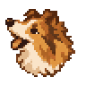 |  |  | 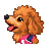 | 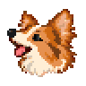 | 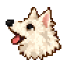 | 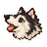 | 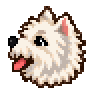 |

## 全部颜色 · 每行一个犬种

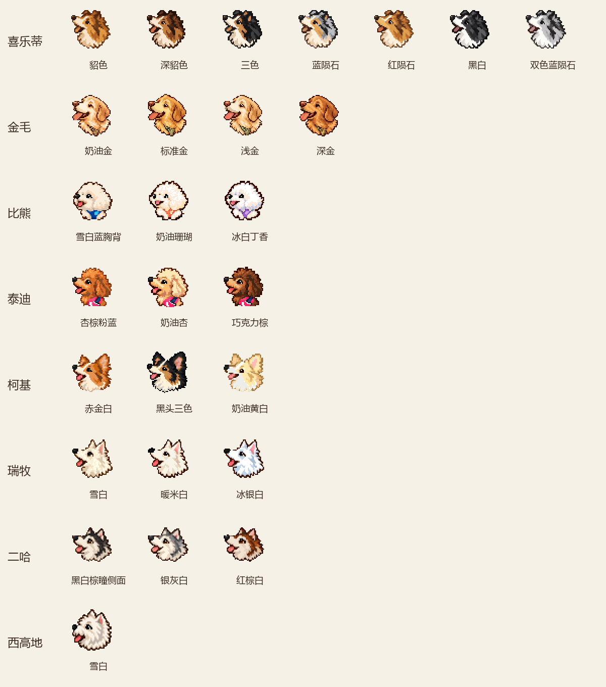

## 鼠标动画 · 每个犬种、每款颜色

下列动画均取自实际指针导出帧，展示正常选择的眨眼、耳毛与表情循环；完整17种动作可在体验页中锁定查看。每行一个犬种，列顺序与上方配色一致。

| 犬种 | 配色1 | 配色2 | 配色3 | 配色4 | 配色5 | 配色6 | 配色7 |
|---|---|---|---|---|---|---|---|
| 喜乐蒂 | 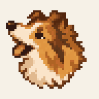<br>貂色 | 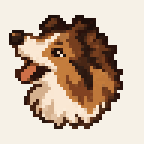<br>深貂色 | 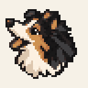<br>三色 | 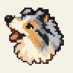<br>蓝陨石 | 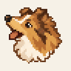<br>红陨石 | 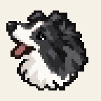<br>黑白 | 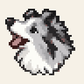<br>双色蓝陨石 |
| 金毛 | 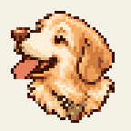<br>奶油金 | 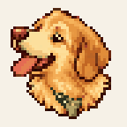<br>标准金 | 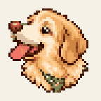<br>浅金 | 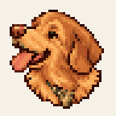<br>深金 |  |  |  |
| 比熊 | <br>雪白蓝胸背 | 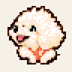<br>奶油珊瑚 | 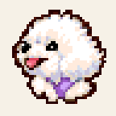<br>冰白丁香 |  |  |  |  |
| 泰迪 | 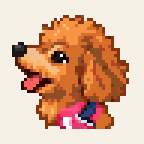<br>杏棕粉蓝 | 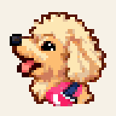<br>奶油杏 | 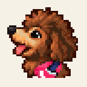<br>巧克力棕 |  |  |  |  |
| 柯基 | 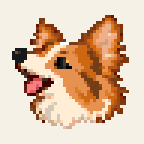<br>赤金白 | 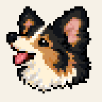<br>黑头三色 | 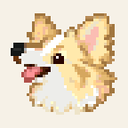<br>奶油黄白 |  |  |  |  |
| 瑞牧 | 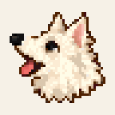<br>雪白 | 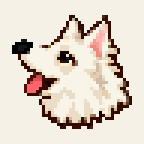<br>暖米白 | 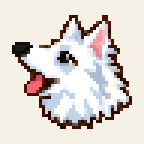<br>冰银白 |  |  |  |  |
| 二哈 | 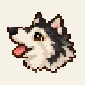<br>黑白棕瞳侧面 | 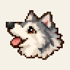<br>银灰白 | 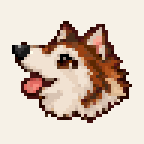<br>红棕白 |  |  |  |  |
| 西高地 | 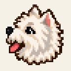<br>雪白 |  |  |  |  |  |  |

## 先体验，再安装

**[下载完整离线体验页](downloads/pet-cursor-playground-27.zip?raw=1)**：完整解压后打开 `index.html`，无需Python。支持全部27款、五档尺寸、深浅背景、慢放、点击点，以及点选、文字、拖动和缩放体验。网页不会更改系统指针。

下载仓库后也可以在根目录运行：

```powershell
python -m http.server 8766 --directory playground
```

再打开 <http://127.0.0.1:8766/>。GitHub 中的 HTML 是源码视图，需要下载后打开或启动本地服务。

## 下载现成安装包

| 范围 | 款数 | Windows 一键安装包 | macOS Mousecape 测试包 |
|---|---:|---|---|
| 全部狗狗 | 27 | [全部安装](downloads/windows-all.zip?raw=1) | [全部导入](downloads/macos-all.zip?raw=1) |
| 喜乐蒂 | 7 | [安装该犬种所有配色](downloads/windows-sheltie.zip?raw=1) | [导入该犬种所有配色](downloads/macos-sheltie.zip?raw=1) |
| 金毛 | 4 | [安装该犬种所有配色](downloads/windows-golden.zip?raw=1) | [导入该犬种所有配色](downloads/macos-golden.zip?raw=1) |
| 比熊 | 3 | [安装该犬种所有配色](downloads/windows-bichon.zip?raw=1) | [导入该犬种所有配色](downloads/macos-bichon.zip?raw=1) |
| 泰迪 | 3 | [安装该犬种所有配色](downloads/windows-teddy.zip?raw=1) | [导入该犬种所有配色](downloads/macos-teddy.zip?raw=1) |
| 柯基 | 3 | [安装该犬种所有配色](downloads/windows-corgi.zip?raw=1) | [导入该犬种所有配色](downloads/macos-corgi.zip?raw=1) |
| 瑞牧 | 3 | [安装该犬种所有配色](downloads/windows-swiss.zip?raw=1) | [导入该犬种所有配色](downloads/macos-swiss.zip?raw=1) |
| 二哈 | 3 | [安装该犬种所有配色](downloads/windows-husky.zip?raw=1) | [导入该犬种所有配色](downloads/macos-husky.zip?raw=1) |
| 西高地 | 1 | [安装该犬种所有配色](downloads/windows-westie.zip?raw=1) | [导入该犬种所有配色](downloads/macos-westie.zip?raw=1) |

### Windows：一键安装与恢复

1. 完整解压ZIP，双击 `一键安装所有狗狗.cmd`，或 `一键安装所有喜乐蒂.cmd` 等单犬种入口。无需管理员权限或Python。
2. 默认32px，按顺序安装并保存每款方案；**最后安装的一套当前生效**。安装成功后打开“鼠标属性 → 指针”，可在方案列表里选择其他款式并应用。
3. 只想安装一款：进入对应主题文件夹，双击 `安装鼠标主题.cmd`。
4. 双击 `恢复原鼠标.cmd` 恢复首次安装前的基线。恢复保留备份、已装文件和已保存的方案。

五档尺寸为32/48/64/96/128px。高级用法在合集目录运行：

```powershell
powershell -NoProfile -ExecutionPolicy Bypass -File ./install-catalog.ps1 -Collection all -Size 96
```

单主题目录用 `install-theme.ps1 -Size 96`。给CMD追加 `--check` 可只做预演。批量安装先检查全部目标，中途失败即停止，已成功项保留。系统辅助功能里的四个颜色按钮不会新增狗狗卡片；调整系统颜色或大小可能覆盖宠物光标，重新运行安装入口可恢复。

### macOS：一键导入与应用

1. 先安装 [Mousecape 官方版本](https://github.com/alexzielenski/Mousecape/releases)，本项目不捆绑第三方程序。
2. 解压Mac合集，双击 `一键导入全部主题-32pt.command`；大号使用48pt入口。也可直接双击 `.cape` 文件逐一导入。
3. 在Mousecape中选中喜欢的一套，然后 **Apply**。批量入口负责导入，不能同时应用多套。
4. 用 `Capes → Restore Defaults` 恢复默认指针。

所有27款均提供32pt/48pt、1×/2×素材。13种源动作对应17个Mac条目，Windows手写、候选、位置和人员状态不直接导出；Mac额外状态保留系统默认。[Mousecape动画格式](https://github.com/alexzielenski/Mousecape/blob/master/Mousecape/mousecloak/apply.m)最多24个等时帧，部分Windows停留节奏需采样；转换记录随包提供。

**Mac版已完成格式、热点、时长及全部嵌入像素校验，尚未在Mac真机导入、应用或测试Retina与多屏。** 双击脚本还可能受本机执行权限限制，可改用直接打开.cape；不需要绕过系统安全提示。详见[macOS说明](docs/macOS.md)与[27款转换校验](docs/macos-27-validation.json)。

## 单款下载

| 犬种 | 配色 · Windows ZIP |
|---|---|
| 喜乐蒂 | [貂色](playground/downloads/pet-pixel-complete.zip?raw=1) · [深貂色](playground/downloads/sheltie-dark-sable-pixel.zip?raw=1) · [三色](playground/downloads/sheltie-tricolor-pixel.zip?raw=1) · [蓝陨石](playground/downloads/sheltie-blue-merle-pixel.zip?raw=1) · [红陨石](playground/downloads/sheltie-red-merle-pixel.zip?raw=1) · [黑白](playground/downloads/sheltie-bi-black-pixel.zip?raw=1) · [双色蓝陨石](playground/downloads/sheltie-bi-blue-pixel.zip?raw=1) |
| 金毛 | [奶油金](playground/downloads/golden-cream-pixel.zip?raw=1) · [标准金](playground/downloads/golden-standard-pixel.zip?raw=1) · [浅金](playground/downloads/golden-light-pixel.zip?raw=1) · [深金](playground/downloads/golden-dark-pixel.zip?raw=1) |
| 比熊 | [雪白蓝胸背](playground/downloads/bichon-photo-v3.zip?raw=1) · [奶油珊瑚](playground/downloads/bichon-cream-coral-v5.zip?raw=1) · [冰白丁香](playground/downloads/bichon-ice-lilac-v5.zip?raw=1) |
| 泰迪 | [杏棕粉蓝](playground/downloads/teddy-profile-v6.zip?raw=1) · [奶油杏](playground/downloads/teddy-cream-profile-v6.zip?raw=1) · [巧克力棕](playground/downloads/teddy-chocolate-profile-v6.zip?raw=1) |
| 柯基 | [赤金白](playground/downloads/corgi-photo-v3.zip?raw=1) · [黑头三色](playground/downloads/corgi-tricolor-v5.zip?raw=1) · [奶油黄白](playground/downloads/corgi-cream-v5.zip?raw=1) |
| 瑞牧 | [雪白](playground/downloads/swiss-profile-v6.zip?raw=1) · [暖米白](playground/downloads/swiss-ivory-profile-v6.zip?raw=1) · [冰银白](playground/downloads/swiss-ice-profile-v6.zip?raw=1) |
| 二哈 | [黑白棕瞳侧面](playground/downloads/husky-profile-v6.zip?raw=1) · [银灰白](playground/downloads/husky-silver-profile-v6.zip?raw=1) · [红棕白](playground/downloads/husky-red-profile-v6.zip?raw=1) |
| 西高地 | [雪白](playground/downloads/westie-profile-v1.zip?raw=1) |

## 动作、鼻尖与验证

Windows每款含17种动画状态：正常、帮助、后台工作、等待、精确定位、文本、手写、不可用、四向缩放、移动、候选、链接、位置和人员选择。点选类使用可见鼻尖；文字用插入线，手写用笔尖，定位及缩放用操作符号接触点。侧面造型保留品种的耳朵、口鼻和毛色特征。

27款沿用已复查的源动作，提供Windows原生加载/绘制、各尺寸与热点检查记录；本次更新安装器经过预演，未在制作机应用主题。实际桌面点击手感、不同DPI与多显示器仍需试用；局部毛发纹理变化可能存在。自动检测不能替代逐帧视觉检查。见[发布目录与验证](docs/release-27.json)及各主题包内报告。

## 用 Skill 制作自己的宠物

[下载 Skill](downloads/pet-cursor-skill.zip?raw=1) · [Skill 源文件](skills/pet-cursor-theme/SKILL.md)

将 `pet-cursor-theme` 文件夹放入客户端技能目录，保留 scripts、references 和 assets。提供宠物照片与风格要求，先确定普通指针侧面造型、可见鼻尖，再扩展17状态和配色。Python只负责分帧、配准和编码，美术由宿主图像生成工具制作；不包含模型或API密钥。

支持Windows CUR/ANI编译、macOS Mousecape转换、可恢复安装、逐帧检查，以及整套/单犬种打包。开发依赖Python3.10+与Pillow，见[Skill说明](skills/pet-cursor-theme/README.md)。Skill不会因本地包完成而自行发布或应用系统鼠标。

```powershell
python -m unittest discover -s skills/pet-cursor-theme/scripts -p "test_*.py"
```

## 文件与许可

`playground/` 为完整体验页；`downloads/` 为平台与犬种合集；`skills/` 为可复用制作工具；`docs/` 为图鉴、动画和检查记录。旧版下载保留供溯源，当前推荐入口均以上方27款为准。下载完整性见 [SHA-256](downloads/SHA256SUMS)。

代码与文档采用 [MIT](LICENSE)；宠物照片、参考图及生成美术的权利单独确认，见[素材说明](ASSETS.md)。本次新增主题和合集不附私人参考照片、密钥或本机路径。

感谢 🍠 不要芋泥要啵啵 的反馈。
