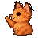
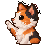
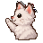
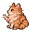
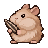
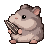
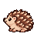
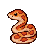

# 免费开源小动物像素鼠标指针

新增24款像素小动物指针，免费使用、修改与再分发，采用 [MIT 许可证](LICENSE)。之前的11种狗狗、37款配色仍在仓库中提供。

## 下载与测试

| 系统 | 下载 | 内容 |
|---|---|---|
| Windows | [下载](https://raw.githubusercontent.com/CYemin/Pet-mouse-pointer/main/other-pets/downloads/Windows.zip) | 17状态，32／48／64／96／128 px，含应用与恢复入口 |
| macOS | [下载](https://raw.githubusercontent.com/CYemin/Pet-mouse-pointer/main/other-pets/downloads/macOS.zip) | Mousecape，13组对应状态，32／48 pt，1×／2× |
| Linux／麒麟／UOS | [下载](https://raw.githubusercontent.com/CYemin/Pet-mouse-pointer/main/other-pets/downloads/Linux.tar.gz) | Xcursor主题，五档尺寸 |

[下载全部24款离线测试页面](https://raw.githubusercontent.com/CYemin/Pet-mouse-pointer/main/other-pets/downloads/offline-24-pets.zip)：完整解压后打开「全部宠物动画测试.html」，默认48px、按1∶1展示，可切换全部17种状态。

安装包按「系统／种类／颜色」排列；macOS需Mousecape，Linux请按主题目录内说明安装。

## 24款真实动画预览

以下GIF直接由当前正常选择状态的透明帧和时间轴导出。每款完整的17种状态可在离线测试页中切换。

| 款式 | 默认动画 |
|---|---|
| 橘猫 |  |
| 橘猫 |  |
| 橘猫 |  |
| 橘猫 |  |
| 橘猫 |  |
| 玄凤鹦鹉 |  |
| 玄凤鹦鹉 |  |
| 玄凤鹦鹉 |  |
| 豹纹守宫 |  |
| 豹纹守宫 |  |
| 豹纹守宫 |  |
| 布偶 · 蓝双色 |  |
| 长毛猫 · 金渐层 |  |
| 长毛猫 · 银渐层 |  |
| 瓜子仓鼠 · 金黄 |  |
| 瓜子仓鼠 · 银灰 |  |
| 瓜子仓鼠 · 奶白 |  |
| 垂耳兔 |  |
| 蜜袋鼯 |  |
| 刺猬 |  |
| 巴西龟 |  |
| 玉米蛇 |  |
| 角蛙 |  |
| 水豚 |  |

## 交互与开源

长毛猫持续吹动毛发；仓鼠抱瓜子、鼓起脸颊，瓜子尖作为点击点；玉米蛇身体保持固定并吐舌。猫咪、玄凤、守宫等也包含各自的局部动作。

已移除伸爪仓鼠、白脸灰玄凤和橘化守宫。

[当前源码与可重建帧快照](source/) · [款式清单](catalog.json) · [MIT许可证](LICENSE)

Windows已完成原生加载与逐帧绘制检查；macOS、Linux已完成导出格式检查，实机安装、恢复及多屏DPI体验仍待验证。本目录的源码、生成指针美术、安装包及预览图按MIT开放；仓库原有狗狗美术的许可范围见根目录ASSETS.md。
