# Pet Mouse Pointer · 宠物鼠标指针

小猫、鹦鹉、守宫、仓鼠和更多小动物，共24款配色，均可免费下载使用。

## 全部默认动画 · 48px

所有指针均按48px展示，先挑喜欢的伙伴。

### 小动物 · 24款

| 种类 | 配色与默认动画 |
|---|---|
| 猫咪 |  猫咪 · 橘猫 · 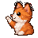 猫咪 · 橘白 ·  猫咪 · 黑白猫 ·  猫咪 · 三花 ·  猫咪 · 纯白猫 |
| 玄凤鹦鹉 | 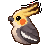 玄凤鹦鹉 · 原始灰 ·  玄凤鹦鹉 · 黄化 ·  玄凤鹦鹉 · 珍珠灰 |
| 豹纹守宫 | 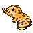 豹纹守宫 · 经典金黄 ·  豹纹守宫 · 麦克雪（Mack Snow） ·  豹纹守宫 · 薰衣草斑 |
| 长毛猫 |  布偶 · 蓝双色 ·  长毛猫 · 金渐层 · 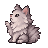 长毛猫 · 银渐层 |
| 瓜子仓鼠 |  瓜子仓鼠 · 金黄 ·  瓜子仓鼠 · 银灰 ·  瓜子仓鼠 · 奶白 |
| 垂耳兔 |  垂耳兔 |
| 蜜袋鼯 |  蜜袋鼯 |
| 刺猬 |  刺猬 |
| 巴西龟 |  巴西龟 |
| 玉米蛇 |  玉米蛇 |
| 角蛙 |  角蛙 |
| 水豚 |  水豚 |

## 其他状态动画 · 48px

### 小动物 · 全部16种其他状态

每款都对应实际发布的动画帧，默认状态见上方。

| 款式 | 帮助选择 | 后台运行 | 忙碌等待 | 精确定位 |
|---|---|---|---|---|
| 猫咪 · 橘猫 |  | 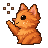 |  |  |
| 猫咪 · 橘白 |  | 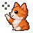 |  | 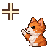 |
| 猫咪 · 黑白猫 |  |  |  | 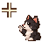 |
| 猫咪 · 三花 | 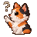 |  |  | 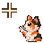 |
| 猫咪 · 纯白猫 |  | 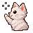 | 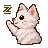 |  |
| 玄凤鹦鹉 · 原始灰 |  | 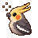 | 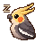 |  |
| 玄凤鹦鹉 · 黄化 | 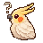 |  | 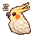 | 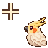 |
| 玄凤鹦鹉 · 珍珠灰 | 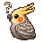 |  |  | 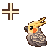 |
| 豹纹守宫 · 经典金黄 | 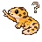 |  |  |  |
| 豹纹守宫 · 麦克雪（Mack Snow） | 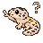 | 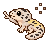 |  | 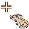 |
| 豹纹守宫 · 薰衣草斑 |  |  |  |  |
| 布偶 · 蓝双色 | 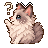 |  |  | 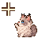 |
| 长毛猫 · 金渐层 |  |  |  |  |
| 长毛猫 · 银渐层 |  | 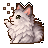 |  |  |
| 瓜子仓鼠 · 金黄 |  | 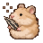 |  |  |
| 瓜子仓鼠 · 银灰 |  |  |  |  |
| 瓜子仓鼠 · 奶白 |  |  |  |  |
| 垂耳兔 | 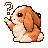 | 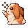 |  |  |
| 蜜袋鼯 |  |  | 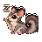 |  |
| 刺猬 | 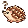 | 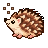 | 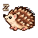 | 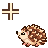 |
| 巴西龟 |  |  | 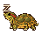 |  |
| 玉米蛇 |  | 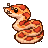 | 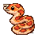 |  |
| 角蛙 |  |  |  |  |
| 水豚 | 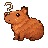 |  |  | 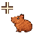 |

| 款式 | 文本选择 | 手写 | 不可用 | 垂直调整 |
|---|---|---|---|---|
| 猫咪 · 橘猫 |  |  |  | 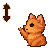 |
| 猫咪 · 橘白 |  |  |  |  |
| 猫咪 · 黑白猫 | 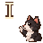 |  | 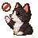 |  |
| 猫咪 · 三花 |  |  |  |  |
| 猫咪 · 纯白猫 |  |  |  | 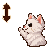 |
| 玄凤鹦鹉 · 原始灰 |  |  |  |  |
| 玄凤鹦鹉 · 黄化 |  |  |  |  |
| 玄凤鹦鹉 · 珍珠灰 |  |  |  |  |
| 豹纹守宫 · 经典金黄 | 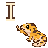 | 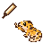 |  |  |
| 豹纹守宫 · 麦克雪（Mack Snow） |  |  |  |  |
| 豹纹守宫 · 薰衣草斑 | 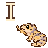 |  |  |  |
| 布偶 · 蓝双色 |  |  | 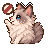 | 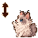 |
| 长毛猫 · 金渐层 |  |  |  |  |
| 长毛猫 · 银渐层 |  |  |  |  |
| 瓜子仓鼠 · 金黄 |  | 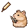 |  | 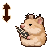 |
| 瓜子仓鼠 · 银灰 |  |  |  |  |
| 瓜子仓鼠 · 奶白 |  |  |  |  |
| 垂耳兔 |  |  |  |  |
| 蜜袋鼯 |  |  |  |  |
| 刺猬 |  |  |  |  |
| 巴西龟 |  |  |  |  |
| 玉米蛇 |  |  |  |  |
| 角蛙 |  |  |  |  |
| 水豚 |  |  |  |  |

| 款式 | 水平调整 | 西北—东南调整 | 东北—西南调整 | 移动 |
|---|---|---|---|---|
| 猫咪 · 橘猫 |  |  |  |  |
| 猫咪 · 橘白 |  |  |  |  |
| 猫咪 · 黑白猫 |  |  |  |  |
| 猫咪 · 三花 |  |  |  |  |
| 猫咪 · 纯白猫 |  |  |  |  |
| 玄凤鹦鹉 · 原始灰 |  |  |  |  |
| 玄凤鹦鹉 · 黄化 |  |  |  |  |
| 玄凤鹦鹉 · 珍珠灰 |  |  |  |  |
| 豹纹守宫 · 经典金黄 |  |  |  |  |
| 豹纹守宫 · 麦克雪（Mack Snow） |  |  |  |  |
| 豹纹守宫 · 薰衣草斑 |  |  |  |  |
| 布偶 · 蓝双色 |  |  |  |  |
| 长毛猫 · 金渐层 |  |  |  |  |
| 长毛猫 · 银渐层 |  |  |  |  |
| 瓜子仓鼠 · 金黄 |  |  |  |  |
| 瓜子仓鼠 · 银灰 |  |  |  |  |
| 瓜子仓鼠 · 奶白 |  |  |  |  |
| 垂耳兔 |  |  |  |  |
| 蜜袋鼯 |  |  |  |  |
| 刺猬 |  |  |  |  |
| 巴西龟 |  |  |  |  |
| 玉米蛇 |  |  |  |  |
| 角蛙 |  |  |  |  |
| 水豚 |  |  |  |  |

| 款式 | 候选选择 | 链接选择 | 位置选择 | 人员选择 |
|---|---|---|---|---|
| 猫咪 · 橘猫 |  |  |  |  |
| 猫咪 · 橘白 |  |  |  |  |
| 猫咪 · 黑白猫 |  |  |  |  |
| 猫咪 · 三花 |  |  |  |  |
| 猫咪 · 纯白猫 |  |  |  |  |
| 玄凤鹦鹉 · 原始灰 |  |  |  |  |
| 玄凤鹦鹉 · 黄化 |  |  |  |  |
| 玄凤鹦鹉 · 珍珠灰 |  |  |  |  |
| 豹纹守宫 · 经典金黄 |  |  |  |  |
| 豹纹守宫 · 麦克雪（Mack Snow） |  |  |  |  |
| 豹纹守宫 · 薰衣草斑 |  |  |  |  |
| 布偶 · 蓝双色 |  |  |  |  |
| 长毛猫 · 金渐层 |  |  |  |  |
| 长毛猫 · 银渐层 |  |  |  |  |
| 瓜子仓鼠 · 金黄 |  |  |  |  |
| 瓜子仓鼠 · 银灰 |  |  |  |  |
| 瓜子仓鼠 · 奶白 |  |  |  |  |
| 垂耳兔 |  |  |  |  |
| 蜜袋鼯 |  |  |  |  |
| 刺猬 |  |  |  |  |
| 巴西龟 |  |  |  |  |
| 玉米蛇 |  |  |  |  |
| 角蛙 |  |  |  |  |
| 水豚 |  |  |  |  |

## 按款下载

选择系统并完整解压。Windows默认48px；macOS使用Mousecape；Linux使用Xcursor主题。

### 小动物 · 单款下载

| 款式 | Windows | macOS | Linux／麒麟／UOS |
|---|---|---|---|
| 猫咪 · 橘猫 | [下载](https://raw.githubusercontent.com/CYemin/Pet-mouse-pointer/main/other-pets/downloads/themes/cat-windows.zip) | [下载](https://raw.githubusercontent.com/CYemin/Pet-mouse-pointer/main/other-pets/downloads/themes/cat-macos.zip) | [下载](https://raw.githubusercontent.com/CYemin/Pet-mouse-pointer/main/other-pets/downloads/themes/cat-linux.tar.gz) |
| 猫咪 · 橘白 | [下载](https://raw.githubusercontent.com/CYemin/Pet-mouse-pointer/main/other-pets/downloads/themes/cat-silver-windows.zip) | [下载](https://raw.githubusercontent.com/CYemin/Pet-mouse-pointer/main/other-pets/downloads/themes/cat-silver-macos.zip) | [下载](https://raw.githubusercontent.com/CYemin/Pet-mouse-pointer/main/other-pets/downloads/themes/cat-silver-linux.tar.gz) |
| 猫咪 · 黑白猫 | [下载](https://raw.githubusercontent.com/CYemin/Pet-mouse-pointer/main/other-pets/downloads/themes/cat-tuxedo-windows.zip) | [下载](https://raw.githubusercontent.com/CYemin/Pet-mouse-pointer/main/other-pets/downloads/themes/cat-tuxedo-macos.zip) | [下载](https://raw.githubusercontent.com/CYemin/Pet-mouse-pointer/main/other-pets/downloads/themes/cat-tuxedo-linux.tar.gz) |
| 猫咪 · 三花 | [下载](https://raw.githubusercontent.com/CYemin/Pet-mouse-pointer/main/other-pets/downloads/themes/cat-calico-windows.zip) | [下载](https://raw.githubusercontent.com/CYemin/Pet-mouse-pointer/main/other-pets/downloads/themes/cat-calico-macos.zip) | [下载](https://raw.githubusercontent.com/CYemin/Pet-mouse-pointer/main/other-pets/downloads/themes/cat-calico-linux.tar.gz) |
| 猫咪 · 纯白猫 | [下载](https://raw.githubusercontent.com/CYemin/Pet-mouse-pointer/main/other-pets/downloads/themes/cat-cream-windows.zip) | [下载](https://raw.githubusercontent.com/CYemin/Pet-mouse-pointer/main/other-pets/downloads/themes/cat-cream-macos.zip) | [下载](https://raw.githubusercontent.com/CYemin/Pet-mouse-pointer/main/other-pets/downloads/themes/cat-cream-linux.tar.gz) |
| 玄凤鹦鹉 · 原始灰 | [下载](https://raw.githubusercontent.com/CYemin/Pet-mouse-pointer/main/other-pets/downloads/themes/cockatiel-windows.zip) | [下载](https://raw.githubusercontent.com/CYemin/Pet-mouse-pointer/main/other-pets/downloads/themes/cockatiel-macos.zip) | [下载](https://raw.githubusercontent.com/CYemin/Pet-mouse-pointer/main/other-pets/downloads/themes/cockatiel-linux.tar.gz) |
| 玄凤鹦鹉 · 黄化 | [下载](https://raw.githubusercontent.com/CYemin/Pet-mouse-pointer/main/other-pets/downloads/themes/cockatiel-lutino-windows.zip) | [下载](https://raw.githubusercontent.com/CYemin/Pet-mouse-pointer/main/other-pets/downloads/themes/cockatiel-lutino-macos.zip) | [下载](https://raw.githubusercontent.com/CYemin/Pet-mouse-pointer/main/other-pets/downloads/themes/cockatiel-lutino-linux.tar.gz) |
| 玄凤鹦鹉 · 珍珠灰 | [下载](https://raw.githubusercontent.com/CYemin/Pet-mouse-pointer/main/other-pets/downloads/themes/cockatiel-pearl-windows.zip) | [下载](https://raw.githubusercontent.com/CYemin/Pet-mouse-pointer/main/other-pets/downloads/themes/cockatiel-pearl-macos.zip) | [下载](https://raw.githubusercontent.com/CYemin/Pet-mouse-pointer/main/other-pets/downloads/themes/cockatiel-pearl-linux.tar.gz) |
| 豹纹守宫 · 经典金黄 | [下载](https://raw.githubusercontent.com/CYemin/Pet-mouse-pointer/main/other-pets/downloads/themes/gecko-windows.zip) | [下载](https://raw.githubusercontent.com/CYemin/Pet-mouse-pointer/main/other-pets/downloads/themes/gecko-macos.zip) | [下载](https://raw.githubusercontent.com/CYemin/Pet-mouse-pointer/main/other-pets/downloads/themes/gecko-linux.tar.gz) |
| 豹纹守宫 · 麦克雪（Mack Snow） | [下载](https://raw.githubusercontent.com/CYemin/Pet-mouse-pointer/main/other-pets/downloads/themes/gecko-snow-windows.zip) | [下载](https://raw.githubusercontent.com/CYemin/Pet-mouse-pointer/main/other-pets/downloads/themes/gecko-snow-macos.zip) | [下载](https://raw.githubusercontent.com/CYemin/Pet-mouse-pointer/main/other-pets/downloads/themes/gecko-snow-linux.tar.gz) |
| 豹纹守宫 · 薰衣草斑 | [下载](https://raw.githubusercontent.com/CYemin/Pet-mouse-pointer/main/other-pets/downloads/themes/gecko-lavender-windows.zip) | [下载](https://raw.githubusercontent.com/CYemin/Pet-mouse-pointer/main/other-pets/downloads/themes/gecko-lavender-macos.zip) | [下载](https://raw.githubusercontent.com/CYemin/Pet-mouse-pointer/main/other-pets/downloads/themes/gecko-lavender-linux.tar.gz) |
| 布偶 · 蓝双色 | [下载](https://raw.githubusercontent.com/CYemin/Pet-mouse-pointer/main/other-pets/downloads/themes/longhair-ragdoll-windows.zip) | [下载](https://raw.githubusercontent.com/CYemin/Pet-mouse-pointer/main/other-pets/downloads/themes/longhair-ragdoll-macos.zip) | [下载](https://raw.githubusercontent.com/CYemin/Pet-mouse-pointer/main/other-pets/downloads/themes/longhair-ragdoll-linux.tar.gz) |
| 长毛猫 · 金渐层 | [下载](https://raw.githubusercontent.com/CYemin/Pet-mouse-pointer/main/other-pets/downloads/themes/longhair-golden-windows.zip) | [下载](https://raw.githubusercontent.com/CYemin/Pet-mouse-pointer/main/other-pets/downloads/themes/longhair-golden-macos.zip) | [下载](https://raw.githubusercontent.com/CYemin/Pet-mouse-pointer/main/other-pets/downloads/themes/longhair-golden-linux.tar.gz) |
| 长毛猫 · 银渐层 | [下载](https://raw.githubusercontent.com/CYemin/Pet-mouse-pointer/main/other-pets/downloads/themes/longhair-silver-windows.zip) | [下载](https://raw.githubusercontent.com/CYemin/Pet-mouse-pointer/main/other-pets/downloads/themes/longhair-silver-macos.zip) | [下载](https://raw.githubusercontent.com/CYemin/Pet-mouse-pointer/main/other-pets/downloads/themes/longhair-silver-linux.tar.gz) |
| 瓜子仓鼠 · 金黄 | [下载](https://raw.githubusercontent.com/CYemin/Pet-mouse-pointer/main/other-pets/downloads/themes/seed-hamster-golden-windows.zip) | [下载](https://raw.githubusercontent.com/CYemin/Pet-mouse-pointer/main/other-pets/downloads/themes/seed-hamster-golden-macos.zip) | [下载](https://raw.githubusercontent.com/CYemin/Pet-mouse-pointer/main/other-pets/downloads/themes/seed-hamster-golden-linux.tar.gz) |
| 瓜子仓鼠 · 银灰 | [下载](https://raw.githubusercontent.com/CYemin/Pet-mouse-pointer/main/other-pets/downloads/themes/seed-hamster-silver-windows.zip) | [下载](https://raw.githubusercontent.com/CYemin/Pet-mouse-pointer/main/other-pets/downloads/themes/seed-hamster-silver-macos.zip) | [下载](https://raw.githubusercontent.com/CYemin/Pet-mouse-pointer/main/other-pets/downloads/themes/seed-hamster-silver-linux.tar.gz) |
| 瓜子仓鼠 · 奶白 | [下载](https://raw.githubusercontent.com/CYemin/Pet-mouse-pointer/main/other-pets/downloads/themes/seed-hamster-ivory-windows.zip) | [下载](https://raw.githubusercontent.com/CYemin/Pet-mouse-pointer/main/other-pets/downloads/themes/seed-hamster-ivory-macos.zip) | [下载](https://raw.githubusercontent.com/CYemin/Pet-mouse-pointer/main/other-pets/downloads/themes/seed-hamster-ivory-linux.tar.gz) |
| 垂耳兔 | [下载](https://raw.githubusercontent.com/CYemin/Pet-mouse-pointer/main/other-pets/downloads/themes/lop-rabbit-windows.zip) | [下载](https://raw.githubusercontent.com/CYemin/Pet-mouse-pointer/main/other-pets/downloads/themes/lop-rabbit-macos.zip) | [下载](https://raw.githubusercontent.com/CYemin/Pet-mouse-pointer/main/other-pets/downloads/themes/lop-rabbit-linux.tar.gz) |
| 蜜袋鼯 | [下载](https://raw.githubusercontent.com/CYemin/Pet-mouse-pointer/main/other-pets/downloads/themes/sugar-glider-windows.zip) | [下载](https://raw.githubusercontent.com/CYemin/Pet-mouse-pointer/main/other-pets/downloads/themes/sugar-glider-macos.zip) | [下载](https://raw.githubusercontent.com/CYemin/Pet-mouse-pointer/main/other-pets/downloads/themes/sugar-glider-linux.tar.gz) |
| 刺猬 | [下载](https://raw.githubusercontent.com/CYemin/Pet-mouse-pointer/main/other-pets/downloads/themes/hedgehog-windows.zip) | [下载](https://raw.githubusercontent.com/CYemin/Pet-mouse-pointer/main/other-pets/downloads/themes/hedgehog-macos.zip) | [下载](https://raw.githubusercontent.com/CYemin/Pet-mouse-pointer/main/other-pets/downloads/themes/hedgehog-linux.tar.gz) |
| 巴西龟 | [下载](https://raw.githubusercontent.com/CYemin/Pet-mouse-pointer/main/other-pets/downloads/themes/red-eared-slider-windows.zip) | [下载](https://raw.githubusercontent.com/CYemin/Pet-mouse-pointer/main/other-pets/downloads/themes/red-eared-slider-macos.zip) | [下载](https://raw.githubusercontent.com/CYemin/Pet-mouse-pointer/main/other-pets/downloads/themes/red-eared-slider-linux.tar.gz) |
| 玉米蛇 | [下载](https://raw.githubusercontent.com/CYemin/Pet-mouse-pointer/main/other-pets/downloads/themes/corn-snake-windows.zip) | [下载](https://raw.githubusercontent.com/CYemin/Pet-mouse-pointer/main/other-pets/downloads/themes/corn-snake-macos.zip) | [下载](https://raw.githubusercontent.com/CYemin/Pet-mouse-pointer/main/other-pets/downloads/themes/corn-snake-linux.tar.gz) |
| 角蛙 | [下载](https://raw.githubusercontent.com/CYemin/Pet-mouse-pointer/main/other-pets/downloads/themes/pacman-frog-windows.zip) | [下载](https://raw.githubusercontent.com/CYemin/Pet-mouse-pointer/main/other-pets/downloads/themes/pacman-frog-macos.zip) | [下载](https://raw.githubusercontent.com/CYemin/Pet-mouse-pointer/main/other-pets/downloads/themes/pacman-frog-linux.tar.gz) |
| 水豚 | [下载](https://raw.githubusercontent.com/CYemin/Pet-mouse-pointer/main/other-pets/downloads/themes/capybara-windows.zip) | [下载](https://raw.githubusercontent.com/CYemin/Pet-mouse-pointer/main/other-pets/downloads/themes/capybara-macos.zip) | [下载](https://raw.githubusercontent.com/CYemin/Pet-mouse-pointer/main/other-pets/downloads/themes/capybara-linux.tar.gz) |

## 小动物合集与离线测试

[Windows全集](https://raw.githubusercontent.com/CYemin/Pet-mouse-pointer/main/other-pets/downloads/Windows.zip) · [macOS全集](https://raw.githubusercontent.com/CYemin/Pet-mouse-pointer/main/other-pets/downloads/macOS.zip) · [Linux全集](https://raw.githubusercontent.com/CYemin/Pet-mouse-pointer/main/other-pets/downloads/Linux.tar.gz) · [48px离线测试页](https://raw.githubusercontent.com/CYemin/Pet-mouse-pointer/main/other-pets/downloads/offline-24-pets.zip)

小动物扩展采用[MIT许可](LICENSE)，可免费使用、修改和再分发。[源码与重建方法](source/)；原有狗狗素材授权见[ASSETS.md](../ASSETS.md)。

