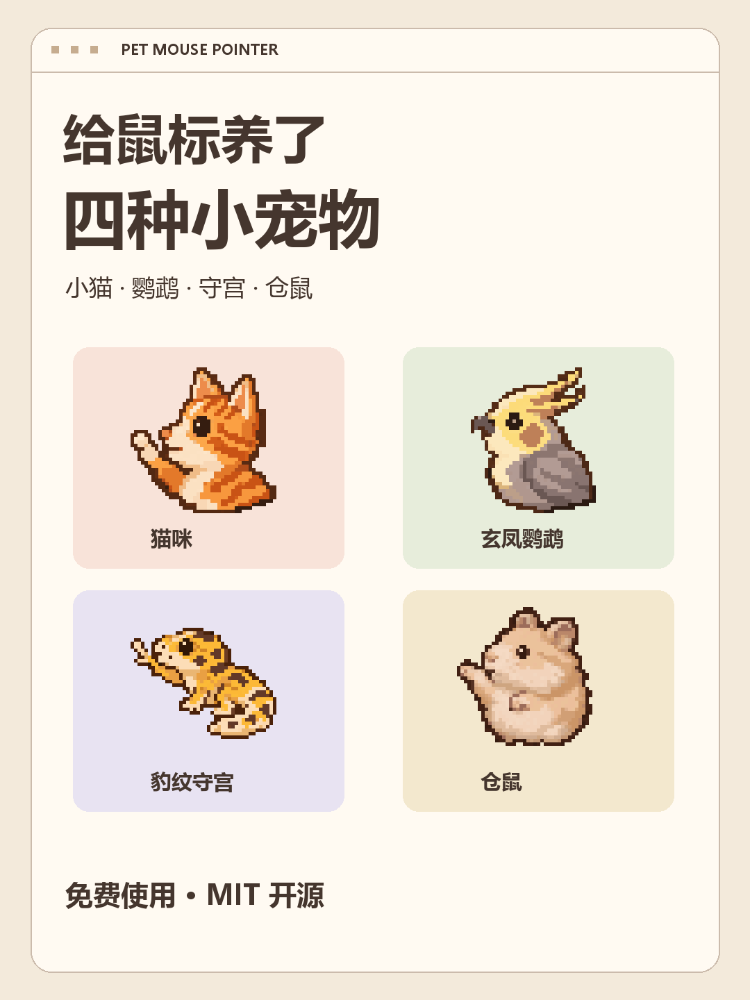

# 其他宠物鼠标指针

猫咪、玄凤鹦鹉、豹纹守宫、仓鼠，共16款配色，免费开源。

## 下载

| 系统 | 下载 | 内容 |
|---|---|---|
| Windows | [完整安装包](https://raw.githubusercontent.com/CYemin/Pet-mouse-pointer/main/other-pets/downloads/Windows.zip) | 17状态，五档尺寸，应用与恢复入口 |
| macOS | [Mousecape导出](https://raw.githubusercontent.com/CYemin/Pet-mouse-pointer/main/other-pets/downloads/macOS.zip) | 13组对应状态，32／48 pt，1×／2× |
| Linux／麒麟／UOS | [Xcursor主题](https://raw.githubusercontent.com/CYemin/Pet-mouse-pointer/main/other-pets/downloads/Linux.zip) | 五档尺寸，17组源动画 |

[离线测试页面](https://raw.githubusercontent.com/CYemin/Pet-mouse-pointer/main/other-pets/downloads/offline-playgrounds.zip) · [小红书六张图与文案](social-post/文案.md) · [构建源码](source/)

安装包完整解压后按「系统／种类／颜色」选择。Windows运行应用入口，恢复时运行恢复入口；macOS需先安装Mousecape；Linux按颜色目录内说明安装。离线测试包完整解压后打开HTML。

## 配色

- 猫咪：橘虎斑、银虎斑、黑白奶牛、三花、奶油虎斑。
- 玄凤鹦鹉：原始灰、白脸灰、黄化、珍珠灰。
- 豹纹守宫：经典金黄、橘化、麦克雪、薰衣草斑。
- 仓鼠：金黄、银灰、奶白。

猫和仓鼠以前爪尖定位，玄凤以上喙尖定位，守宫以前脚趾尖定位。文本、精确定位和调整尺寸使用对应操作标记。三色仓鼠测试页以实际像素大小展示。

## 许可与验证

本目录中的扩展源码、生成的指针美术、安装包与宣传图采用MIT许可证。使用、修改和再分发时保留许可。[许可证](LICENSE)

Windows已经完成原生加载、逐帧绘制与热点检查。macOS和Linux完成格式导出检查，实机安装、恢复、多显示器及不同DPI体验仍待验证。
